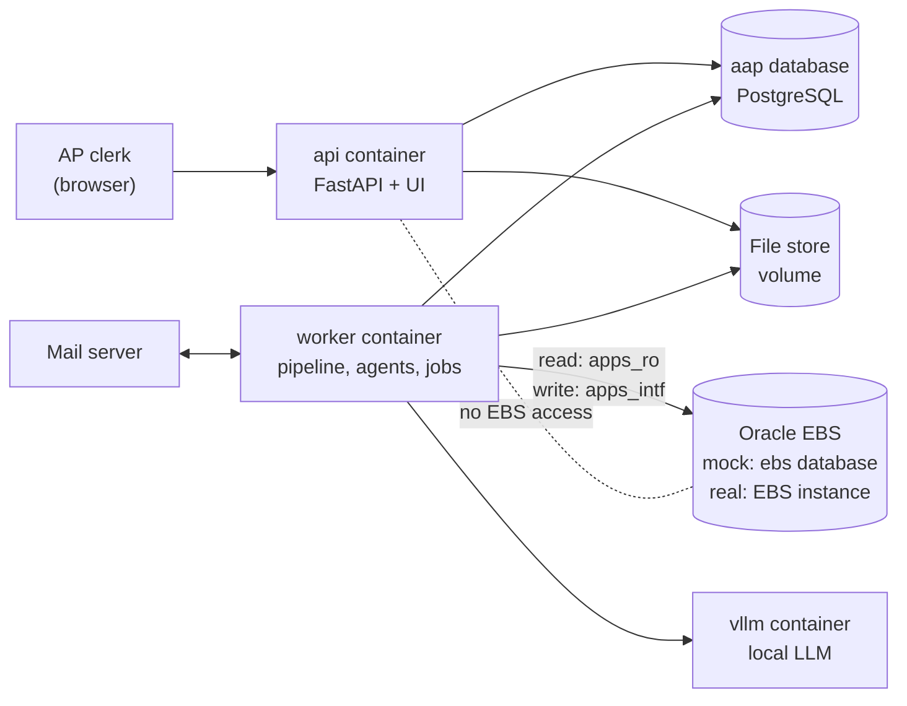

# AAP Module: Actions and Data Flow

| Item | Value |
|---|---|
| Audience | Oracle EBS technical consultants, integration and DBA teams |
| Scope | Every action in the AAP UI, every background job, and the data each one reads and writes |
| Date | 2026-09-30 (updated 2026-10-26: real-invoice changes, APLOAD file) |
| Related documents | [HOW-IT-WORKS.md](HOW-IT-WORKS.md) (internals), [ARCHITECTURE.md](ARCHITECTURE.md), [TECH-STACK.md](TECH-STACK.md) §9, [IMPLEMENTATION-PLAN.md](IMPLEMENTATION-PLAN.md) §3 (mock EBS tables) |

> **Status of the "Real EBS" columns.** The application is built and tested against the **mock EBS**: a PostgreSQL database with EBS table names, column names, `APPS` views, the Payables Open Interface and a mock `APXIIMPT`. The real Oracle adapter (`EbsOpenInterfaceAdapter`, python-oracledb) is **not built yet**. The "Real EBS" columns below give the target objects that the adapter will use. They are the same objects the mock copies, and §6 lists where the two differ.

---

## 1. The systems

| System | Mock / dev environment | Real environment | Holds |
|---|---|---|---|
| Application database | PostgreSQL 16 database `aap` (container `postgres`) | Same: PostgreSQL on the application host | Documents, invoice versions, validation, agent decisions, review tasks, holds (proposed), emails, submissions, the reference copy (`ref_*`), GL history, job queue, audit log |
| File store | Docker volume `filestore` at `/data/filestore` | Same: a volume or file system on the application host | Original files (`originals/<sha256>`), page images, raw emails |
| ERP | PostgreSQL database `ebs`: EBS schemas (`ap`, `po`, `gl`, `fnd`, `hr`, `inv`, `hz`, `iby`, `zx`) and an `apps` schema with a view for each table | The customer's Oracle EBS R12 database, `APPS` schema objects | Master data, POs, receipts, invoices, holds, the open interface |
| Concurrent manager | Container `ebs-cm` (runs the mock `APXIIMPT`) | The EBS Concurrent Manager | Runs Payables Open Interface Import |
| Mail server | GreenMail container `mail` (SMTP 3025, IMAP 3143), AP mailbox `ap@acse.local` | The customer's mail server (Exchange Online, Gmail or other) through IMAP/SMTP. A Microsoft Graph connector can be added behind the same interface. | Inbound invoices and vendor replies; outbound vendor emails |
| LLM | Container `vllm` (Qwen2.5-VL-7B), or `LLM_BACKEND=stub` | Same (local GPU host). No invoice data leaves the host. | No storage |

**Important boundaries:**

- The `api` container (what the browser talks to) never connects to EBS. Only the `worker` container does, and only through the adapter.
- The application never reads EBS tables in the UI path. Master data is read from the **reference copy** (`ref_*` tables in `aap`), refreshed by the reference sync. Data that changes during the day (POs, receipts, duplicates, CCID validity, rates) is read **live** at decision time.
- The application writes to EBS in only two ways: the **Payables Open Interface** (and the import request), and the **hold API**. It never writes to `AP_INVOICES_ALL` or any other base table directly.

### 1.1 Database accounts

| Purpose | Mock account (`.env` key) | Real EBS account (planned) | Permissions |
|---|---|---|---|
| Read master and transaction data | `apps_ro` (`EBS_RO_DSN`), `search_path=apps` | A custom read-only schema (for example `XXAAP_RO`) with `SELECT` grants on the objects in §5 and synonyms | SELECT only |
| Write the open interface, submit the import, place holds | `apps_intf` (`EBS_INTF_DSN`) | A custom schema (for example `XXAAP_INTF`) with `INSERT`/`SELECT` on the two interface tables, `SELECT` on the status tables, and `EXECUTE` on a wrapper package that calls `FND_REQUEST.SUBMIT_REQUEST` and `AP_HOLDS_PKG.INSERT_SINGLE_HOLD` | See §6 |
| Seeding (mock only) | `ebs_owner` (`EBS_OWNER_DSN`) | Not used | Mock only |
| Application database | `aap_app` (`AAP_DSN`); `aap_owner` for migrations | Same | `audit_event` is INSERT-only for `aap_app` |

The adapter is selected with `ADAPTER` in `.env` (today only `ebs_mock`). The invoice source written to `AP_INVOICES_INTERFACE.SOURCE` (and to the InvoiceSource column of the APLOAD file, §3.9) is `INVOICE_SOURCE` (default `AAP`). This value must exist as a Payables `SOURCE` lookup in EBS.

---

## 2. How to read the action tables

Each action has a table with these columns:

- **Step:** what happens, in order.
- **Reads (source)** / **Writes (destination):** the object. `aap.<table>` is the application database. EBS objects are given in upper case, first the mock object, then the real one when it is different.
- An action that says **"no EBS access"** only touches the application database and the file store, in both environments.

The status names (`IN_REVIEW`, `ON_HOLD`, …) are the document statuses in `aap.document.status`. Each status change also writes `aap.document_status_history` and `aap.audit_event`. That is not repeated in every table.

---

## 3. User actions (UI)

The UI is at `/ui`. The same actions are available in the REST API (`/docs`).

### 3.1 "Acting as" (top right)

Sets the name that is recorded as the user on approvals, rejections, uploads and outbox actions.

| Step | Reads | Writes |
|---|---|---|
| Type a name | – | Browser cookie `aap_user` only (default `clerk`) |

No database access. There are no logins or roles in the dev build; everyone can do everything. The planned roles (clerk, supervisor, administrator) are in ARCHITECTURE.md §10.

### 3.2 Inbox: list and filter invoices

| Step | Reads | Writes |
|---|---|---|
| Show the list (refreshes every 10 s) | `aap.document`, the latest `aap.invoice_version` (supplier, invoice number, amount), open `aap.review_task` (reasons) | – |
| Status chips with counts | `aap.document` | – |

No EBS access. Email containers (`.eml`, `.msg`) are not listed; their attachments are.

### 3.3 Upload invoices

Button **Upload** on the Inbox (API: `POST /api/documents`). Accepted: PDF, PNG, JPG, TIFF, XLSX, XLS, CSV, TXT, HTML, EML, MSG; maximum `MAX_UPLOAD_MB` (25 MB) per file.

| Step | Reads | Writes |
|---|---|---|
| 1. Check size and real file type (from the content, not the extension) | The uploaded bytes | – |
| 2. Duplicate file check (SHA-256) | `aap.document.sha256` | If found: `aap.audit_event` `intake.duplicate_file`, and the UI links to the existing document. Skipped when `ALLOW_DUPLICATE_UPLOADS=true` (testing only). |
| 3. Store the file | – | File store `originals/<sha[:2]>/<sha256>` |
| 4. Register the document | – | `aap.document` (status `RECEIVED`, `source=upload`, `uploaded_by` = the "acting as" name), `aap.audit_event` `intake.received` |
| 5. Queue the pipeline | – | `aap.procrastinate_jobs` (job `parse`, queue `ingest`) |

No EBS access at upload. The pipeline that follows reads EBS (§4.1).

### 3.4 Open an invoice

Page `/ui/documents/{id}`.

| Section on the page | Reads |
|---|---|
| Original file | File store `originals/…` |
| Review tasks, "agents are waiting" | `aap.review_task`, LangGraph checkpoint tables (`aap.checkpoint*`) |
| Decision form (lines, PO line, GL account) | Latest `aap.invoice_version` + `aap.agent_run.outcome` (PO line pairing and proposed GL accounts) |
| Invoice fields: value, "on the invoice", method, flags | Latest `aap.invoice_version.canonical_invoice` |
| Validation | `aap.validation_result` |
| Agent decisions | `aap.agent_decision` |
| Holds | `aap.hold` |
| Emails | `aap.email_outbox`, `aap.email_message` |
| Oracle | `aap.submission` (interface id, request id, Oracle invoice id, holds, reject codes) |
| History | `aap.document_status_history` |

No EBS access. The Oracle section shows what the application stored when it last polled EBS.

**Method column values** (where each value came from): `extracted` (read from the document by the LLM), `normalized`, `value_map` (from `aap.value_map`), `exact` / `fuzzy` (matched against the reference copy), `fuzzy_llm` (the LLM chose from a candidate list; always flagged for checking), `derived`, `default`, `user` (clerk correction), `vendor_reply`.

### 3.5 Approve and post to Oracle

Allowed when the status is `IN_REVIEW`, `ON_HOLD` or `ORACLE_ERROR` and the agents are not waiting for an email approval or a vendor reply. Per line, the clerk can set a **PO line** (PO-matched line) or a **GL account** (non-PO line, format `01-510-6420-0000`). Only changed values are recorded as corrections. Approval is allowed with failed validation checks; that is the clerk's decision.

**A. Approval (immediate, no EBS access)**

| Step | Reads | Writes |
|---|---|---|
| 1. Build the approved invoice | Latest reviewed `aap.invoice_version`, `aap.agent_run.outcome` | – |
| 2. Apply corrections; every ITEM line must have a PO line or a GL account | Form values | – |
| 3. Save the approved version | – | New `aap.invoice_version` (kind `approved`, `created_by` = user). Earlier versions are kept. |
| 4. Learn GL coding from people | `aap.ref_ccid` (account string → CCID) | `aap.gl_history_line` (`source=review`) for lines whose GL account a person decided |
| 5. Close tasks, set status | – | `aap.review_task` (done), status `APPROVED`, `aap.audit_event` `invoice.approved` |
| 6. Queue the submit | – | `aap.procrastinate_jobs` (job `submit`, queue `erp`) |

**B. Submit (worker, within seconds)**

| Step | Reads | Writes |
|---|---|---|
| 1. Idempotency key `<document_id>:<version>` | `aap.submission` | `aap.submission` (status `pending`) |
| 2. Convert to the interface format (see §3.5.1) | Approved `aap.invoice_version` | – |
| 3. Check that this key was not sent already | `AP_INVOICES_INTERFACE` where `ATTRIBUTE15` = key | – (if found, the existing row is reused and nothing is inserted) |
| 4. Insert the invoice | Sequences `AP_INVOICES_INTERFACE_S`, `AP_INVOICE_LINES_INTERFACE_S` | `AP_INVOICES_INTERFACE` (one row, `GROUP_ID` = `AAP-<n>`, `SOURCE` = `INVOICE_SOURCE`, `ATTRIBUTE15` = key), `AP_INVOICE_LINES_INTERFACE` (one row per line) |
| 5. Submit Payables Open Interface Import | – | Mock: `apps.fnd_request_submit_request('SQLAP','APXIIMPT', …)` → `FND_CONCURRENT_REQUESTS`. Real: `FND_REQUEST.SUBMIT_REQUEST('SQLAP','APXIIMPT', …)` (§6). |
| 6. Record | – | `aap.submission` (group id, interface invoice id, request id, status `submitted`), status `SUBMITTED`, `aap.audit_event` `submit.sent` (includes the full payload) |

**C. Import (EBS)**

| Mock `ebs-cm` / mock `APXIIMPT` | Real EBS |
|---|---|
| Picks up interface rows of the group with `STATUS` null. Validates them, then creates `AP_INVOICES_ALL`, `AP_INVOICE_LINES_ALL`, `AP_INVOICE_DISTRIBUTIONS_ALL` (PO-matched lines take the PO distribution account). Updates `QUANTITY_BILLED` on `PO_LINE_LOCATIONS_ALL` / `PO_DISTRIBUTIONS_ALL`. Sets the interface `STATUS` to `PROCESSED`, or to `REJECTED` with rows in `AP_INTERFACE_REJECTIONS`. Then it runs a simplified invoice validation that places `QTY REC`, `QTY ORD` and `PRICE` holds in `AP_HOLDS_ALL` (tolerances from `AP_TOLERANCE_TEMPLATES`). | Standard Payables Open Interface Import. Invoice Validation (and so the matching holds) runs when the customer's Invoice Validation program or approval workflow runs, **not** during the import (§6). |

**D. Result polling (worker, every 5 s, at most 120 polls ≈ 10 min)**

| Step | Reads | Writes |
|---|---|---|
| 1. Interface status | `AP_INVOICES_INTERFACE.STATUS`, `REQUEST_ID` | `aap.submission.polls` |
| 2. Request status | `FND_CONCURRENT_REQUESTS` (`PHASE_CODE`, `STATUS_CODE`, `COMPLETION_TEXT`) | – |
| 3a. `PROCESSED` | `AP_INVOICES_ALL` where `ATTRIBUTE15` = key → `INVOICE_ID`; `AP_HOLDS_ALL` (unreleased holds) | `aap.submission` (status `created`, Oracle invoice id, holds). **Hold API:** for each hold the agents proposed that Oracle did not place: mock `apps.ap_holds_pkg_insert_single_hold` / real `AP_HOLDS_PKG.INSERT_SINGLE_HOLD` → `AP_HOLDS_ALL`. `aap.hold` → `active`. Status `CREATED`, `aap.audit_event` `submit.created`. |
| 3b. `REJECTED` | `AP_INTERFACE_REJECTIONS` (header and line rejections) | `aap.submission` (status `error`, reject codes), `aap.review_task` `ORACLE_ERROR` + codes, status `ORACLE_ERROR` |
| 3c. No result after 120 polls | – | `aap.review_task` `ORACLE_TIMEOUT`, status `ORACLE_ERROR` |
| 3d. EBS not reachable | – | `aap.review_task` `ORACLE_UNAVAILABLE`, status `ORACLE_ERROR` |

From `ORACLE_ERROR` the clerk corrects and approves again (a new version and a new idempotency key), or rejects.

#### 3.5.1 Interface column mapping (`to_payload`)

| `AP_INVOICES_INTERFACE` column | Value |
|---|---|
| `INVOICE_ID` | Next value of `AP_INVOICES_INTERFACE_S` |
| `INVOICE_NUM`, `INVOICE_DATE`, `GL_DATE` | From the approved invoice. `GL_DATE` follows `GL_DATE_POLICY`: `invoice_date` (default) = the invoice date when its AP period is open, otherwise the current date; `today` = always the current date. |
| `INVOICE_TYPE_LOOKUP_CODE` | The invoice type from the document title: `CREDIT` for a credit memo / note (amounts made negative), otherwise `STANDARD`; always `CREDIT` when the total is negative. Rule C13 stops a `CREDIT` with a positive total. |
| `VENDOR_ID`, `VENDOR_SITE_ID`, `VENDOR_SITE_CODE`, `ORG_ID` | From the mapping (reference copy of `AP_SUPPLIERS`, `AP_SUPPLIER_SITES_ALL`) |
| `INVOICE_AMOUNT`, `INVOICE_CURRENCY_CODE` | From the invoice. `INVOICE_AMOUNT` = sum of the lines. |
| `EXCHANGE_RATE_TYPE`, `EXCHANGE_DATE` | `Corporate` and the GL date, only when the invoice currency is not the ledger currency. EBS calculates the rate. |
| `TERMS_ID` (or `TERMS_NAME` when there is no id) | From the mapping (`AP_TERMS`) |
| `PO_NUMBER`, `DESCRIPTION` | From the invoice |
| `SOURCE` | `INVOICE_SOURCE` (default `AAP`) |
| `GROUP_ID` | `AAP-<n>`, one group per submission |
| `ATTRIBUTE15` | Idempotency key `<document_id>:<version>` |

| `AP_INVOICE_LINES_INTERFACE` column | Value |
|---|---|
| `LINE_NUMBER`, `LINE_TYPE_LOOKUP_CODE` | 1…n; `ITEM`, `TAX` or `FREIGHT`. Header tax and freight become their own lines: one `TAX` line per printed tax row (for example GST and QST), and a printed freight row stays a `FREIGHT` line in its place. |
| `AMOUNT`, `DESCRIPTION` | From the line |
| `QUANTITY_INVOICED`, `UNIT_PRICE`, `UNIT_OF_MEAS_LOOKUP_CODE` | ITEM lines only |
| `PO_NUMBER`, `PO_LINE_NUMBER` | PO-matched lines. EBS derives the account from the PO distribution. |
| `DIST_CODE_CONCATENATED` | Non-PO lines: the GL account from the GL agent or the clerk |
| `TAX_RATE_CODE` | TAX lines (`ZX_RATES_B`) |

### 3.6 Reject

The clerk must enter a reason.

| Step | Reads | Writes |
|---|---|---|
| Reject | `aap.document` | `aap.review_task` (done), status `REJECTED`, `aap.audit_event` `invoice.rejected` (with the reason) |

No EBS access. Nothing is sent to EBS or to the vendor.

### 3.7 Outbox: vendor emails

The exception agent drafts emails to vendors (missing PO number, wrong invoice maths, reminders). A draft is never sent without approval. The subject contains a reference token `[AP-REF:<8 hex>]` that links the vendor's reply to the invoice.

**How the draft was made (before the clerk sees it):**

| Reads | Writes |
|---|---|
| Recipient: `AP_SUPPLIER_SITES_ALL.EMAIL_ADDRESS` / `REMITTANCE_EMAIL` (live), buyer email from `PO_HEADERS_ALL.AGENT_ID` → `PER_ALL_PEOPLE_F.EMAIL_ADDRESS` (live). Facts from `aap.validation_result` and the agent state. The LLM writes only the wording. | `aap.email_outbox` (status `PENDING_APPROVAL`), `aap.review_task`, the agent waits (LangGraph checkpoint in `aap`) |

**Actions:**

| Action | Reads | Writes |
|---|---|---|
| **Approve and send** (subject and body can be edited first) | `aap.email_outbox` | `aap.email_outbox` (`APPROVED` → `SENT`, approved by, Message-ID), mail sent through **SMTP** (Reply-To = AP mailbox), `aap.email_message` (outbound), status `AWAITING_VENDOR`, `aap.audit_event`. A reminder is sent the same way, threaded on the first email; the status does not change. |
| **Discard** | `aap.email_outbox` | `aap.email_outbox` (`DISCARDED`). First email: the agent continues without it and the invoice goes to review. Reminder: only the reminder review task is closed; the agent keeps waiting for the reply. |

No EBS writes. The vendor's reply comes back through the mailbox poll (§4.3).

### 3.8 Admin page

| Action | Reads | Writes |
|---|---|---|
| View | `aap.mailbox_state`, `aap.procrastinate_jobs` (queue counts), last `aap.ref_sync_run`, `aap.gl_history_line` (counts), `FAILED` documents, `aap.eval_run` | – |
| **Poll now** | – | Queues one mailbox poll (§4.3) |
| **Sync now** | – | Queues one reference sync (§4.4) |
| **Retry** (failed document) | `aap.document` (must be `FAILED`) | Status `RECEIVED`, queue job `parse`. The pipeline runs again from parsing (§4.1). |

The page itself has no EBS access. Sync now reads EBS through the worker.

### 3.9 APLOAD file (API and command line, no UI button)

The customer's existing AP interfaces load a pipe-delimited file (`APILOAD_<date>.csv`) of `H` (header) and `L` (line) rows instead of writing the open-interface tables. The application writes the same file for its invoices. Approval still posts through the open interface (§3.5); whether the file replaces that is open (PLAN-REAL-INVOICES.md R2.4). Format: HOW-IT-WORKS.md §11.4.

| Action | Reads | Writes |
|---|---|---|
| `GET /api/documents/{id}/apload` (one invoice) | The `approved` `aap.invoice_version`; before approval, the latest reviewed version + `aap.agent_run.outcome` (header `X-AAP-Approved: false`) | – (text response) |
| `python -m aap.submit.apload --out <file> [--document <id> …]` | Every document with an `approved` version, or the ones given | The file (for example under `/data/filestore/apload/`) |

No EBS access. The file carries the supplier number and site name (from the mapping), the GL account for lines without a PO line, and `INVOICE_SOURCE` as InvoiceSource.

---

## 4. Automatic actions (no button)

### 4.1 Pipeline for each document (stages 2 to 8)

These run one job per stage in the worker, after an upload or a received email.

| Stage | What it does | Reads | Writes |
|---|---|---|---|
| 2 Unpack (email only) | Separates body and attachments; detects auto-replies; checks the sender domain | File store, `aap.ref_supplier_site` (email domains) | Child `aap.document` rows (one per invoice attachment), `aap.email_message`, `aap.email_attachment`; `NOT_INVOICE` for auto-replies |
| 3 Parse | Text, words with coordinates, tables, page images | File store | `aap.page`, file store `pages/<document_id>/<n>.png` |
| 4 Route | Text-layer quality per page: text + image, image only, or text only | `aap.page` | `aap.page.route` |
| 5 Extract | The LLM reads the values exactly as printed | `aap.page`, page images | `aap.extraction_run` (prompt version, raw output), `aap.invoice_version` (kind `source`) |
| 6 Normalize | Dates, amounts, currency, PO number, bank details; invoice type from the title (credit memo → negative amounts); tax rows summed; unit prices per 1000 / in cents converted | – | `aap.invoice_version` (kind `normalized`) |
| 7 Map | Printed values → EBS ids: supplier, site, OU, terms (from the printed terms or the due date), UOM, category, tax rate code; store / location → cost center (value maps `location`) | Reference copy: `aap.ref_supplier`, `ref_supplier_site`, `ref_operating_unit`, `ref_terms`, `ref_currency`, `ref_uom`, `ref_category`, `ref_tax_rate`, `ref_gl_period`; `aap.value_map`; `aap.gl_history_line` | `aap.invoice_version` (kind `mapped`), `aap.agent_decision` for every LLM choice |
| 8 Validate | The rules below | See the rules table | `aap.validation_result` |

**Validation rules and their source:**

| Rule | Check | Source | Mock | Real EBS |
|---|---|---|---|---|
| C1–C5 | Required fields; line, subtotal, tax and total maths | Invoice only | – | – |
| C6 | Tax ID format and checksum | Invoice only | – | – |
| C7 | Tax ID = supplier master | Reference copy | `ref_supplier` ← `AP_SUPPLIERS` / `HZ_PARTIES` | same |
| C8 | Supplier and site active; pay site in the OU | Reference copy | `ref_supplier`, `ref_supplier_site` ← `AP_SUPPLIERS`, `AP_SUPPLIER_SITES_ALL` | same |
| C9, V-GL | Invoice date sensible; GL date in an open AP period | Reference copy | `ref_gl_period` ← `GL_PERIOD_STATUSES` (application 200) | same |
| C10 | Duplicate invoice (same supplier and invoice number) | `aap.invoice_version` **and live EBS** | `AP_INVOICES_ALL` | same |
| C11 | Bank account / IBAN = supplier bank (fraud check); fails on any printed bank-change notice | Reference copy | `ref_supplier_bank` ← `IBY_EXT_BANK_ACCOUNTS` + `IBY_ACCOUNT_OWNERS` | same |
| C12 | Source check (value is on the page) | Invoice only | – | – |
| C13 | Invoice type matches the sign of the total | Invoice only | – | – |
| V-05 | Every EBS value mapped; printed terms that disagree with the due date | Invoice only | – | – |
| V-PO | PO exists in the OU, same supplier, approved and open for invoicing | **Live EBS** | `PO_HEADERS_ALL`, `PO_LINES_ALL`, `PO_LINE_LOCATIONS_ALL`, `PO_DISTRIBUTIONS_ALL` | same |
| V-FX | Corporate rate exists for a foreign-currency invoice | **Live EBS** | `GL_DAILY_RATES` | same |
| V-REF | Reference copy is current | `aap.ref_sync_run` | – | – |
| V-SENDER | Sender domain known | `aap.ref_supplier_site` | – | – |

After validation the agents run (§4.2). Nothing is written to EBS in stages 2 to 8.

### 4.2 Agents (after validation, and after each vendor reply)

| Agent step | What it does | Reads | Writes |
|---|---|---|---|
| Triage | Routes on the validation results (bank change, duplicate, inactive site, PO not open, maths error) | `aap.validation_result` | `aap.agent_decision` |
| Find PO | Printed PO, or search the supplier's open POs by currency, open amount and unit prices | **Live:** `PO_HEADERS_ALL`, `PO_LINES_ALL`, `PO_LINE_LOCATIONS_ALL` | `aap.agent_decision` |
| Pair lines | Invoice line ↔ PO line (price, quantity, description) | **Live:** `PO_LINES_ALL`, `PO_LINE_LOCATIONS_ALL`, `MTL_SYSTEM_ITEMS_B`, `PO_DISTRIBUTIONS_ALL` + `GL_CODE_COMBINATIONS_KFV` (PO account) | `aap.agent_decision` |
| Three-way match | Quantity billed vs received vs ordered, price vs PO price, with the site's tolerance template | **Live:** `PO_LINE_LOCATIONS_ALL` (`QUANTITY`, `QUANTITY_RECEIVED`, `QUANTITY_BILLED`, `QUANTITY_CANCELLED`, `PRICE_OVERRIDE`, `RECEIPT_REQUIRED_FLAG`, `MATCH_OPTION`); reference copy `ref_tolerance` ← `AP_TOLERANCE_TEMPLATES` | `aap.hold` (status `proposed`: `QTY REC`, `QTY ORD`, `PRICE`); status `ON_HOLD`. **Not written to EBS yet** (see §3.5 D). |
| GL coding (non-PO lines) | Exact history, then similar history (vector search), then an LLM choice among accounts | `aap.gl_history_line` (copy of `AP_INVOICE_DISTRIBUTIONS_ALL`), `aap.ref_ccid`; **live:** `GL_CODE_COMBINATIONS_KFV` (exists, enabled, postable, active on the GL date) | `aap.agent_decision` |
| Exception email | Drafts the vendor email | **Live:** `AP_SUPPLIER_SITES_ALL`, `PO_HEADERS_ALL`, `PER_ALL_PEOPLE_F` | `aap.email_outbox` (§3.7) |
| Parse vendor reply | Reads the PO number from the reply; the PO must exist | **Live:** `PO_HEADERS_ALL` | New `aap.invoice_version` (kind `vendor_reply`), then validation and agents again |
| Finalize | One review task with reason codes, summary and suggested action | – | `aap.review_task`, `aap.agent_run.outcome`, status `IN_REVIEW` or `ON_HOLD` |

The agents only **read** EBS. Every step writes `aap.agent_decision` (candidates, prompt, raw LLM output, choice, reason) and `aap.audit_event`.

Each step is described in detail, with worked examples, in [AGENT-LAYER.md](AGENT-LAYER.md).

### 4.3 Mailbox poll (every 30 s)

Controlled by `MAILBOX_ENABLED` and `MAILBOX_POLL_SECONDS`.

| Step | Reads | Writes |
|---|---|---|
| Fetch new messages | IMAP `INBOX` (UID after `aap.mailbox_state.last_uid`) | – |
| Skip messages already seen | `aap.email_message` (Message-ID, SHA-256) | – |
| Reply to one of our emails (In-Reply-To, References or `[AP-REF:…]`) | `aap.email_message`, `aap.email_outbox` | `aap.email_message` (`vendor_reply` or `auto_reply`), raw `.eml` in the file store; the waiting agent continues (§4.2) |
| New email | – | `aap.email_message` + intake of the `.eml` as a document (as in §3.3, `source=mailbox`), then unpack (§4.1) |
| Move the message | – | IMAP folder `Processed` (or `Failed` if handling raised an error); `aap.mailbox_state` |

No EBS access.

### 4.4 Reference sync (nightly at 02:00, and "Sync now")

Copies EBS master data into the `ref_*` tables in **one transaction** (the old copy is replaced). The run is recorded in `aap.ref_sync_run` (counts or error).

| Destination (`aap`) | Source: mock (`ebs.apps.*`) and real EBS (`APPS`) |
|---|---|
| `ref_operating_unit` | `HR_OPERATING_UNITS`, `GL_LEDGERS`, `HR_ALL_ORGANIZATION_UNITS`, `HR_LOCATIONS_ALL` |
| `ref_supplier` | `AP_SUPPLIERS`, `HZ_PARTIES` (tax id). Custom DFFs: `ATTRIBUTE1` = PO required, `ATTRIBUTE2` = default cost centre (§6). |
| `ref_supplier_site` | `AP_SUPPLIER_SITES_ALL` (address, email domains, pay site, tolerance, match option, liability account) |
| `ref_supplier_bank` | `IBY_EXT_BANK_ACCOUNTS`, `IBY_ACCOUNT_OWNERS` (→ `AP_SUPPLIERS.PARTY_ID`), `HZ_PARTIES` (bank name) |
| `ref_terms` | `AP_TERMS`, `AP_TERMS_LINES` |
| `ref_currency` | `FND_CURRENCIES` |
| `ref_ccid` | `GL_CODE_COMBINATIONS_KFV`, `FND_FLEX_VALUES_VL`, `FND_FLEX_VALUE_SETS` (segment descriptions; value set names are configurable per customer, §6) |
| `ref_category` | `MTL_CATEGORIES_VL` |
| `ref_uom` | `MTL_UNITS_OF_MEASURE` |
| `ref_tax_rate` | `ZX_RATES_B` |
| `ref_tolerance` | `AP_TOLERANCE_TEMPLATES` |
| `ref_gl_period` | `GL_PERIOD_STATUSES` (AP, application 200) |
| `gl_history_line` (new rows only, `source=ebs`) | `AP_INVOICE_DISTRIBUTIONS_ALL`, `AP_INVOICES_ALL`, `AP_INVOICE_LINES_ALL`, `GL_CODE_COMBINATIONS_KFV`, `MTL_ITEM_CATEGORIES`, `MTL_CATEGORIES_B` |

Account: read-only. The UI and the mapping read only the copy. If the copy is too old, rule V-REF shows a warning on each invoice.

### 4.5 Other periodic jobs

| Job | Schedule | Reads | Writes |
|---|---|---|---|
| Recheck holds | Every 5 min | `ON_HOLD` documents with a proposed `QTY REC` hold; **live** `PO_LINE_LOCATIONS_ALL.QUANTITY_RECEIVED` | When the received quantity changed: the agents run again, and holds that no longer apply are released in `aap.hold` |
| Vendor follow-ups | Hourly | `aap.email_outbox`, `aap.email_message` | After 3 days (`VENDOR_REPLY_REMINDER_DAYS`): one reminder draft (needs approval). After 7 days (`VENDOR_REPLY_TIMEOUT_DAYS`): `aap.review_task` `VENDOR_NO_REPLY`, status `IN_REVIEW` |
| Embedding backfill | Every 5 min | `aap.gl_history_line` without a vector | `aap.gl_history_line.embedding` |
| Requeue stalled | Every minute | Documents in an intermediate status for more than 5 min with no job | `aap.procrastinate_jobs` |
| Recover orphaned jobs | At worker start (`WORKER_RECOVER_ON_START`) | `aap.procrastinate_jobs` in status `doing` (left by a worker that died) | Those jobs back to `todo` |

None of these write to EBS.

---

## 5. EBS object reference

Every EBS object the application touches. **R** = read, **W** = write. "Live" = read at decision time; "Sync" = read by the reference sync.

| EBS object | Access | How | Used by |
|---|---|---|---|
| `AP_SUPPLIERS` | R | Sync; live join for bank owners | Mapping, C7, C8, C11 |
| `AP_SUPPLIER_SITES_ALL` | R | Sync; live (contacts) | Mapping (site), C8, sender check, vendor emails |
| `HZ_PARTIES` | R | Sync | Tax id, bank names |
| `IBY_EXT_BANK_ACCOUNTS`, `IBY_ACCOUNT_OWNERS` | R | Sync | C11 bank-change check |
| `AP_TERMS` (view over `AP_TERMS_TL`), `AP_TERMS_LINES` | R | Sync | Terms mapping, due date |
| `FND_CURRENCIES` | R | Sync | Currency |
| `HR_OPERATING_UNITS`, `HR_ALL_ORGANIZATION_UNITS`, `HR_LOCATIONS_ALL`, `GL_LEDGERS` | R | Sync | OU, ledger currency, bill-to |
| `GL_CODE_COMBINATIONS_KFV` | R | Sync; live (CCID check, PO account) | GL coding, approval |
| `FND_FLEX_VALUE_SETS`, `FND_FLEX_VALUES_VL` | R | Sync | Account descriptions for GL coding |
| `GL_PERIOD_STATUSES` | R | Sync; live | V-GL, GL date |
| `GL_DAILY_RATES` | R | Live | V-FX |
| `MTL_CATEGORIES_VL`, `MTL_UNITS_OF_MEASURE`, `MTL_ITEM_CATEGORIES`, `MTL_CATEGORIES_B` | R | Sync | Category and UOM mapping, GL history |
| `MTL_SYSTEM_ITEMS_B` | R | Live | Line pairing (item description) |
| `ZX_RATES_B` | R | Sync | Tax rate code |
| `AP_TOLERANCE_TEMPLATES` | R | Sync | Three-way match tolerances |
| `PO_HEADERS_ALL`, `PO_LINES_ALL`, `PO_LINE_LOCATIONS_ALL`, `PO_DISTRIBUTIONS_ALL` | R | Live | V-PO, find PO, line pairing, three-way match, recheck holds |
| `PER_ALL_PEOPLE_F` | R | Live | Buyer name and email |
| `RCV_TRANSACTIONS`, `RCV_SHIPMENT_HEADERS` | R | Adapter method `get_receipts` exists, but no step calls it today | Received quantities come from `PO_LINE_LOCATIONS_ALL.QUANTITY_RECEIVED` |
| `AP_INVOICES_ALL` | R | Live | C10 duplicates; result polling (by `ATTRIBUTE15`) |
| `AP_INVOICE_LINES_ALL`, `AP_INVOICE_DISTRIBUTIONS_ALL` | R | Sync | GL coding history |
| `AP_HOLDS_ALL` | R, W (API) | Live; written only through `AP_HOLDS_PKG.INSERT_SINGLE_HOLD` | Result polling; application holds |
| `AP_INVOICES_INTERFACE`, `AP_INVOICE_LINES_INTERFACE` | R, W | Insert at submit; read at polling | Posting approved invoices |
| `AP_INTERFACE_REJECTIONS` | R | Live | Reject codes shown to the clerk |
| `FND_CONCURRENT_REQUESTS` | R, W (API) | Written only through `FND_REQUEST.SUBMIT_REQUEST` | `APXIIMPT` request status |

Nothing else in EBS is read or written. Base-table writes (`AP_INVOICES_ALL`, lines, distributions, `QUANTITY_BILLED` updates) are done only by EBS's own import program.

---

## 6. Differences between the mock and real EBS (integration checklist)

| Area | Mock | Real EBS: what the integration must do |
|---|---|---|
| Driver and connection | psycopg to PostgreSQL `ebs`; `EBS_RO_DSN`, `EBS_INTF_DSN` | python-oracledb (thin mode) to the EBS database; new adapter `ebs_oracle.py` selected by `ADAPTER`. The SQL is written against `APPS` object names and is reused; only bind syntax (`%s` → `:1`) and PostgreSQL-only constructs (`array_agg … FILTER`, `= ANY(array)`, `localtimestamp`, `concat_ws`) change. |
| Schemas and grants | `apps` schema of views; roles `apps_ro`, `apps_intf` | Custom schemas with grants and synonyms (§1.1). Do not connect as `APPS`. |
| Submitting `APXIIMPT` | SQL function `fnd_request_submit_request('SQLAP','APXIIMPT', description, NULL, false, org_id, source, group_id)`; the `ebs-cm` container runs it | A PL/SQL wrapper that calls `FND_GLOBAL.APPS_INITIALIZE` (user, Payables responsibility, application 200), `MO_GLOBAL.SET_POLICY_CONTEXT('S', org_id)`, then `FND_REQUEST.SUBMIT_REQUEST` with the full `APXIIMPT` argument list of the customer's release (12.1 or 12.2), then `COMMIT`. The EBS user and responsibility are integration decisions. |
| Holds placed by the import | The mock import runs a simplified invoice validation and places `QTY REC` / `QTY ORD` / `PRICE` holds at once | The real import does not validate matching. Matching holds appear when **Invoice Validation** runs (scheduled by the customer). Result polling may see no holds at first. |
| Application holds | `apps.ap_holds_pkg_insert_single_hold(invoice_id, hold_code, 'INVOICE HOLD REASON', reason)` accepts `QTY REC`, `QTY ORD`, `PRICE` | `AP_HOLDS_PKG.INSERT_SINGLE_HOLD` places only manual (user-releasable) hold codes defined in `AP_HOLD_CODES`. `QTY REC`, `QTY ORD` and `PRICE` are system holds and cannot be placed manually. **Decision needed:** define custom manual hold codes (for example `AAP QTY REC`), or rely on Invoice Validation and do not place application holds. |
| Idempotency key | `AP_INVOICES_INTERFACE.ATTRIBUTE15`, copied to `AP_INVOICES_ALL.ATTRIBUTE15` | The customer must reserve invoice DFF segment `ATTRIBUTE15` (or another free segment) for AAP; the import copies interface attributes to the invoice DFF. |
| Supplier DFFs | `AP_SUPPLIERS.ATTRIBUTE1` = PO required (`Y`/`N`), `ATTRIBUTE2` = default cost centre | Map to the customer's own DFF segments, or leave unused (then every supplier is treated as PO required and GL coding uses history only). |
| Item DFF | `MTL_SYSTEM_ITEMS_B.ATTRIBUTE1` = vendor catalogue wording (used only by the test-invoice generator) | Not used. |
| Chart of accounts | 4 segments, `Company-CostCentre-Account-SubAccount` (`01-510-6420-0000`); value sets `ACSE_COMPANY`, `ACSE_COST_CENTRE`, `ACSE_ACCOUNT` | The value set names are hard-coded in the CCID query today and must be made configurable for the customer's chart of accounts (segment count, order, value set names). The customer's APLOAD sample shows 8 segments separated by `.`, segment 3 = location (PLAN-REAL-INVOICES.md R2.1, R2.2). |
| Store / location → cost center | No `location` value maps loaded, so `cost_center` stays empty | Load the customer's store ↔ cost-center table as `aap.value_map` rows with `map_type = location` (R2.1). |
| Invoice source | `AAP` | Create the Payables `SOURCE` lookup value (`INVOICE_SOURCE`). The customer's APLOAD sample uses `BRUIN`; the source for AAP invoices is open (R2.4). |
| Submit format | Open interface tables (§3.5) | Open interface, or the customer's APLOAD file (§3.9) delivered to their existing load (R2.4). |
| Concurrent request lookup | `FND_CONCURRENT_REQUESTS.ARGUMENT3` = group id | Adjust to the argument position of `GROUP_ID` in the customer's `APXIIMPT` definition. |
| Import delay | Random 1–10 s (`EBS_IMPORT_DELAY_MIN/MAX`) | Depends on the Concurrent Manager queue. The poll limit (120 × 5 s) may need to increase; see ARCHITECTURE.md §9.2 (15 minutes). |
| Invoice image | Kept in the AAP file store only | Not attached to the EBS invoice. Attaching it (`FND_ATTACHED_DOCUMENTS`) is not in scope. |
| Alternative | – | Option B: EBS Integrated SOA Gateway REST service that wraps the open interface (TECH-STACK.md §9, open item T-01). The adapter interface stays the same. |
| Mail | GreenMail, IMAP/SMTP with a password | Customer mail server. Only IMAP/SMTP with a password is implemented. OAuth2 (XOAUTH2) or Microsoft Graph needs a new connector. |
| Seed data and `aap-mock` CLI | Faker seed, golden scenarios S1–S15, simulated receipts | Not used against real EBS. |

---

## 7. Where to look

| Question | Where |
|---|---|
| The exact SQL for each EBS read and write | `src/aap/adapters/ebs_mock.py` |
| The adapter interface a real adapter must implement | `src/aap/adapters/base.py` (`ErpReadPort`, `ErpWritePort`) |
| Mock EBS table definitions | `src/aap/ebs_mock/ddl/*.sql` |
| Mock import program | `src/aap/ebs_mock/import_program.py`, `concurrent_manager.py` |
| Submit and result polling | `src/aap/submit/submit.py` |
| Approve and reject | `src/aap/submit/decision.py` |
| Reference sync | `src/aap/refsync/sync.py` |
| Every change to a document, with the user | `aap.audit_event`, `aap.document_status_history`; check with `python -m aap.audit_check` |
