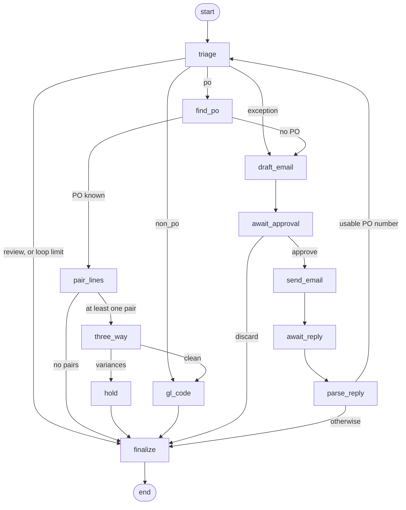

# AAP Module: The Agent Layer, Step by Step

| Item | Value |
|---|---|
| Audience | Engineers and Oracle EBS technical consultants who work on or review the agent code |
| Scope | Every step of the agent graph (ACTIONS-AND-DATA-FLOW.md §4.2): what it reads, what it decides, what it writes, with three worked examples that follow the code |
| Date | 2026-10-01 |
| Describes | The code as built: `src/aap/agents/`, graph version `1` |
| Related documents | [ACTIONS-AND-DATA-FLOW.md](ACTIONS-AND-DATA-FLOW.md) §4.2 (the summary table), [HOW-IT-WORKS.md](HOW-IT-WORKS.md) §9, [WORKED-EXAMPLE.md](WORKED-EXAMPLE.md) (the design-time example with illustrative numbers) |

> **Where the example numbers come from.** Part 2 uses three seeded scenario invoices (S1, S2, S3 in `src/aap/ebs_mock/scenarios.py`). The values marked **recorded** were read from `aap.agent_decision`, `aap.agent_run`, `aap.hold`, `aap.review_task` and `aap.email_outbox` in the dev database, from runs on 2026-09-28. Those runs used `LLM_BACKEND=stub` (the model column says `stub:choose`), so every "model" answer in them is the stub's answer, not Qwen's. Steps marked **traced** have no recorded run; they were worked out from the code and the same data, and the pairing scores in them were computed with the real functions.

> **Table names.** `aap.<table>` means a table in the application database `aap` (schema `public`), as in ACTIONS-AND-DATA-FLOW.md. EBS objects are in upper case.

## Contents

- **Part 1: Reference**
  1. [What the agent layer is](#1-what-the-agent-layer-is)
  2. [The graph](#2-the-graph)
  3. [The state that travels through the graph](#3-the-state-that-travels-through-the-graph)
  4. [Triage](#4-triage)
  5. [Find PO](#5-find-po)
  6. [Pair lines](#6-pair-lines)
  7. [Three-way match and hold](#7-three-way-match-and-hold)
  8. [GL coding](#8-gl-coding)
  9. [Exception email](#9-exception-email)
  10. [Parse vendor reply](#10-parse-vendor-reply)
  11. [Finalize](#11-finalize)
  12. [Where a model is used](#12-where-a-model-is-used)
  13. [Settings](#13-settings)
- **Part 2: Worked examples**
  14. [Example A: PO invoice with a quantity hold (S1)](#14-example-a-po-invoice-with-a-quantity-hold-s1)
  15. [Example B: non-PO invoice and GL coding (S2)](#15-example-b-non-po-invoice-and-gl-coding-s2)
  16. [Example C: missing PO number and the vendor email loop (S3)](#16-example-c-missing-po-number-and-the-vendor-email-loop-s3)
- **Part 3: Notes**
  17. [Where the code differs from ACTIONS-AND-DATA-FLOW.md §4.2](#17-where-the-code-differs-from-actions-and-data-flowmd-42)
  18. [Things to know when you read a run](#18-things-to-know-when-you-read-a-run)
  19. [How to look at a run yourself](#19-how-to-look-at-a-run-yourself)
  20. [Where to look in the code](#20-where-to-look-in-the-code)

---

# Part 1: Reference

## 1. What the agent layer is

The agent layer is one LangGraph state machine that runs once per invoice, after validation. It decides the route of the invoice, matches it to a purchase order, proposes holds and GL accounts, writes to the vendor when the invoice cannot be processed, and ends with one review task for the AP clerk. It only **reads** EBS.

| Topic | How it works | Code |
|---|---|---|
| When it starts | The `validate` stage sets the document to `VALIDATED` and queues the job `agents` on the queue `agents`. | `pipeline/stages.py` `stage_validate`, `stage_agents` |
| Other starts | The hold recheck (every 5 minutes), and a manual re-run with `POST /api/documents/{id}/agents`. | `agents/recheck.py`, `api/main.py` |
| What it works on | The newest `aap.invoice_version` of kind `mapped`, `user` or `vendor_reply`. | `agents/runner.py` `run_agents` |
| What a run creates | One `aap.agent_run` row (status `running`), and the document status `AGENTS_RUNNING`. | `agents/runner.py` |
| Thread | The LangGraph `thread_id` is the document id. One document has one thread. | `agents/runner.py` `_config` |
| Checkpoints | After every step the state is saved in `aap.checkpoints`, `aap.checkpoint_blobs` and `aap.checkpoint_writes`. | `PostgresSaver` in `agents/runner.py` |
| Pausing | Two steps call `interrupt()`. The graph stops there and the job ends. A later job resumes the same thread with a value. | `agents/nodes/exception.py` |
| Resuming | The job `aap.agents.resume` calls `resume_agents(document_id, value, expect=…)`. `expect` must be the type the graph waits for (`approve_email` or `vendor_reply`), otherwise the call fails. | `worker/tasks.py`, `agents/runner.py` |
| Already waiting | `run_agents` does nothing if the thread is paused, unless it is called with `restart=True`. | `agents/runner.py` |
| Retries | The job is tried 4 times (waits of 10, 30 and 90 seconds). | `worker/tasks.py` |
| Failure | On the last attempt the invoice gets a review task `AGENTS_ERROR` and status `IN_REVIEW`. It is not lost. | `pipeline/stages.py` `stage_agents` |
| Logging | Every step calls `decide()`: one `aap.agent_decision` row (inputs, candidates, prompt, raw model output, choice, reason) and one `aap.audit_event` row named `agent.<step>`. | `agents/context.py` |

Each step opens its own database transaction with `work(state)`. That helper loads the document and the working invoice version and gives the step the invoice as a `CanonicalInvoice` object.

## 2. The graph



The graph has 12 steps. The table in ACTIONS-AND-DATA-FLOW.md §4.2 has 8 rows because it groups them:

| Row in §4.2 | Graph steps |
|---|---|
| Triage | `triage` |
| Find PO | `find_po` |
| Pair lines | `pair_lines` |
| Three-way match | `three_way`, `hold` |
| GL coding | `gl_code` |
| Exception email | `draft_email`, `await_approval`, `send_email`, `await_reply` |
| Parse vendor reply | `parse_reply` |
| Finalize | `finalize` |

The routing functions are in `agents/graph.py`:

```python
MAX_LOOPS = 2

def _after_triage(state):
    if (state.get("loops") or 0) > MAX_LOOPS:
        return "finalize"
    return {"review": "finalize", "exception": "draft_email", "po": "find_po", "non_po": "gl_code"}[state["route"]]

def _after_find_po(state):   return "pair_lines" if state.get("po_number") else "draft_email"
def _after_pair(state):      return "three_way" if state.get("pairs") else "finalize"
def _after_three_way(state): return "hold" if state.get("variances") else "gl_code"
def _after_reply(state):     return "triage" if state.get("route") == "triage" else "finalize"
```

## 3. The state that travels through the graph

A step returns a dictionary of the keys it changes. LangGraph merges it into the state and saves a checkpoint. Values are JSON-friendly (ids and money as strings).

| Key | Meaning | Set by |
|---|---|---|
| `document_id`, `version_id`, `run_id` | The document, the working `aap.invoice_version`, the `aap.agent_run` | `run_agents`; `parse_reply` changes `version_id` |
| `route` | `po`, `non_po`, `exception`, `review` (and `triage` or `finalize` after a reply) | `triage`, `find_po`, `parse_reply` |
| `reasons` | Reason codes for the review task | Most steps |
| `notes` | Plain-language findings shown with the review task | Most steps |
| `suggested_action` | Action shown to the clerk | `triage`, `hold`, `finalize` |
| `po_number`, `po_source` | The PO and where it came from: `invoice`, `search` or `vendor_reply` | `find_po`, `parse_reply` |
| `pairs`, `unmatched` | Invoice line ↔ PO line pairs; invoice lines with no PO line | `pair_lines` |
| `variances` | Three-way differences, one per proposed hold | `three_way` |
| `gl_lines` | GL account proposal per ITEM line | `gl_code` |
| `exception` | `{kind, problem, ask}` for the vendor email | `triage`, `find_po` |
| `outbox_id`, `approval`, `reply` | The email draft, the clerk's decision, the vendor's reply | Email steps |
| `loops` | Number of vendor-reply loops so far | `parse_reply` |
| `outcome` | `ON_HOLD` or `IN_REVIEW` | `hold`, `finalize` |

Reason codes are in `agents/state.py` (class `Reason`).

## 4. Triage

Code: `agents/nodes/triage.py`. No model. No EBS access.

**Reads:** the latest validation run of the working version (`aap.validation_result`), the document flags (`aap.document.flags`), and the supplier's PO-required setting (`aap.ref_supplier.po_required`, copied from `AP_SUPPLIERS.ATTRIBUTE1`).

**Decides:** the first branch that applies, in this order.

| Order | Condition | Reason code | Route | Suggested action |
|---|---|---|---|---|
| 1 | C11 failed (bank account differs from the supplier master) or flag `unknown_sender` | `BANK_CHANGE`, `UNKNOWN_SENDER` | `review` | `verify_bank_details_by_phone` |
| 2 | C10 failed | `DUPLICATE` | `review` | `reject_as_duplicate` |
| 3 | C8 failed | `SUPPLIER_INACTIVE` | `review` | `correct_supplier_site` |
| 4 | V-PO failed | `PO_NOT_OPEN` | `review` | `contact_buyer_to_reopen_po_or_reject` |
| 5 | Any of C2, C3, C4, C5 failed, and the supplier is mapped | `INVOICE_MATH` | `exception` | – (vendor email) |
| 6 | Any other fail | `DATA_MISSING` if C1 or V-05 failed, otherwise `VALIDATION_FAILED` | `review` | `correct_invoice_data` |
| 7 | No fails | – | `po` or `non_po` | – |

- **Why the order matters.** Fraud signals and duplicates come first, so a suspicious invoice never causes an email to the vendor. A changed bank account must be confirmed by phone on a number already on file.
- **Branch 5** also builds the email request: problem = "The amounts on the invoice do not add up: …", ask = "Could you send a corrected invoice or a credit note?".
- **Branch 7** chooses `po` when a PO number is on the invoice or the supplier is PO-required, otherwise `non_po`.
- **Warnings do not block.** In branch 7, a C9 warning adds `DATE_AMBIGUOUS`. A V-05 result whose message contains "chosen by the model" adds `CHECK_MAPPING`.

**Writes:** `aap.agent_decision` (chosen = the route, inputs = the failed rules, warnings and flags).

## 5. Find PO

Code: `agents/nodes/matching.py` `find_po`. No model.

**Case 1: a PO number is on the invoice.** It is taken as it is. There is no EBS read in this step, because validation rule V-PO already checked the PO. `po_source` is `invoice` (or stays `vendor_reply` after a reply).

**Case 2: no PO number.** One live query (`SQL_SEARCH_OPEN_POS` in `adapters/ebs_mock.py`) reads `PO_HEADERS_ALL`, `PO_LINES_ALL` and `PO_LINE_LOCATIONS_ALL`. A PO fits when all of these are true:

| Condition | Column |
|---|---|
| Same supplier | `PO_HEADERS_ALL.VENDOR_ID` |
| Same currency | `CURRENCY_CODE` |
| Standard PO | `TYPE_LOOKUP_CODE = 'STANDARD'` |
| Approved | `AUTHORIZATION_STATUS = 'APPROVED'` |
| Not cancelled | header and shipment `CANCEL_FLAG` |
| Open for invoicing | `CLOSED_CODE` not `CLOSED`, `FINALLY CLOSED` or `CLOSED FOR INVOICE` |
| Enough open amount | Sum over shipments of `(QUANTITY − QUANTITY_CANCELLED − QUANTITY_BILLED) × PRICE_OVERRIDE` ≥ the invoice subtotal |
| A matching price | At least one `PO_LINES_ALL.UNIT_PRICE` exactly equal to an invoice unit price (skipped when the invoice has no unit prices) |

The search is not limited to the operating unit.

| Result | What the step does |
|---|---|
| Exactly one PO | Uses it. `po_source = search`, reasons `PO_MISSING` and `PO_SUGGESTED`, so the clerk must confirm it. |
| None or several | Does not guess. Sets `route = exception` and an exception of kind `PO_MISSING`. The graph goes to the vendor email. |

**Writes:** `aap.agent_decision` (candidates = the POs that fit, with open amount and matching prices).

## 6. Pair lines

Code: `agents/nodes/matching.py` `pair_lines`, `agents/tools/pairing.py`. A model is used only for lines the scores cannot decide.

**Reads (live):** one query (`SQL_PO`) loads the whole PO: `PO_HEADERS_ALL`, `PO_LINES_ALL`, `PO_LINE_LOCATIONS_ALL`, distribution number 1 of `PO_DISTRIBUTIONS_ALL` with its account string from `GL_CODE_COMBINATIONS_KFV`, the item number from `MTL_SYSTEM_ITEMS_B`, and the buyer from `PER_ALL_PEOPLE_F`. The PO is looked up in the invoice's operating unit.

**Steps:**

1. Drop cancelled PO lines and PO lines without shipments.
2. Score every invoice ITEM line against every PO line:

   `score = 0.45 × price + 0.20 × quantity + 0.35 × text`

   | Part | Value |
   |---|---|
   | Price | 1.0 when the unit prices are equal, falling in a straight line to 0 at a 10% difference. 0 when the invoice line has no price. |
   | Quantity | 1.0 when the invoice quantity ≤ ordered − billed on the PO line, otherwise 0. 0.5 when the invoice line has no quantity. |
   | Text | RapidFuzz `token_set_ratio` between the invoice description and `PO_LINES_ALL.ITEM_DESCRIPTION`, 0 to 1. Both texts are first folded to lower case with punctuation removed (`text_key`). |

3. Find the best one-to-one assignment for the whole invoice with the Hungarian algorithm (`scipy.optimize.linear_sum_assignment`).
4. Accept an assigned pair without a model when **both** are true:
   - its score ≥ `MATCH_AUTO_ACCEPT` (0.80),
   - it is at least `MATCH_MARGIN` (0.15) ahead of the best other PO line for that invoice line.
5. For every other invoice line, ask the model. The candidates are the PO lines that are not taken yet, with a score ≥ 0.3, at most 5, best first. The answer must be one of those line numbers or `none` (the JSON schema is an enum), so the model cannot invent a line. A pair made this way adds the reason `LINE_PAIRED_BY_MODEL`.
6. A line with no candidates, or where the model answers `none`, is unmatched. Any unmatched line adds `LINE_NOT_ON_PO`.

A perfect price and quantity match gives 0.65. The text must add the rest: the pair is accepted automatically only when the text similarity is at least 0.43.

**Writes:** `aap.agent_decision` twice when a model is asked: one row `agent.pair_lines` per model call (prompt, raw output), and one row `pair_lines` with the full score matrix and the final pairs.

## 7. Three-way match and hold

Code: `agents/nodes/matching.py` `three_way`, `hold`. No model.

**Reads:** the PO again, live, so receipts are current. The tolerance template of the supplier site from the reference copy (`aap.ref_supplier_site.tolerance_id` → `aap.ref_tolerance`, copied from `AP_TOLERANCE_TEMPLATES`). With no template the tolerance is 0%.

**Quantities are per PO line, summed over its shipments:**

| Name | Formula |
|---|---|
| ordered | `QUANTITY − QUANTITY_CANCELLED` |
| received | `QUANTITY_RECEIVED` |
| billed | `QUANTITY_BILLED` |
| open received | received − billed |
| open ordered | ordered − billed |
| receipt required | `RECEIPT_REQUIRED_FLAG = 'Y'` on any shipment |

If the invoice line has no quantity, it is amount ÷ unit price. If it has no unit price, it is amount ÷ quantity.

**Checks for each pair:**

| Hold | Condition | Reason code |
|---|---|---|
| `QTY REC` | Receipt is required **and** invoice quantity > open received × (1 + `qty_received_tolerance` %) | `QTY_VARIANCE` |
| `QTY ORD` | Checked only when `QTY REC` did not apply: invoice quantity > open ordered × (1 + `quantity_tolerance` %) | `QTY_VARIANCE` |
| `PRICE` | Checked for every pair: invoice unit price > `PO_LINES_ALL.UNIT_PRICE` × (1 + `price_tolerance` %). Only a higher price is a variance. | `PRICE_VARIANCE` |

Each variance has a summary sentence built from a template, with a suggested action (hold until received, credit note, PO price amendment).

**The `hold` step** runs when there is at least one variance:

- It inserts one `aap.hold` row per variance with status `proposed`. A row with the same hold code and line that is already proposed is not inserted again.
- It sets `outcome = ON_HOLD` and `suggested_action = hold_until_resolved`.
- It writes nothing to EBS. The hold is placed in Oracle only after approval and import, and only if Oracle did not place it itself (ACTIONS-AND-DATA-FLOW.md §3.5 D).

**Writes:** `aap.agent_decision` for `three_way` (inputs = every checked pair with its quantities and prices) and for `hold`; `aap.hold`.

## 8. GL coding

Code: `agents/nodes/gl.py`, `agents/tools/gl.py`. A model is used only when history disagrees.

The step runs when the route is `non_po`, or after a three-way match with no variances. It goes through every ITEM line. TAX and FREIGHT lines are not coded.

**A line paired to a PO line:** the account of the first shipment's distribution number 1 on that PO line. Method `po_distribution`, automatic, no model.

**A line without a PO line**, in this order:

| Step | Rule | Result |
|---|---|---|
| 1. Exact history | Rows in `aap.gl_history_line` for the same supplier with the same description (case ignored) | See the next table |
| 2. Similar history | The 5 most similar distinct past descriptions of the supplier | If all 5 have one natural account **and** the lowest similarity ≥ `GL_SIM_AUTO` (0.90): automatic |
| 3. Model | The model chooses among the natural accounts found in step 2, or answers `review` | Never automatic |
| 4. No history | The supplier has no history rows | No account proposed |

Exact history has three outcomes:

| Past lines with the same text | Result |
|---|---|
| All coded to one natural account | Automatic, confidence 1.0 |
| At least `GL_EXACT_MIN` (3) lines and at least `GL_EXACT_AUTO` (90%) agree | Automatic; the rest is treated as past miscoding |
| Otherwise | The majority account is proposed, not automatic |

**How "similar" is measured:** bge-m3 cosine similarity with pgvector, but only when the embedding model is loaded **and** every history row of the supplier has an embedding. Otherwise RapidFuzz `token_sort_ratio`.

**The full account string:** history gives a natural account (segment 3). For steps 2 and 3 the company and cost centre are those the supplier's past lines most often use with that natural account (`template_ccid`).

**What the model sees in step 3:** per candidate account, its description from `aap.ref_ccid.account_desc` and the past lines with their similarity.

**Live check for every proposed account** (`ccid_valid`, reads `GL_CODE_COMBINATIONS_KFV`): the combination exists, `ENABLED_FLAG = 'Y'`, `DETAIL_POSTING_ALLOWED_FLAG = 'Y'`, `SUMMARY_FLAG = 'N'`, and the GL date (or the invoice date) is inside `START_DATE_ACTIVE` and `END_DATE_ACTIVE`. A failed check makes the line not automatic.

Any line that is not automatic adds the reason `GL_REVIEW` and a note.

**Writes:** `aap.agent_decision` (`agent.gl_code` per model call, `gl_code` for the step).

## 9. Exception email

Code: `agents/nodes/exception.py` `draft_email`, `await_approval`, `send_email`, `await_reply`. The model writes only the wording.

The graph comes here from `triage` (kind `INVOICE_MATH`) or from `find_po` (kind `PO_MISSING`).

**`draft_email`**

| Topic | Rule |
|---|---|
| One draft only | If the document already has an outbox row in `PENDING_APPROVAL` or `APPROVED`, it is used again. |
| Recipient | The first address in `AP_SUPPLIER_SITES_ALL.EMAIL_ADDRESS` of the invoice's site (live). If the site has none, the email address printed on the invoice. |
| Facts (from code) | Supplier name, invoice number, invoice date and amount as printed, the problem, the request, a subject. |
| Model | Gets the facts, returns JSON `{subject, body}`. The system prompt forbids facts that are not in the list. |
| Reference token | `[AP-REF:<first 8 characters of the document id>]` is added to the subject. It links the reply to the invoice. |
| Writes | `aap.email_outbox` (`PENDING_APPROVAL`), `aap.review_task` (reasons `VENDOR_EMAIL_PENDING` and the exception kind, action `approve_vendor_email`), status `IN_REVIEW`. |

**`await_approval`** calls `interrupt({"type": "approve_email", "outbox_id": …})`. The graph stops. Nothing is sent without a person.

| Clerk action | API | Resume value | Next |
|---|---|---|---|
| Approve (subject and body can be edited) | `POST /api/outbox/{id}/approve` | `{"action": "approve", "subject", "body", "by"}` | `send_email` |
| Discard | `POST /api/outbox/{id}/discard` | `{"action": "discard", "by"}` | `finalize` with reason `EMAIL_DISCARDED` |

**`send_email`** applies the edits, sets the outbox row to `APPROVED`, sends through SMTP, then sets it to `SENT` with the Message-ID. It writes an outbound `aap.email_message`, closes the open review tasks, and sets the status `AWAITING_VENDOR`.

**`await_reply`** calls `interrupt({"type": "vendor_reply", …})`. The graph stops again, for as long as the vendor takes. Reminders (after 3 days) and the no-reply task (after 7 days) are made by the hourly job in `agents/followup.py`; they do not move the graph.

## 10. Parse vendor reply

Code: `agents/nodes/exception.py` `parse_reply`.

The mailbox poll links a message to a document through `In-Reply-To`, `References` or the `[AP-REF:…]` token (`mailbox/classify.py`). It removes quoted text and resumes the graph with `{"text", "from_addr", "message_id"}`. The same can be done by hand with `POST /api/documents/{id}/vendor-reply`.

| Exception kind | What the step does |
|---|---|
| `INVOICE_MATH` | No parsing. It notes the first 300 characters of the reply, adds `VENDOR_REPLIED` and goes to `finalize`. A corrected invoice arrives as a new document. |
| `PO_MISSING` | The steps below. |

1. The model returns `{"po_number": string or null}`.
2. Code keeps only the digits.
3. **Check 1:** the digits must be in the reply text as a number of their own.
4. **Check 2:** the PO must exist in the invoice's operating unit (live `get_po`).
5. If a check fails: reason `VENDOR_REPLY_UNUSABLE`, go to `finalize`.
6. If both pass:
   - a new `aap.invoice_version` of kind `vendor_reply` is written, with the PO number on the header (method `vendor_reply`) and on every ITEM line (method `derived`);
   - validation runs on the new version at once (new `aap.validation_result` rows);
   - the state is reset: new `version_id`, `loops + 1`, reasons = `[VENDOR_REPLIED]`, notes = one line, no exception, no outbox;
   - the graph goes back to `triage`.

**Loop limit:** when `loops` is more than 2, `triage` still runs but the graph goes straight to `finalize`.

## 11. Finalize

Code: `agents/nodes/finalize.py`. No model. No EBS access.

| Step | Rule |
|---|---|
| Reasons | The collected reasons, plus `EMAIL_DISCARDED` when the clerk discarded the email, minus `VENDOR_EMAIL_PENDING`. |
| Suggested action | The action already in the state; otherwise the action of the first reason in this list: `QTY_VARIANCE` → `hold_until_received_or_credit_note`, `PRICE_VARIANCE` → `hold_and_resolve_price`, `GL_REVIEW` → `confirm_gl_accounts`, `PO_SUGGESTED` → `confirm_suggested_po`, `DATE_AMBIGUOUS` → `confirm_invoice_date`, `EMAIL_DISCARDED` → `decide_without_vendor`, `VENDOR_REPLY_UNUSABLE` → `read_vendor_reply`; otherwise `approve`. |
| Summary | The notes, then the pairs ("line 1 -> PO line 1 (score)"), then the GL accounts. For a clean invoice: "All checks passed; ready for approval." |
| Old tasks | Every open review task of the document is closed (resolved by `agents`). |
| Old holds | Every proposed hold that is not in the current variances is set to `released`, and a line is added to the summary. |
| New task | One `aap.review_task` with the reasons, summary and action. |
| Status | `ON_HOLD` when holds were proposed, otherwise `IN_REVIEW`. |
| Run | `aap.agent_run` is set to `done` with `outcome` = `{status, reasons, suggested_action, po_number, pairs, gl_lines, variances}`. |

There is no automatic posting. A clean invoice also stops at `IN_REVIEW`.

`aap.agent_run.outcome` is read by two other parts: the decision form on the invoice page (pairs and GL accounts), and the hold recheck (the received quantity at the time of the run).

## 12. Where a model is used

| Step | Task | What the model may answer | If it is unsure |
|---|---|---|---|
| `pair_lines` | Choose the PO line for an invoice line the scores cannot decide | One of the candidate line numbers, or `none` | The line is unmatched |
| `gl_code` | Choose the natural account when similar history disagrees | One of the accounts found in history, or `review` | No account proposed |
| `draft_email` | Write the subject and body from the facts | Free text in JSON `{subject, body}` | A person edits the draft |
| `parse_reply` | Copy the PO number from the reply | A string or null | The reply goes to review |

Everything else is code: routing, the PO search, scoring, the assignment, the three-way comparison, exact and similar history, the account check, the hold decision, the review task.

The first two calls go through `mapping/choose.py` `choose()`, which builds the enum schema and writes its own `aap.agent_decision` row. With `LLM_BACKEND=stub` the "model" returns the first candidate, fills the email from a template, and finds the PO number with a regular expression (`llm/stub.py`).

## 13. Settings

| Setting (`.env`) | Default | Used by |
|---|---|---|
| `MATCH_AUTO_ACCEPT` | 0.80 | Pair lines: minimum score to accept without a model |
| `MATCH_MARGIN` | 0.15 | Pair lines: minimum lead over the next PO line |
| `GL_SIM_AUTO` | 0.90 | GL coding: minimum similarity for the similar-history rule |
| `GL_EXACT_AUTO` | 0.90 | GL coding: share of exact-history lines that must agree |
| `GL_EXACT_MIN` | 3 | GL coding: minimum number of exact-history lines for the share rule |
| `EMBED_ENABLED` | true | GL coding: false means RapidFuzz only |
| `VENDOR_REPLY_REMINDER_DAYS` | 3 | Follow-up job: reminder draft |
| `VENDOR_REPLY_TIMEOUT_DAYS` | 7 | Follow-up job: no-reply review task |
| `LLM_BACKEND` | `stub` | `vllm` or `stub` |

Fixed in code: the score weights 0.45 / 0.20 / 0.35 and the 10% price band (`agents/tools/pairing.py`), the candidate floor 0.3 and the limit of 5 candidates (`pair_lines`), `MAX_LOOPS = 2` (`agents/graph.py`), 5 similar history lines (`similar_history`).

---

# Part 2: Worked examples

Each example follows one invoice through the graph. For every step it shows the code that runs, the values that go in, and the rows that come out.

## 14. Example A: PO invoice with a quantity hold (S1)

**Path:** `triage → find_po → pair_lines → three_way → hold → finalize`. All values in §14.1 to §14.8 are **recorded** (document `0ad2f131-6353-4927-995f-bb02e06f3ecd`, run `a93b3097-042f-47df-a966-db8e0bd69c0f`, 2026-09-28 17:03:24).

### 14.1 The inputs

**The invoice** (version 2, kind `mapped`):

| Field | Value |
|---|---|
| Supplier | Northwind IT Supplies Inc, `vendor_id` 30418, site `DALLAS-HQ` (`vendor_site_id` 7276), `org_id` 204 |
| Invoice | `NW-INV-20457`, 12-Sep-2026, USD |
| PO number on the invoice | `4500123` |

| Line | Description | Quantity | Unit price | Amount |
|---|---|---|---|---|
| 1 | Dell Latitude 5440 14" i7/16GB/512GB | 10 | 1,150.00 | 11,500.00 |
| 2 | Dell Dock WD19S USB-C 130W | 10 | 180.00 | 1,800.00 |
| 3 | On-site imaging & setup | 1 | 500.00 | 500.00 |

**Validation run 1:** 16 rules pass (C1 to C10, C12, V-05, V-GL `SEP-26`, V-PO "PO 4500123 open, 4 line(s)", V-REF, V-SENDER). C11 and V-FX are skipped (no bank details printed; invoice in ledger currency). No fails, no warnings. The document has no flags.

**PO 4500123 in the mock EBS** (`APPROVED`, `OPEN`, `org_id` 204):

| PO line | `ITEM_DESCRIPTION` | `UNIT_PRICE` | `QUANTITY` | `QUANTITY_RECEIVED` | `QUANTITY_BILLED` | `RECEIPT_REQUIRED_FLAG` | Account (distribution 1) |
|---|---|---|---|---|---|---|---|
| 1 | LAPTOP, 14 IN, STANDARD ISSUE | 1,150.00 | 10 | **8** | 0 | Y | 01-000-1650-0000 |
| 2 | DOCKING STATION, USB-C | 180.00 | 10 | 10 | 0 | Y | 01-510-6410-0000 |
| 3 | DEVICE IMAGING SERVICE | 500.00 | 1 | 1 | 0 | N | 01-510-6450-0000 |
| 4 | LAPTOP, 16 IN, ENGINEERING | 1,150.00 | 5 | 0 | 0 | Y | 01-000-1650-0000 |

**Tolerance template of site 7276:** `Standard`: price 2%, quantity 0%, quantity received 0%.

### 14.2 Start: `run_agents`

```python
# agents/runner.py
version = s.scalars(select(InvoiceVersion).where(
    InvoiceVersion.document_id == doc.id, InvoiceVersion.kind.in_(["mapped", "user", "vendor_reply"]))
    .order_by(InvoiceVersion.version.desc()).limit(1)).first()
run = AgentRun(document_id=doc.id, thread_id=doc_id, invoice_version_id=version.id,
               graph_version=GRAPH_VERSION, status="running")
set_status(s, doc, Status.AGENTS_RUNNING, actor="agents")
state = {"document_id": doc_id, "version_id": str(version.id), "run_id": str(run.id), "loops": 0,
         "reasons": [], "notes": [], "pairs": [], "unmatched": [], "variances": [], "gl_lines": [], ...}
get_graph().invoke(state, _config(doc_id))
```

| What | Value |
|---|---|
| Version chosen | Version 2, kind `mapped` |
| `aap.agent_run` | `a93b3097-…`, status `running`, graph version `1` |
| Document status | `AGENTS_RUNNING`. The change from `VALIDATED` was recorded at 17:03:01 by a first attempt that stopped early (§18); this run is the retry. |
| `thread_id` | `0ad2f131-6353-4927-995f-bb02e06f3ecd` |

### 14.3 `triage`

```python
# agents/nodes/triage.py
fails = {r.rule_id: r for r in results if r.result == "fail"}       # {}
warns = {r.rule_id: r for r in results if r.result == "warning"}    # {}
flags = set(w.doc.flags or [])                                      # set()
supplier_po_required = _po_required(w.session, inv.vendor_id.value) # True (ref_supplier 30418)
...
else:
    ...
    route = "po" if inv.po_number.value or supplier_po_required else "non_po"
```

No branch 1 to 6 applies, because `fails` is empty. In branch 7, `inv.po_number.value` is `"4500123"`, so the route is `po`.

| Output | Value |
|---|---|
| `aap.agent_decision` 259 | node `triage`, inputs `{"fails": [], "flags": [], "warnings": []}`, chosen `{"value": "po"}` |
| State change | `route = "po"`, `reasons = []`, `notes = []` |
| Next step | `_after_triage`: `loops` is 0, route `po` → `find_po` |

### 14.4 `find_po`

```python
# agents/nodes/matching.py
if inv.po_number.value:
    decide(w, state, "find_po", chosen=inv.po_number.value, reason="PO number printed on the invoice")
    return {"po_number": inv.po_number.value, "po_source": state.get("po_source") or "invoice"}
```

| Output | Value |
|---|---|
| `aap.agent_decision` 260 | node `find_po`, chosen `{"value": "4500123"}`, reason "PO number printed on the invoice" |
| State change | `po_number = "4500123"`, `po_source = "invoice"` |
| EBS access | None in this step |
| Next step | `_after_find_po`: `po_number` is set → `pair_lines` |

### 14.5 `pair_lines`

**a. Load the PO and build the two lists.**

```python
po = _load_po(state, w.inv.org_id.value)                  # get_po("4500123", 204), live
po_lines = [pl for pl in po.lines if not pl.cancelled and pl.shipments]   # all 4 lines
inv_lines = _inv_lines(w.inv)                             # 3 ITEM lines
matrix = score_matrix(inv_lines, po_lines)
assignment = assign(matrix)
```

**b. The score matrix.** Each cell is `0.45 × price + 0.20 × quantity + 0.35 × text` (`agents/tools/pairing.py`). The recorded parts and scores:

| Invoice line | PO line | Price | Quantity | Text | Score |
|---|---|---|---|---|---|
| 1 Dell Latitude 5440 … | 1 LAPTOP, 14 IN | 1.0 | 1.0 | 0.355 | **0.774** |
| | 2 DOCKING STATION | 0.0 | 1.0 | 0.321 | 0.312 |
| | 3 DEVICE IMAGING | 0.0 | 0.0 | 0.316 | 0.111 |
| | 4 LAPTOP, 16 IN | 1.0 | 0.0 | 0.305 | 0.557 |
| 2 Dell Dock WD19S … | 1 | 0.0 | 1.0 | 0.340 | 0.319 |
| | 2 | 1.0 | 1.0 | 0.511 | **0.829** |
| | 3 | 0.0 | 0.0 | 0.250 | 0.087 |
| | 4 | 0.0 | 0.0 | 0.200 | 0.070 |
| 3 On-site imaging & setup | 1 | 0.0 | 1.0 | 0.417 | 0.346 |
| | 2 | 0.0 | 1.0 | 0.429 | 0.350 |
| | 3 | 1.0 | 1.0 | 0.605 | **0.862** |
| | 4 | 0.0 | 1.0 | 0.400 | 0.340 |

Three cells worked out:

| Cell | Price | Quantity | Text | Sum |
|---|---|---|---|---|
| Invoice 1 ↔ PO 1 | 1,150 = 1,150 → 0.45 × 1 = 0.450 | 10 ≤ 10 − 0 → 0.20 × 1 = 0.200 | 0.35 × 0.355 = 0.124 | 0.774 |
| Invoice 1 ↔ PO 4 | 1,150 = 1,150 → 0.450 | 10 > 5 − 0 → 0 | 0.35 × 0.305 = 0.107 | 0.557 |
| Invoice 2 ↔ PO 1 | 180 vs 1,150 is more than 10% apart → 0 | 10 ≤ 10 → 0.200 | 0.35 × 0.340 = 0.119 | 0.319 |

The text similarity of invoice line 1 is low because the two texts share almost no words: after `text_key` they are `dell latitude 5440 14 i7/16gb/512gb` and `laptop 14 in standard issue`. The vendor writes a product name; the PO has the internal wording.

**c. The assignment.** `assign(matrix)` returns `{0: 0, 1: 1, 2: 2}`: invoice line 1 → PO line 1, 2 → 2, 3 → 3 (total score 2.465, the highest possible).

**d. Accept or not.**

```python
if chosen and chosen.score >= s.match_auto_accept and chosen.score - second >= s.match_margin:
    pairs.append(dict(line=il.line_number, po_line=chosen.po_line_num, score=chosen.score,
                      method="score", reason=f"score {chosen.score:.2f} vs next {second:.2f}"))
    taken.add(chosen.po_line_num)
else:
    ambiguous.append(i)
```

| Invoice line | Assigned score | Next best | Score ≥ 0.80 | Lead ≥ 0.15 | Result |
|---|---|---|---|---|---|
| 1 | 0.774 | 0.557 | No | Yes (0.217) | Ambiguous |
| 2 | 0.829 | 0.319 | Yes | Yes (0.510) | Accepted, "score 0.83 vs next 0.32" |
| 3 | 0.862 | 0.350 | Yes | Yes (0.512) | Accepted, "score 0.86 vs next 0.35" |

After this loop `taken = {2, 3}`.

**e. The model call for invoice line 1.**

```python
row = [c for c in sorted(matrix[i], key=lambda c: c.score, reverse=True)
       if c.po_line_num not in taken and c.score >= 0.3][:5]
```

PO line 2 (0.312) is taken, and PO line 3 (0.111) is taken and below 0.3. Two candidates remain: PO line 1 (0.774) and PO line 4 (0.557). `choose()` builds this prompt (recorded):

```
Match the invoice line to the purchase order line that describes the same product.
Invoice value: "Dell Latitude 5440 14" i7/16GB/512GB, qty 10, 1150.00"
Candidates:
- 1: PO line 1: "LAPTOP, 14 IN, STANDARD ISSUE", qty open 10, 1150.00 (score 0.774)
- 4: PO line 4: "LAPTOP, 16 IN, ENGINEERING", qty open 5, 1150.00 (score 0.557)
Answer with the candidate id, or "none" if unsure.
```

The schema allows only `"1"`, `"4"` or `"none"` for `choice`. The recorded answer is `{"choice": "1", "reason": "stub backend: first candidate"}`. With vLLM the reason would be the model's own text; the choice is limited to the same three values.

| Output | Value |
|---|---|
| `aap.agent_decision` 261 | node `agent.pair_lines`, model `stub:choose`, the 2 candidates, the prompt, the raw output, chosen `{"choice": "1"}` |
| `aap.agent_decision` 262 | node `pair_lines`, candidates = the full matrix, reason "3 paired, 0 unmatched" |
| State change | `pairs` = line 2 → PO 2 (`score`), line 3 → PO 3 (`score`), line 1 → PO 1 (`llm`); `unmatched = []`; `reasons = ["LINE_PAIRED_BY_MODEL"]` |
| Next step | `_after_pair`: `pairs` is not empty → `three_way` |

### 14.6 `three_way`

```python
po = _load_po(state, w.inv.org_id.value)                 # live again
tol = _tolerance(w.session, w.inv.vendor_site_id.value)  # Standard: price 2, quantity 0, qty received 0
...
receipt_required = any(s.receipt_required for s in pl.shipments)
open_received = pl.received - pl.billed
open_ordered = pl.ordered - pl.billed
if qty is not None and receipt_required and qty > open_received * (1 + pct(tol and tol.qty_received_tolerance)):
    ...  # QTY REC
elif qty is not None and qty > open_ordered * (1 + pct(tol and tol.quantity_tolerance)):
    ...  # QTY ORD
if price is not None and price > pl.unit_price * (1 + pct(tol and tol.price_tolerance)):
    ...  # PRICE
```

The pairs are checked in the order they are in the state (2, 3, 1):

| Pair | Receipt required | `QTY REC`: quantity > open received × 1.00 | `QTY ORD`: quantity > open ordered × 1.00 | `PRICE`: price > PO price × 1.02 | Result |
|---|---|---|---|---|---|
| Line 2 ↔ PO 2 | Yes | 10 > 10 − 0 = 10: no | 10 > 10: no | 180.00 > 183.60: no | Clean |
| Line 3 ↔ PO 3 | No | Not checked | 1 > 1: no | 500.00 > 510.00: no | Clean |
| Line 1 ↔ PO 1 | Yes | 10 > 8 − 0 = 8: **yes** | Not checked (`elif`) | 1,150.00 > 1,173.00: no | **`QTY REC`** |

For line 1, `short = 10 − 8 = 2`. The invoice price and the PO price differ by less than 0.005, so the sentence "The price matches." is added. The recorded summary:

> Line 1 (Dell Latitude 5440 14" i7/16GB/512GB): billed 10, received 8 on PO 4500123 line 1. The price matches. Suggested action: hold the invoice until the remaining 2 unit(s) are received, or ask the vendor for a credit note for 2 unit(s).

| Output | Value |
|---|---|
| `aap.agent_decision` 263 | node `three_way`, inputs `checked` = the three pairs with `qty`, `price`, `po_price`, `received`, `billed`, `ordered`; chosen `{"value": ["QTY REC"]}`; reason = the summary |
| State change | `variances` = one entry (hold `QTY REC`, kind `QTY_VARIANCE`, line 1, PO line 1, received `"8"`); `reasons = ["LINE_PAIRED_BY_MODEL", "QTY_VARIANCE"]`; `notes` = the summary |
| Next step | `_after_three_way`: `variances` is not empty → `hold` |

### 14.7 `hold`

```python
existing = {(h.hold_lookup_code, h.line_number) for h in w.session.scalars(
    select(Hold).where(Hold.document_id == w.doc.id, Hold.status == "proposed"))}     # empty
for v in state.get("variances") or []:
    if (v["hold"], v["line"]) in existing:
        continue
    w.session.add(Hold(document_id=w.doc.id, invoice_version_id=w.version.id, hold_lookup_code=v["hold"],
                       line_number=v["line"], summary=v["summary"], status="proposed"))
return {"suggested_action": "hold_until_resolved", "outcome": "ON_HOLD"}
```

| Output | Value |
|---|---|
| `aap.hold` | `7fdd7d79-…`, `QTY REC`, line 1, status `proposed`, summary as above |
| `aap.agent_decision` 264 | node `hold`, chosen `{"value": ["QTY REC"]}`, reason "hold proposed; applied in Oracle after approval (Phase 9)" |
| State change | `suggested_action = "hold_until_resolved"`, `outcome = "ON_HOLD"` |
| EBS | Nothing written. `AP_HOLDS_ALL` is not touched. |
| Next step | `finalize` |

### 14.8 `finalize`

```python
reasons = [r for r in reasons if r != Reason.VENDOR_EMAIL_PENDING]   # LINE_PAIRED_BY_MODEL, QTY_VARIANCE
on_hold = state.get("outcome") == "ON_HOLD"                          # True
action = state.get("suggested_action") or next((ACTIONS[r] for r in reasons if r in ACTIONS), None) or "approve"
```

- `action` is `hold_until_resolved`, because the `hold` step already put it in the state.
- The summary is the note from the three-way match plus the pairs. There is no GL part, because `gl_code` did not run.
- No open review task exists, so none is closed.
- The proposed hold (`QTY REC`, line 1) is in the current variances, so it is kept.

| Output | Value |
|---|---|
| `aap.review_task` | `431916c0-…`, status `open`, reasons `["LINE_PAIRED_BY_MODEL", "QTY_VARIANCE"]`, action `hold_until_resolved`, summary = the three-way sentence, then `PO 4500123: line 2 -> PO line 2 (score); line 3 -> PO line 3 (score); line 1 -> PO line 1 (llm)` |
| Document status | `AGENTS_RUNNING` → `ON_HOLD`, reason "LINE_PAIRED_BY_MODEL, QTY_VARIANCE" |
| `aap.agent_run` | status `done`; `outcome` = `{status: "ON_HOLD", reasons, suggested_action, po_number: "4500123", pairs, gl_lines: [], variances}` |
| `aap.agent_decision` 265 | node `finalize`, chosen `{"value": "ON_HOLD"}` |

The run wrote 7 decision rows (259 to 265). With the stub backend, 41 ms passed between the first and the last row.

### 14.9 What happens next (traced)

**The goods arrive.** The job `recheck-holds` runs every 5 minutes (`agents/recheck.py`):

1. It selects documents in `ON_HOLD` with a proposed `QTY REC` hold.
2. It takes the last finished run's `outcome`: `po_number` `4500123` and the variance with `received = "8"` on PO line 1.
3. It reads the PO live and compares. When `QUANTITY_RECEIVED` on PO line 1 becomes 10, the values differ: "PO line 1: received 8 -> 10".
4. It sets the status to `AGENTS_RUNNING` (reason "receipt changed: …"), writes the audit event `agents.recheck` and queues the `agents` job.

The new run goes through the same steps with a new `aap.agent_run`:

| Step | Result in the second run |
|---|---|
| `triage`, `find_po` | Same as before |
| `pair_lines` | Same scores. Line 1 is asked again, because its score is still 0.774. |
| `three_way` | Line 1: 10 > 10 − 0: no. No variances. |
| `gl_code` | Runs now. All three lines are paired, so each takes the PO distribution account: line 1 `01-000-1650-0000`, line 2 `01-510-6410-0000`, line 3 `01-510-6450-0000`. Each is checked live in `GL_CODE_COMBINATIONS_KFV`. |
| `finalize` | `outcome` is not `ON_HOLD`, so the set of current holds is empty. The old hold is set to `released`, and the summary gets "Hold QTY REC on line 1 released: no longer applies." The old review task is closed, a new one is written, and the status is `IN_REVIEW`. |

**The clerk approves while the invoice is still on hold.** Approval is allowed from `ON_HOLD`. After the import, result polling places each hold the agents proposed that Oracle did not place itself, through the hold API, and sets `aap.hold` to `active` (ACTIONS-AND-DATA-FLOW.md §3.5 D).

## 15. Example B: non-PO invoice and GL coding (S2)

**Path:** `triage → gl_code → finalize`. All values are **recorded** (document `3d32b2f7-6174-420e-9c19-beb3d3775982`, run `1d387841-c6c6-4e3c-8220-e0dc488b9914`).

### 15.1 The inputs

| Field | Value |
|---|---|
| Supplier | Amazon Web Services, Inc., `vendor_id` 30300, PO required = false, default cost centre 510 |
| Invoice | `INV-US-2026-8841327`, 01 Sep 2026, no PO number |

| Line | Description | Amount |
|---|---|---|
| 1 | Amazon Elastic Compute Cloud - US East (N. Virginia) - Linux/UNIX On-Demand | 2,340.18 |
| 2 | Amazon Simple Storage Service - US East (N. Virginia) | 412.07 |

**Validation:** no fails. One warning, V-05: "chosen by the model from candidates, please check: lines[1].category_code, lines[2].category_code".

**GL history of supplier 30300** (`aap.gl_history_line`, 19 rows, 6 distinct texts, all `source = ebs`):

| Past description | Natural account | Account string | Rows |
|---|---|---|---|
| Amazon Elastic Compute Cloud - US East (N. Virginia) - Linux/UNIX On-Demand | 6420 | 01-510-6420-0000 | 14 |
| Amazon Simple Storage Service - US East | 6430 | 01-510-6430-0000 | 1 |
| Amazon S3 - Standard storage | 6430 | 01-510-6430-0000 | 1 |
| Amazon S3 Glacier | 6430 | 01-510-6430-0000 | 1 |
| Amazon Simple Storage Service - EU (Ireland) | 6420 | 01-510-6420-0000 | 1 |
| AWS Data Transfer - US East | 6420 | 01-510-6420-0000 | 1 |

### 15.2 `triage`

- `fails` is empty, `warns = {"V-05"}`.
- The V-05 message contains "chosen by the model", so `CHECK_MAPPING` is added.
- `inv.po_number.value` is empty and the supplier is not PO-required, so the route is `non_po`.

| Output | Value |
|---|---|
| `aap.agent_decision` 202 | node `triage`, inputs `{"fails": [], "flags": [], "warnings": ["V-05"]}`, chosen `{"value": "non_po"}` |
| State change | `route = "non_po"`, `reasons = ["CHECK_MAPPING"]` |
| Next step | `gl_code` |

### 15.3 `gl_code`, line 1: exact history

```python
# agents/nodes/gl.py  _non_po
exact = exact_history(w.session, vendor_id, desc)          # 14 rows
if exact:
    acct, n, total = majority([h.natural_account for h in exact])    # ("6420", 14, 14)
    concat = majority([h.concatenated for h in exact if h.natural_account == acct])[0]   # "01-510-6420-0000"
    if n == total:
        return dict(account=concat, method="exact_history", auto=True, confidence=1.0,
                    reason=f"{total} past line(s) with the same text, all coded {acct}")
```

All 14 past lines with this text are coded 6420, so the first rule applies. Then the live check:

```python
check = adapter.ccid_valid(entry["account"], inv.gl_date.value or inv.invoice_date.value)
entry["ccid"] = check.ccid          # 12579, valid
```

Result for line 1: account `01-510-6420-0000`, method `exact_history`, automatic, confidence 1.0, CCID 12579.

### 15.4 `gl_code`, line 2: similar history, then the model

**a. Exact history** finds nothing. The invoice says "Amazon Simple Storage Service - US East (N. Virginia)"; the closest past line has no "(N. Virginia)".

**b. Similar history** returns the 5 closest distinct past texts (recorded):

| Past description | Similarity | Natural account |
|---|---|---|
| Amazon Simple Storage Service - US East | 0.86 | 6430 |
| Amazon Simple Storage Service - EU (Ireland) | 0.74 | 6420 |
| Amazon Elastic Compute Cloud - US East (N. Virginia) - Linux/UNIX On-Demand | 0.53 | 6420 |
| Amazon S3 - Standard storage | 0.51 | 6430 |
| Amazon S3 Glacier | 0.42 | 6430 |

The sixth text, "AWS Data Transfer - US East", is outside the top 5.

In this recorded run the values match the RapidFuzz fallback. For the first row, the past text (37 characters after folding) is fully contained in the invoice text (49 characters), so `token_sort_ratio` is 2 × 37 ÷ (37 + 49) = 0.86. All 19 history rows of this supplier have an embedding now and the model loads in the worker, so a run today uses bge-m3 cosine similarity and the numbers will be different.

**c. The automatic rule fails.**

```python
accounts = {h.natural_account for h in hits}                       # {"6420", "6430"}
if len(accounts) == 1 and min(h.similarity for h in hits) >= sim_auto:
```

There are two accounts (and the lowest similarity is 0.42, below 0.90). The model is asked.

**d. The model call.** Candidates are sorted by account number. The recorded prompt:

```
Choose the GL natural account for this invoice line. Use the past decisions and the account descriptions.
Invoice value: "Amazon Simple Storage Service - US East (N. Virginia)"
Candidates:
- 6420: 6420 = Cloud compute and networking; past lines: "Amazon Simple Storage Service - EU (Ireland)" (0.74); "Amazon Elastic Compute Cloud - US East (N. Virginia) - Linux/UNIX On-Demand" (0.53)
- 6430: 6430 = Data storage and backup; past lines: "Amazon Simple Storage Service - US East" (0.86); "Amazon S3 - Standard storage" (0.51); "Amazon S3 Glacier" (0.42)
Answer with the candidate id, or "review" if unsure.
```

The schema allows `"6420"`, `"6430"` or `"review"`. The recorded answer is `{"choice": "6420", "reason": "stub backend: first candidate"}`. This is the stub: it always returns the first candidate. It is not evidence of what Qwen would choose.

**e. Build the account string and check it.**

```python
return dict(account=template_ccid(w.session, vendor_id, pick.id), method="llm", auto=False, confidence=0.5,
            reason=f"model chose {pick.id}: {pick.reason}")
```

`template_ccid(30300, "6420")` takes the most frequent account string of this supplier with natural account 6420: `01-510-6420-0000`. `ccid_valid` finds CCID 12579, valid.

Result for line 2: account `01-510-6420-0000`, method `llm`, **not** automatic, confidence 0.5. A model choice always goes to review.

| Output | Value |
|---|---|
| `aap.agent_decision` 205 | node `agent.gl_code`, model `stub:choose`, the 2 candidates, the prompt, the raw output |
| `aap.agent_decision` 206 | node `gl_code`, chosen `[[1, "01-510-6420-0000", "exact_history"], [2, "01-510-6420-0000", "llm"]]`, reason "line 1: 14 past line(s) with the same text, all coded 6420; line 2: model chose 6420: stub backend: first candidate" |
| State change | `gl_lines` = the two entries; `reasons = ["CHECK_MAPPING", "GL_REVIEW"]`; one note for line 2 |
| Next step | `finalize` |

### 15.5 `finalize`

- `suggested_action` is not in the state. The first reason with an action is `GL_REVIEW`, so the action is `confirm_gl_accounts`. `CHECK_MAPPING` has no action of its own.
- `outcome` is not `ON_HOLD`, so the status is `IN_REVIEW`.

| Output | Value |
|---|---|
| `aap.review_task` | `b0b1e2db-…`, reasons `["CHECK_MAPPING", "GL_REVIEW"]`, action `confirm_gl_accounts`, summary: `GL line 2 (Amazon Simple Storage Service - US East (N. Virginia)): 01-510-6420-0000 - model chose 6420: stub backend: first candidate`, then `GL: line 1: 01-510-6420-0000 (exact_history); line 2: 01-510-6420-0000 (llm)` |
| Document status | `AGENTS_RUNNING` → `IN_REVIEW`, reason "CHECK_MAPPING, GL_REVIEW" |
| `aap.agent_run` | `done`; `outcome.gl_lines` holds both lines with `auto`, `ccid`, `method`, `reason`, `account`, `confidence` |
| `aap.agent_decision` 207 | node `finalize`, chosen `{"value": "IN_REVIEW"}` |

### 15.6 What happens next (traced)

The clerk sees both accounts in the decision form and can change line 2 to `01-510-6430-0000`. On approval, the account a person decided is written to `aap.gl_history_line` with `source = review` (ACTIONS-AND-DATA-FLOW.md §3.5 A, step 4). The next invoice with exactly this line text finds that row in exact history and is coded without a model.

## 16. Example C: missing PO number and the vendor email loop (S3)

**Path, first pass:** `triage → find_po → draft_email → await_approval` (paused). §16.1 to §16.5 are **recorded** (document `5fd22cd9-597e-496c-81ec-2d3d3c11807a`, run `c857bc78-0cd2-4032-a7f7-ea6027639ba8`). The email has not been approved in the dev database, so §16.6 onward is **traced**.

### 16.1 The inputs

| Field | Value |
|---|---|
| Supplier | Northwind IT Supplies Inc, `vendor_id` 30418, site `DALLAS-HQ` (7276), PO required = true |
| Invoice | `NW-INV-20511`, 20-Sep-2026, USD, **no PO number**, subtotal 3,600.00 |

| Line | Description | Quantity | Unit price | Amount |
|---|---|---|---|---|
| 1 | Dell P2425H 24in Monitor | 10 | 250.00 | 2,500.00 |
| 2 | Logitech MK540 Keyboard/Mouse | 10 | 110.00 | 1,100.00 |

**Validation:** no fails. Two warnings: V-05 (categories chosen by the model) and V-PO ("no PO number on the invoice and the supplier requires a PO").

**Northwind's open standard POs in the mock EBS:**

| PO | Site | Lines (quantity × price) | Open amount | Line prices |
|---|---|---|---|---|
| 4500123 | DALLAS-HQ | See Example A | 19,550.00 | 1,150.00, 180.00, 500.00 |
| 4500187 | DALLAS-HQ | 10 × 250.00 monitors, 10 × 110.00 keyboard sets | 3,600.00 | 250.00, 110.00 |
| 4500188 | AUSTIN | 20 × 250.00 monitors, 5 × 180.00 docks | 5,900.00 | 250.00, 180.00 |

### 16.2 `triage`

- No fails. V-05 adds `CHECK_MAPPING`. The V-PO result is a warning, not a fail, so branch 4 does not apply.
- No PO number, but `supplier_po_required` is true, so the route is `po`.

| Output | Value |
|---|---|
| `aap.agent_decision` 243 | inputs `{"fails": [], "flags": [], "warnings": ["V-05", "V-PO"]}`, chosen `{"value": "po"}` |
| Next step | `find_po` |

### 16.3 `find_po`: the search

```python
items = inv.item_lines()
base = inv.subtotal.value or sum((_dec(ln.amount.value) or ZERO for ln in items), ZERO)       # 3600.00
prices = sorted({_dec(ln.unit_price.value) for ln in items if ln.unit_price.value is not None})  # [110.00, 250.00]
hits = adapter.search_open_pos(inv.vendor_id.value, inv.currency_code.value, Decimal(str(base)), prices)
```

`search_open_pos(30418, "USD", 3600.00, [110.00, 250.00])` runs `SQL_SEARCH_OPEN_POS`:

| PO | Open amount ≥ 3,600.00 | A line price is 110.00 or 250.00 | Fits |
|---|---|---|---|
| 4500123 | 19,550.00: yes | No (1,150, 180, 500) | No |
| 4500187 | 3,600.00: yes | Yes (110.00 and 250.00) | **Yes** |
| 4500188 | 5,900.00: yes | Yes (250.00) | **Yes** |

Two POs fit. The code does not pick the better one (4500187 matches both prices and the exact amount):

```python
if len(hits) == 1:
    ...
why = "no open PO fits" if not hits else f"{len(hits)} open POs fit ({', '.join(c['po_number'] for c in cands)})"
decide(w, state, "find_po", chosen=None, candidates=cands, reason=why)
return {"po_number": None, "route": "exception", "reasons": add(state, "reasons", Reason.PO_MISSING), ...
        "exception": {"kind": "PO_MISSING",
                      "problem": "We cannot process it yet because it does not show our purchase order number.",
                      "ask": "Could you reply with the PO number for this order, or send a corrected invoice?"}}
```

| Output | Value |
|---|---|
| `aap.agent_decision` 247 | node `find_po`, chosen null, reason "2 open POs fit (4500187, 4500188)", candidates `[{"po_number": "4500187", "open_amount": "3600.00", "matching_prices": ["110.00", "250.00"]}, {"po_number": "4500188", "open_amount": "5900.00", "matching_prices": ["250.00"]}]` |
| State change | `po_number = None`, `route = "exception"`, reason `PO_MISSING`, note "No PO number on the invoice and 2 open POs fit (4500187, 4500188).", `exception` = kind `PO_MISSING` |
| Next step | `_after_find_po`: no PO number → `draft_email` |

### 16.4 `draft_email`

**a. Recipient.** `get_supplier_contacts(7276)` reads the site live: emails `["billing@northwind.example"]`, remittance email `remit@northwind.example`, buyer emails of the site's POs (two addresses). Only the first site email is used:

```python
to = (contacts.emails[:1] if contacts and contacts.emails else []) or ([inv.vendor_email.value] if inv.vendor_email.value else [])
```

**b. Facts and prompt** (recorded):

```
Facts:
- vendor_name: Northwind IT Supplies Inc
- invoice_num: NW-INV-20511
- invoice_date: 20-Sep-2026
- amount: $3,600.00 USD
- problem: We cannot process it yet because it does not show our purchase order number.
- ask: Could you reply with the PO number for this order, or send a corrected invoice?
- subject: Invoice NW-INV-20511 - PO number needed
```

The date and amount are the values as printed on the invoice (`source_value`), not the normalized ones.

**c. The answer** (recorded; this is the stub's template):

```
Subject: Invoice NW-INV-20511 - PO number needed

Hello Northwind IT Supplies Inc,

Thank you for invoice NW-INV-20511. We cannot process it yet because it does not show our purchase order number.
Could you reply with the PO number for this order, or send a corrected invoice?

Kind regards,
ACSE Accounts Payable
```

**d. The token.** `ref_token` gives `[AP-REF:5fd22cd9]`. It is not in the subject yet, so it is added.

| Output | Value |
|---|---|
| `aap.email_outbox` | `5b59b7d7-…`, kind `exception`, status `PENDING_APPROVAL`, to `billing@northwind.example`, no CC, subject `Invoice NW-INV-20511 - PO number needed [AP-REF:5fd22cd9]` |
| `aap.review_task` | `b1364ac6-…`, reasons `["VENDOR_EMAIL_PENDING", "PO_MISSING"]`, action `approve_vendor_email`, summary "Approve the email to billing@northwind.example: Invoice NW-INV-20511 - PO number needed [AP-REF:5fd22cd9]" |
| `aap.agent_decision` 249 | node `draft_email`, model `stub:draft_email`, inputs = the facts, the prompt, the raw output, chosen = the outbox id |
| Document status | `AGENTS_RUNNING` → `IN_REVIEW`, reason "vendor email waiting for approval" |
| State change | `outbox_id`, reason `VENDOR_EMAIL_PENDING` added |

### 16.5 `await_approval`: the graph stops

```python
def await_approval(state):
    decision = interrupt({"type": "approve_email", "outbox_id": state["outbox_id"]})
    return {"approval": decision}
```

`interrupt()` saves the state in the checkpoint tables and ends the job. This is the present state of the document in the dev database:

| What | Value |
|---|---|
| Document status | `IN_REVIEW` |
| `aap.agent_run` | status `running`, no outcome, 3 decision rows (243, 247, 249) |
| `pending_interrupt(document_id)` | `{"type": "approve_email", "outbox_id": "5b59b7d7-…"}` |
| Approve and post | Not allowed while the agents wait for the email decision (ACTIONS-AND-DATA-FLOW.md §3.5) |

### 16.6 The clerk approves (traced)

`POST /api/outbox/5b59b7d7-…/approve` checks that the graph waits for `approve_email` and queues the job `aap.agents.resume` with `{"action": "approve", "subject": …, "body": …, "by": "<acting as>"}`.

`resume_agents` calls `graph.invoke(Command(resume=value))`. `await_approval` returns the value as `approval`. `after_approval` sees `action == "approve"` → `send_email`.

```python
# send_email
box.subject = approval.get("subject") or box.subject
box.body = approval.get("body") or box.body
box.approved_by = approval.get("by") or "clerk"
box.status = "APPROVED"
message_id = mail.send(to=box.to_addrs, subject=box.subject, body=box.body)
box.status, box.sent_message_id, box.sent_at = "SENT", message_id, datetime.now(UTC)
```

| Output | Value |
|---|---|
| `aap.email_outbox` | `APPROVED`, then `SENT` with the Message-ID |
| Mail | One SMTP message to `billing@northwind.example` |
| `aap.email_message` | One row, direction `outbound`, classification `exception`, `thread_key` = the document id |
| `aap.review_task` | The open task is closed, resolved by the approver |
| `aap.agent_decision` | node `send_email`, chosen = the Message-ID |
| Document status | `AWAITING_VENDOR`, reason "vendor email sent" |

Then `await_reply` calls `interrupt({"type": "vendor_reply", …})` and the graph stops again.

If the clerk had discarded the email instead: the outbox row becomes `DISCARDED`, the graph goes to `finalize`, and the review task has reasons `PO_MISSING`, `EMAIL_DISCARDED` (and `CHECK_MAPPING`), action `decide_without_vendor`, status `IN_REVIEW`.

### 16.7 The vendor replies (traced)

The vendor answers "Sorry about that, it's PO 4500187." The mailbox poll (every 30 seconds):

1. `classify` links the message to the document through `In-Reply-To`, `References`, or `[AP-REF:5fd22cd9]` in the subject.
2. It is not an auto-reply, so the kind is `vendor_reply`. An inbound `aap.email_message` row is written.
3. The graph waits for `vendor_reply`, so the job `aap.agents.resume` is queued with `{"text": "Sorry about that, it's PO 4500187.", "from_addr": …, "message_id": …}`.

An out-of-office answer (scenario S14) is stored as `auto_reply` and does not resume the graph.

### 16.8 `parse_reply` (traced)

```python
resp = get_llm().ask(LlmRequest(task="parse_reply", ..., schema={... "po_number": {"type": ["string", "null"]}}))
po = (resp.data.get("po_number") or "").strip() or None          # "4500187"
digits = re.sub(r"\D", "", po or "")                             # "4500187"
found = bool(digits) and digits in re.sub(r"\D", " ", text).split()   # True: the text has the number 4500187
exists = bool(found and get_read_adapter().get_po(digits, w.inv.org_id.value))   # True: PO 4500187, org 204
```

| Check | Value | Result |
|---|---|---|
| The model's answer | `"4500187"` | – |
| The digits are in the reply as a number of their own | `["4500187"]` contains `4500187` | Pass |
| The PO exists in operating unit 204 | Live read finds it | Pass |

Both checks pass:

```python
inv = w.inv.model_copy(deep=True)
inv.po_number = Field(value=digits, source_value=po, method=Method.vendor_reply, note=...)
for ln in inv.item_lines():
    ln.po_number = Field(value=digits, method=Method.derived)
version = _new_version(w.session, w.doc.id, "vendor_reply", inv, parent=w.version, created_by="agents")
summary = validate_version(w.session, w.doc, version)
return {"version_id": new_version_id, "route": "triage", "loops": (state.get("loops") or 0) + 1,
        "po_number": digits, "po_source": "vendor_reply", "exception": None, "outbox_id": None,
        "reasons": [Reason.VENDOR_REPLIED], "notes": [...]}
```

| Output | Value |
|---|---|
| `aap.invoice_version` | Version 3, kind `vendor_reply`, parent = version 2, PO number `4500187` with method `vendor_reply` |
| `aap.validation_result` | A new run for version 3. V-PO now checks PO 4500187 (open, same supplier) and passes. |
| `aap.agent_decision` | node `parse_reply`, chosen `4500187`, reason "in reply text: True; PO exists: True" |
| Document status | `AGENTS_RUNNING`, reason "vendor replied" |
| State change | `version_id` = version 3, `loops = 1`, `po_number = "4500187"`, `po_source = "vendor_reply"`, reasons reset to `["VENDOR_REPLIED"]` |
| Next step | `_after_reply`: route is `triage` → `triage` |

### 16.9 Second pass (traced; scores computed with the real functions)

| Step | What happens |
|---|---|
| `triage` | Reads the validation of version 3. No fails. The V-05 warning is still there, so `CHECK_MAPPING` is added. A PO number is on the invoice now → route `po`. `loops` is 1, not more than 2 → `find_po`. |
| `find_po` | PO number present → taken as it is. `po_source` stays `vendor_reply`. |
| `pair_lines` | See the matrix below. Both lines are accepted on score; no model call. |
| `three_way` | Both PO lines: ordered 10, received 10, billed 0, receipt required, prices equal. 10 > 10: no. No variances. |
| `gl_code` | Both lines take the PO distribution account `01-520-6410-0000` (CCID 12572, valid). Automatic. |
| `finalize` | Reasons `VENDOR_REPLIED`, `CHECK_MAPPING`. Neither has an action in the list, so the action is `approve`. Status `IN_REVIEW`. The run is `done`. |

Score matrix against PO 4500187:

| Invoice line | PO line | Price | Quantity | Text | Score | Next best | Result |
|---|---|---|---|---|---|---|---|
| 1 Dell P2425H 24in Monitor | 1 MONITOR, 24 IN | 1.0 | 1.0 | 0.700 | **0.895** | 0.302 | Accepted |
| | 2 KEYBOARD AND MOUSE SET, WIRELESS | 0.0 | 1.0 | 0.291 | 0.302 | | |
| 2 Logitech MK540 Keyboard/Mouse | 1 MONITOR, 24 IN | 0.0 | 1.0 | 0.190 | 0.267 | | |
| | 2 KEYBOARD AND MOUSE SET, WIRELESS | 1.0 | 1.0 | 0.533 | **0.837** | 0.267 | Accepted |

### 16.10 Other endings of the loop

| Situation | What happens |
|---|---|
| The reply has no PO number, or a number that is not a PO in the operating unit | `VENDOR_REPLY_UNUSABLE`, note with the first 300 characters of the reply, `finalize`, action `read_vendor_reply`, status `IN_REVIEW` |
| No reply after 3 days | The hourly job writes one reminder draft (`aap.email_outbox` kind `reminder`, `PENDING_APPROVAL`) and a review task `VENDOR_REMINDER_PENDING`. The graph keeps waiting. |
| No reply after 7 days | A review task `VENDOR_NO_REPLY` (action `decide_without_vendor`) and status `IN_REVIEW`. The graph keeps waiting; a late reply still resumes it. |
| A vendor email arrives when the graph is not waiting for a reply | A review task `VENDOR_REPLY_UNEXPECTED`. The graph is not resumed. |

---

# Part 3: Notes

## 17. Where the code differs from ACTIONS-AND-DATA-FLOW.md §4.2

| Row in §4.2 | The table says | The code does |
|---|---|---|
| Triage | Reads `aap.validation_result` | Also reads `aap.document.flags` and `aap.ref_supplier.po_required` |
| Find PO | Reads the PO tables live | Only when no PO number is on the invoice. With a PO number, this step has no EBS read. |
| Pair lines | Reads `MTL_SYSTEM_ITEMS_B` | The query reads only the item number from it. The text score uses `PO_LINES_ALL.ITEM_DESCRIPTION`. The item number is not used in the score. |
| Three-way match | Lists `PRICE_OVERRIDE` and `MATCH_OPTION` | Both are read, but the price is compared with `PO_LINES_ALL.UNIT_PRICE`, and `MATCH_OPTION` is not used. `PRICE_OVERRIDE` is used only in the open-amount sum of the PO search. |
| GL coding | "non-PO lines" | The step also fills paired lines with the PO distribution account. |
| Exception email | Reads `PO_HEADERS_ALL`, `PER_ALL_PEOPLE_F` (buyer) | The buyer emails and the remittance email are read, but the email goes only to the first site email address. No CC is set. |

## 18. Things to know when you read a run

- **`aap.agent_run.status` has two values.** A run is `running` from the start and `done` only when `finalize` ends. A run paused at an email step is `running`. A run that crashed is also `running`; the retry creates a new row. In the dev database, document `0ad2f131-…` (Example A) has such a row: run `3d382524-…` stopped after `find_po`, and run `a93b3097-…` 22 seconds later is the complete one. To tell a paused run from a dead one, call `pending_interrupt(document_id)`.
- **GL coding is skipped when a hold is proposed.** `three_way` goes to `hold` and then to `finalize`. `gl_lines` is empty in that run (Example A). If the invoice also has lines that match no PO line, they get no account proposal until a later run has no variances.
- **`QTY REC` hides `QTY ORD`.** The two quantity checks are `if` / `elif`. A line that fails the received check is not checked against the ordered quantity.
- **Only a higher price is a variance.** An invoice price below the PO price passes.
- **Only `QTY REC` holds are rechecked.** The 5-minute job looks at received quantities. A `PRICE` or `QTY ORD` hold changes only when the agents run again for another reason (manual re-run).
- **The PO search does not rank.** Two fitting POs always lead to a vendor email, even when one of them matches every price and the exact amount (Example C).
- **The vendor-reply check is "exists", not "open".** `parse_reply` only checks that the PO exists in the operating unit. Whether it is open and belongs to the supplier is checked by V-PO in the validation that follows, and a fail sends the invoice to review as `PO_NOT_OPEN`.
- **A reply loop resets the reasons.** After a usable reply, reasons and notes from the first pass are dropped; the review task of the second pass shows `VENDOR_REPLIED` and what the second pass found.
- **Recorded runs with `stub:` in the model column** show the stub's answer. Check `aap.agent_decision.model` before you judge a model choice.

## 19. How to look at a run yourself

Run these in the `aap` database. Replace the document id.

```sql
-- runs of a document
SELECT id, status, created_at, finished_at, outcome->>'status' AS outcome
FROM   agent_run
WHERE  document_id = '0ad2f131-6353-4927-995f-bb02e06f3ecd'
ORDER  BY created_at;

-- every decision of one run, in order
SELECT id, node, model, reason, inputs, candidates, chosen, prompt, raw_output
FROM   agent_decision
WHERE  agent_run_id = 'a93b3097-042f-47df-a966-db8e0bd69c0f'
ORDER  BY id;

-- what the run left behind
SELECT hold_lookup_code, line_number, status, summary FROM hold WHERE document_id = '…';
SELECT status, reason_codes, suggested_action, summary FROM review_task WHERE document_id = '…' ORDER BY created_at;
SELECT kind, status, to_addrs, subject FROM email_outbox WHERE document_id = '…';
SELECT from_status, to_status, reason, created_at FROM document_status_history WHERE document_id = '…' ORDER BY id;
```

The same data is on the invoice page (`/ui/documents/{id}`, sections "Agent decisions", "Holds", "Emails") and in `GET /api/documents/{id}/agents`.

## 20. Where to look in the code

| Question | Where |
|---|---|
| The graph and its routing | `src/aap/agents/graph.py` |
| Start, resume, checkpoints | `src/aap/agents/runner.py` |
| State keys and reason codes | `src/aap/agents/state.py` |
| The decision log helper | `src/aap/agents/context.py` |
| Triage | `src/aap/agents/nodes/triage.py` |
| Find PO, pair lines, three-way match, hold | `src/aap/agents/nodes/matching.py` |
| Scoring and assignment | `src/aap/agents/tools/pairing.py` |
| GL coding | `src/aap/agents/nodes/gl.py`, `src/aap/agents/tools/gl.py` |
| Email draft, approval, send, reply | `src/aap/agents/nodes/exception.py`, `src/aap/agents/tools/mail.py` |
| Finalize | `src/aap/agents/nodes/finalize.py` |
| Hold recheck | `src/aap/agents/recheck.py` |
| Reminders and no-reply timeout | `src/aap/agents/followup.py` |
| The bounded model choice | `src/aap/mapping/choose.py` |
| Prompts | `src/aap/extraction/prompts/v2/` (`choose_system`, `draft_email_system`, `parse_reply_system`) |
| The live EBS queries | `src/aap/adapters/ebs_mock.py` (`SQL_PO`, `SQL_SEARCH_OPEN_POS`, `SQL_CONTACTS`, `SQL_BUYER_EMAILS`, `SQL_CCID_BY_SEGMENTS`) |
| Reply threading | `src/aap/mailbox/classify.py`, `src/aap/mailbox/poller.py` |
| Scenario data used in Part 2 | `src/aap/ebs_mock/scenarios.py` (S1, S2, S3) |
