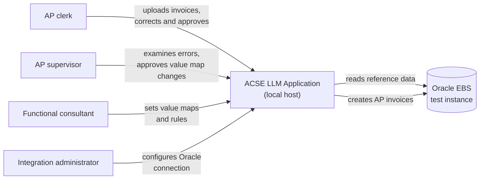
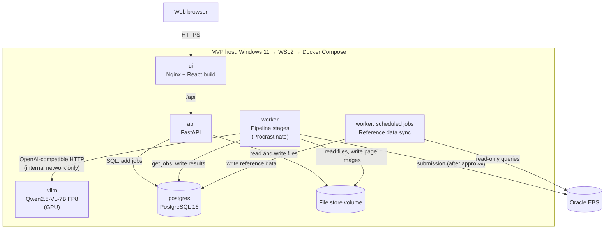
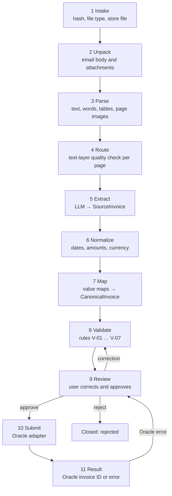
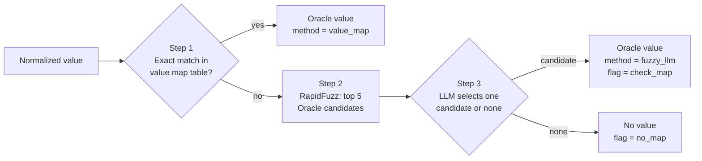
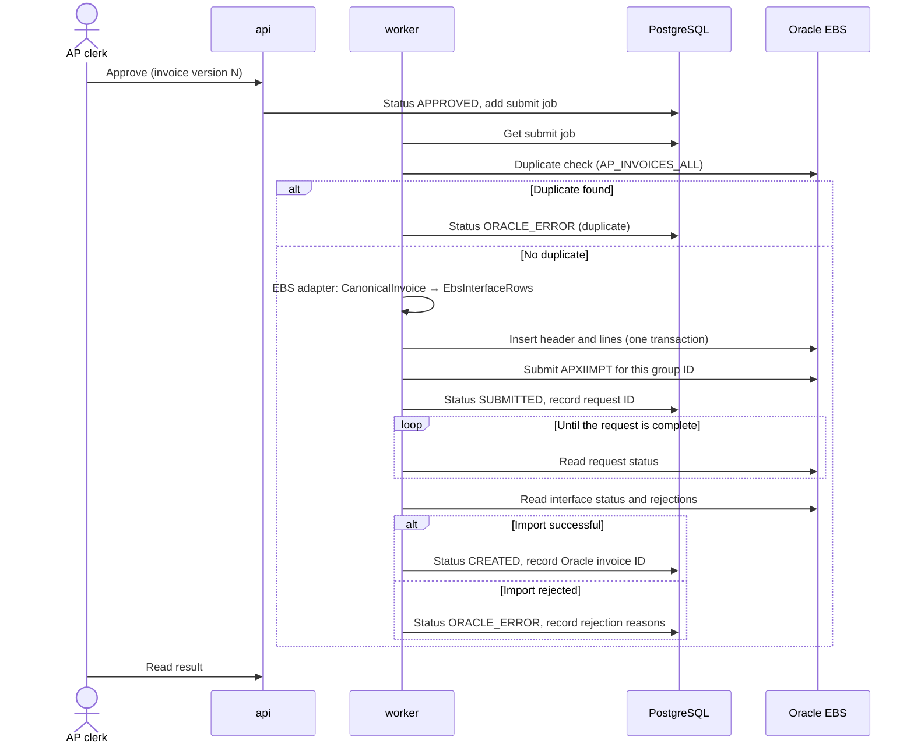
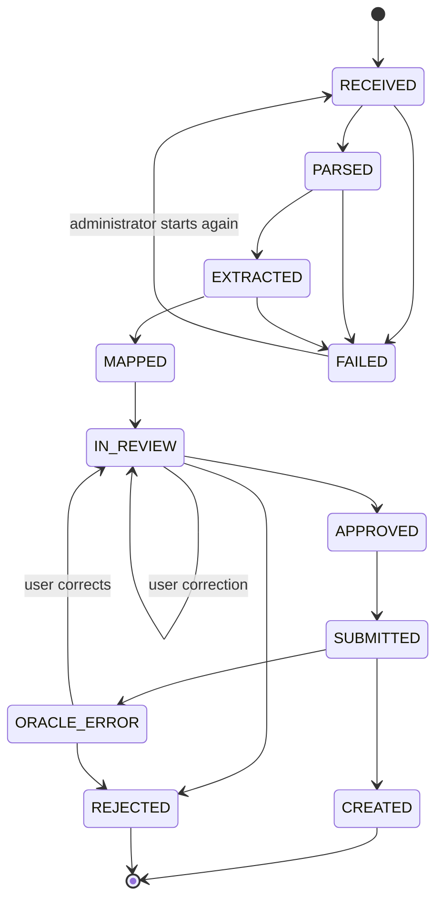
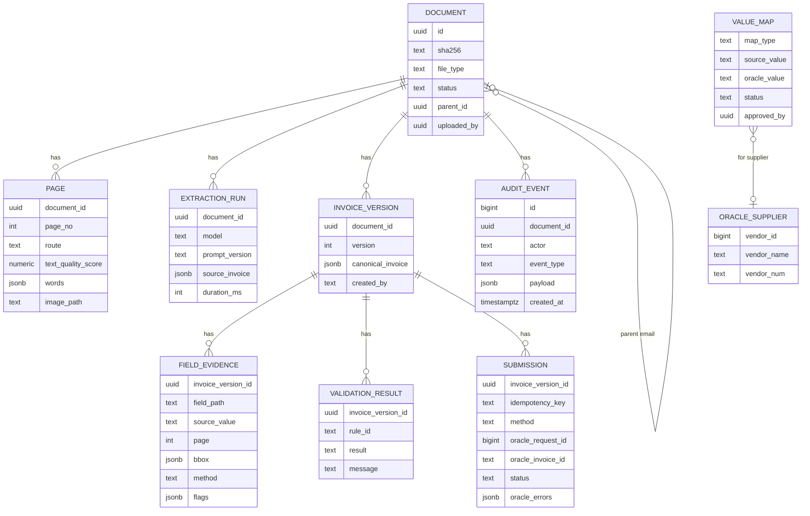
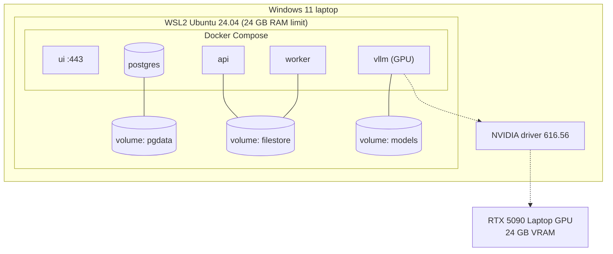
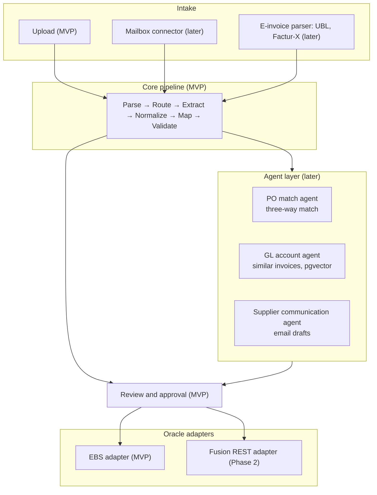

# ACSE LLM Application: System Architecture

| Item | Value |
|---|---|
| Document status | Draft 0.1 |
| Date | 2026-09-25 |
| Language standard | ASD-STE100 Simplified Technical English |
| Related documents | MVP Definition and Goals (MVP.md), MVP Technology Stack (TECH-STACK.md) |

## 1. Purpose of This Document

This document gives the end-to-end system architecture of the ACSE LLM application. It starts at the supplier invoice file and stops at the AP invoice in Oracle.

Sections 2 to 13 give the MVP architecture. Section 14 shows how the architecture changes for the later stages.

References F-xx, V-xx, P-xx, S-xx and O-xx refer to MVP.md. References T-xx refer to TECH-STACK.md.

The diagrams use Mermaid. GitHub and most Markdown viewers show Mermaid diagrams.

## 2. Architecture Rules

These rules apply to all parts of the architecture. They extend the principles P-01 to P-06 in MVP.md.

| ID | Rule | Reason |
|---|---|---|
| R-01 | The LLM has no tools. It cannot call an API, a database or a network address. | Text in an invoice can contain instructions to the LLM. Without tools, these instructions cannot cause an action. |
| R-02 | The LLM only reads the input and writes JSON that agrees with a schema. | The output is always machine-readable (P-04). |
| R-03 | Each value in the output has a record of its source: page, location, source value and method. | The user can find the source of each value (P-06). |
| R-04 | Each pipeline stage writes its result to the database before the next stage starts. | If a stage fails, the application starts again at that stage. It does not start again at stage 1. |
| R-05 | The application never changes a stored result. It adds a new version. | The audit log is complete (F-10). |
| R-06 | The core of the application uses a canonical invoice model. Only the Oracle adapter knows the Oracle tables and APIs. | The team can add Oracle Fusion in Phase 2 and change only the adapter (G-04). |
| R-07 | The Oracle submission uses an idempotency key. | If the application sends the same invoice two times, Oracle creates only one invoice. |

## 3. System Context

This diagram shows the application and the persons and systems that connect to it.



The application has no connection to the internet at run time. The model files come from Hugging Face one time, before the first start (P-01).

## 4. Container View

This diagram shows the services that operate on the MVP host. Each service is one Docker container.



| Container | Responsibility | Exposed port |
|---|---|---|
| `ui` | Serves the React application. Sends `/api` calls to the `api` container. | 443 (only port open to users) |
| `api` | Authentication, file upload, review screen data, user corrections, approval. It adds jobs to the queue. It does not call the LLM or Oracle. | Internal only |
| `worker` | Operates the pipeline stages (Section 6). It is the only container that calls vLLM and Oracle. | None |
| `vllm` | Serves the LLM on the GPU. | Internal only |
| `postgres` | All application data, the job queue and the audit log. | Internal only |

The `api` container and the `worker` container use the same Python code base. They start with different commands.

## 5. Canonical Data Model

The application uses three invoice data models. All three are Pydantic models in the `schemas` package.

| Model | Content | Made by |
|---|---|---|
| `SourceInvoice` | Values exactly as the supplier wrote them. Each value has its page and location. | LLM (stage 5) |
| `CanonicalInvoice` | Normalized values and Oracle values. It is the JSON output in MVP.md, Section 9.4. | Application code (stages 6 and 7) |
| `EbsInterfaceRows` | Rows for `AP_INVOICES_INTERFACE` and `AP_INVOICE_LINES_INTERFACE`. | EBS adapter (stage 10) |

Each field in `SourceInvoice` and `CanonicalInvoice` has this structure:

```json
{
  "value": "7 NET",
  "source_value": "7 days",
  "page": 1,
  "bbox": [412, 188, 470, 201],
  "method": "value_map",
  "flags": []
}
```

| Property | Description |
|---|---|
| `value` | The value that the next stage uses. |
| `source_value` | The value as the supplier wrote it. |
| `page`, `bbox` | The page number and the location on the page (x0, y0, x1, y1). |
| `method` | How the application got the value: `extracted`, `normalized`, `value_map`, `fuzzy_llm`, `default`, `user`. |
| `flags` | Problems for the review screen. Examples: `not_found_in_source`, `two_date_formats`, `low_match_score`. |

## 6. Pipeline

### 6.1 Pipeline Stages

Each stage is one job in the queue. Each stage reads the result of the stage before it from the database and writes its own result (R-04).



| # | Stage | Input | Output | LLM |
|---|---|---|---|---|
| 1 | Intake | Uploaded file | Stored file, SHA-256 hash, real file type | No |
| 2 | Unpack | Email file | Email body and attachments as separate documents | No |
| 3 | Parse | File | For each page: text, words with coordinates, tables, page image | No |
| 4 | Route | Parsed pages | For each page: `text_and_image` or `image_only` (F-02) | No |
| 5 | Extract | Pages and route | `SourceInvoice` | **Yes** |
| 6 | Normalize | `SourceInvoice` | ISO dates, `Decimal` amounts, ISO currency codes | No |
| 7 | Map | Normalized values | `CanonicalInvoice` with Oracle values (F-04, F-05) | Only for step 3 of the value map |
| 8 | Validate | `CanonicalInvoice` | Validation results (F-07) | No |
| 9 | Review | All results | User corrections, approval or rejection (F-08) | No |
| 10 | Submit | Approved `CanonicalInvoice` | Oracle request (F-09) | No |
| 11 | Result | Oracle status | Oracle invoice ID or Oracle error (F-10) | No |

The LLM operates in only two places: stage 5 and step 3 of stage 7.

### 6.2 Stages 1 to 4: Intake, Unpack, Parse and Route

**Intake.** The application calculates the SHA-256 hash of the file. If the hash is already in the database, the application shows the earlier result and does not process the file again. The application finds the file type from the file content, not from the file extension. It accepts only the file types in MVP.md, Section 9.1.

**Unpack.** For an email file, the application makes one document for the email body and one document for each attachment. It uses these rules:

- If the email has one PDF or image attachment, that attachment is the invoice.
- If the email has no attachment, the email body is the invoice.
- If the email has more than one possible invoice, the user selects the invoice on the review screen.

**Parse.** The parser changes each format into the same page structure:

| Format | Text and words | Page image |
|---|---|---|
| PDF | pdfplumber | pypdfium2, 200 DPI |
| PNG, JPG, TIFF | None | Pillow; OpenCV corrects the rotation |
| XLSX, XLS, CSV | Each sheet as a Markdown table | None |
| Email body | Plain text from html2text | None |

**Route.** For each PDF page, the application calculates a text-layer quality score (TECH-STACK.md, Section 7). If the score is sufficient, the route is `text_and_image`. If not, the route is `image_only`. Excel, CSV and email body pages have the route `text_only`.

### 6.3 Stage 5: Extract

The worker sends one request to vLLM for each invoice.

| Part of the request | Content |
|---|---|
| System prompt | Task instructions. The prompt tells the LLM to copy each value exactly as it is in the source. |
| Page content | For each page: the page image, and the text if the route is `text_and_image` or `text_only`. |
| Output schema | The JSON schema of `SourceInvoice`. vLLM with xgrammar enforces it (P-04). |
| Settings | Temperature 0. Maximum output tokens set from the schema size. |

**Pages.** One request can contain a maximum of 4 page images (TECH-STACK.md, Section 5: `--limit-mm-per-prompt image=4`). If an invoice has more than 4 pages, the worker sends the first 4 pages for the header and the lines. Then it sends the other pages in groups of 4 for the lines only. It joins the lines and sets the flag `multi_request` for the review screen.

**Source check.** After the extraction, application code looks for each extracted value in the page text:

- If the value is in the text layer, the application gets the location from the pdfplumber word coordinates.
- If the page has no text layer, the application uses the location that the LLM gave.
- If the value is not in the text layer of a `text_and_image` page, the application sets the flag `not_found_in_source`.

This check finds values that the LLM invented.

**Prompt versions.** Each prompt has a version number. The database records the prompt version and the model name for each extraction. The evaluation harness compares the prompt versions.

### 6.4 Stage 6: Normalize

Application code changes the source values into standard formats. The LLM does not do this stage.

| Field type | Rule |
|---|---|
| Amount | Remove currency symbols and thousands separators. Convert to `Decimal`. Use the decimal separator of the supplier country. |
| Date | dateparser with the supplier country as a hint. If the date has two possible meanings, set the flag `two_date_formats`. |
| Currency | Symbol or code → ISO 4217 code. If the symbol has more than one currency, use the default currency of the supplier. |
| Text | Remove extra spaces. Do not change the letters. |

### 6.5 Stage 7: Map

The application maps each value to an Oracle value in three steps. It stops at the first step that gives a result.



- The LLM can select only from the candidate list. The JSON schema for step 3 is an `enum` of the candidates and `none`. The LLM cannot invent an Oracle value.
- The candidates come from the local copy of the Oracle reference data (Section 9.3).
- Supplier values map first. Supplier site values use the selected supplier as a filter.
- Fixed values (for example `INVOICE_TYPE_LOOKUP_CODE = STANDARD` and `SOURCE`) come from the configuration. Their method is `default`.

**Value map feedback.** If the user corrects a mapped value on the review screen, the application makes a proposed value map entry. The AP supervisor approves or rejects the proposal. An approved entry becomes a step 1 exact match for the next invoice. Thus the application improves without fine-tuning.

### 6.6 Stage 8: Validate

The rule module operates each rule V-01 to V-07 on the `CanonicalInvoice`. Each rule gives one result: `pass`, `fail` or `warning`.

- A `fail` result stops the approval. The user must correct the value or reject the invoice.
- A `warning` result does not stop the approval. The user must examine the value.
- V-06 (duplicate invoice) operates two times: at stage 8 against the local data, and at stage 10 against Oracle.

The validation operates again after each user correction.

### 6.7 Stage 9: Review

The review screen gets all data from the `api` container. It shows:

- The source file in the document viewer, with a box around the location of the selected value.
- Each field with its value, its source value, its method and its flags.
- The validation results.

Fields with flags or failed rules show first. Each user correction makes a new version of the `CanonicalInvoice` with the method `user` (R-05).

### 6.8 Stages 10 and 11: Submit and Result



This sequence is for option A (TECH-STACK.md, Section 9). For option B, the adapter calls the REST service in place of the insert and the import program. The other steps do not change.

**Idempotency (R-07).** The submission record has a unique key: the document ID and the invoice version. Before the insert, the adapter looks for this key in the Oracle interface table. If the key is there, the adapter reads the status and does not insert the invoice again.

**Group ID.** Each submission uses its own `GROUP_ID` in the interface table. The import program then processes only this invoice.

## 7. Invoice Status Model



| Status | Description |
|---|---|
| `RECEIVED` | The application stored the file. |
| `PARSED` | The pages, text and page images are available. |
| `EXTRACTED` | The `SourceInvoice` is available. |
| `MAPPED` | The `CanonicalInvoice` and the validation results are available. |
| `IN_REVIEW` | The invoice is on the review list. |
| `APPROVED` | The user approved the invoice. The submit job is in the queue. |
| `SUBMITTED` | The application sent the invoice to Oracle. |
| `CREATED` | Oracle created the AP invoice. |
| `ORACLE_ERROR` | Oracle rejected the invoice, or the duplicate check failed. |
| `REJECTED` | The user rejected the invoice. |
| `FAILED` | A technical error occurred after all retries. |

## 8. Data Architecture

### 8.1 Main Tables



### 8.2 Data Groups

| Group | Tables | Owner | Change rule |
|---|---|---|---|
| Transaction data | `DOCUMENT`, `PAGE`, `EXTRACTION_RUN`, `INVOICE_VERSION`, `FIELD_EVIDENCE`, `VALIDATION_RESULT`, `SUBMISSION` | Application | Add new rows only (R-05). |
| Configuration data | `VALUE_MAP`, rule settings, fixed Oracle values | Functional consultant | Changes need AP supervisor approval. Each change goes into the audit log. |
| Reference data | `ORACLE_SUPPLIER`, supplier sites, payment terms, currencies, operating units | Oracle EBS | The sync job replaces it. Users cannot change it. |
| Audit data | `AUDIT_EVENT` | Application | The database user of the application has no `UPDATE` or `DELETE` permission on this table. |

### 8.3 Reference Data Sync

- A scheduled job copies the Oracle reference data every night (TECH-STACK.md, Section 9).
- An administrator can also start the job from the application.
- The review screen shows the time of the last sync.
- If the last sync is more than 48 hours old, the application shows a warning on each invoice.

### 8.4 File Store

| Directory | Content |
|---|---|
| `originals/<sha256>` | The uploaded files. The application never changes these files. |
| `pages/<document_id>/<page_no>.png` | Page images for the LLM and for the document viewer. |

## 9. Integration Architecture

### 9.1 Adapter Interface

The Oracle adapter is a Python interface with these operations:

| Operation | Description |
|---|---|
| `load_reference_data()` | Reads suppliers, sites, payment terms, currencies and operating units. |
| `find_duplicate(invoice)` | Looks for an invoice with the same number and supplier. |
| `to_payload(invoice)` | Converts a `CanonicalInvoice` into the format of the target system. |
| `submit(payload, key)` | Sends the invoice. Returns a submission reference. |
| `get_status(reference)` | Returns `pending`, `created` with the Oracle invoice ID, or `error` with the reasons. |

The MVP has one adapter: `EbsOpenInterfaceAdapter` (option A) or `EbsRestAdapter` (option B). The integration team selects one (O-03).

### 9.2 Oracle Connection

| Item | Value |
|---|---|
| Driver | python-oracledb, thin mode |
| Accounts | One read-only account. One account with write access only to the interface tables and permission to submit the import program. |
| Network | From the `worker` container to the Oracle EBS test instance only. |
| Timeouts | Connection: 10 seconds. Query: 60 seconds. Import program status: maximum 15 minutes, then status `ORACLE_ERROR` with the reason `timeout`. |

## 10. Security Architecture

| Area | Control |
|---|---|
| Data location | All data stays on the MVP host. No service sends invoice data to the internet (P-01, S-08). |
| Network | Only the `ui` container has a port that users can reach. The `vllm` and `postgres` containers are on an internal Docker network. The `vllm` container has no internet access at run time (`HF_HUB_OFFLINE=1`). |
| Users | Local user accounts, Argon2 passwords, three roles: clerk, supervisor, administrator. |
| Permissions | Clerk: upload, correct, approve, reject. Supervisor: clerk permissions, value map approval, error list. Administrator: configuration, reference data sync, restart of failed jobs. |
| Secrets | Oracle passwords are in environment files that are not in Git. The files are readable only by the service user. |
| Uploads | Maximum file size 25 MB. Only the file types in MVP.md, Section 9.1. The application does not run macros in Excel files. It removes scripts from HTML email bodies. |
| Prompt injection | Invoice text can contain instructions for the LLM. The controls are: no LLM tools (R-01), schema-enforced output (R-02), Oracle values only from candidate lists (Section 6.5), the source check (Section 6.3) and user approval (P-05). |
| Oracle access | Minimum permissions (Section 9.2). The LLM has no Oracle access. |
| Audit | Each user action, each LLM request and response, and each Oracle call goes into `AUDIT_EVENT`. |

## 11. Errors and Recovery

| Error | Action |
|---|---|
| File type not accepted | The upload fails. The screen shows the reason. |
| Parse error (for example, a damaged PDF) | Status `FAILED`. The error list shows the reason. |
| vLLM not available or timeout | The job tries again 3 times with a longer wait each time (10, 30, 90 seconds). Then status `FAILED`. |
| LLM output does not agree with the schema | This must not occur because vLLM enforces the schema. If it occurs, the job tries again one time. Then status `FAILED`. |
| Oracle not available | The submit job tries again 3 times. Then status `ORACLE_ERROR` with the reason `connection`. The invoice data stays approved. |
| Oracle import rejection | Status `ORACLE_ERROR`. The review screen shows the Oracle rejection reasons. The user corrects the invoice or rejects it. |
| Worker stops during a job | Procrastinate gives the job to a worker again. Each stage can operate again without problems (R-04, R-07). |

## 12. Performance

The target is 60 seconds or less from upload to review screen (S-06). This table gives the estimated time for a 2-page PDF on the MVP host. The team must measure the real values in Phase 0.

| Stage | Estimated time |
|---|---|
| Intake, unpack, parse, route | 1–3 seconds |
| Extract (2 page images and text, approximately 800 output tokens) | 10–25 seconds |
| Normalize, map, validate (no LLM in step 3) | Less than 1 second |
| Map, step 3 (one LLM call for each unmatched value) | 1–3 seconds for each value |
| **Total** | **Approximately 15–35 seconds** |

**Throughput.** The MVP operates on one invoice at a time for each user. vLLM can process more than one request at the same time. The worker can operate 2 to 4 extraction jobs at the same time without a change to the architecture.

## 13. Deployment Architecture



| Item | Value |
|---|---|
| Start command | `docker compose up -d` |
| Configuration | One `.env` file for each environment (development, test). |
| Model files | The `models` volume. The team downloads the files one time. |
| Database changes | Alembic migrations operate when the `api` container starts. |
| Backup | `pg_dump` every day. A copy of the `filestore` volume every day. |
| Environments | The MVP has one environment on the laptop. It connects to the Oracle EBS test instance only. |

## 14. Target Architecture After the MVP

The MVP architecture has extension points for the later stages. This diagram shows the new parts in the later stages.



| Later stage | Architecture change | MVP parts that stay the same |
|---|---|---|
| Oracle Fusion (Phase 2) | Add `FusionRestAdapter`. Add a Fusion reference data sync. | All other parts. |
| Other AP invoice types | Add fields and rules to `CanonicalInvoice` and the validation module. | Pipeline, adapters interface, review screen. |
| Mailbox intake | Add a mailbox connector that makes a `DOCUMENT` for each email. | Stage 2 to stage 11. |
| Structured e-invoices | Add a parser route that makes the `SourceInvoice` without the LLM. | Stage 6 to stage 11. |
| PO match, GL accounts, supplier emails | Add an agent layer with LangGraph between stage 8 and stage 9. The agents use tools with fixed parameters and read-only views. An email to a supplier needs user approval. | Pipeline, data model, adapters. |
| Fine-tuned model | Load a LoRA adapter in vLLM (`--lora-modules`). Change the model name in the configuration. | All parts. |
| Submission without approval | Add an auto-approval rule: all rules pass, no flags, and the supplier has a good history. | All parts. |
| Server host | Move the Docker Compose services to a server. Increase the worker and vLLM capacity. | All parts. |

## 15. Architecture Decisions

| ID | Decision | Alternative that the team did not select | Reason |
|---|---|---|---|
| AD-01 | One vision-language model for all LLM tasks | A separate text model for the value map | Less GPU memory. Fewer components. |
| AD-02 | The LLM copies source values. Application code normalizes and maps them. | The LLM gives Oracle values directly | Each step is testable. Value map changes do not need a new prompt or a new model. |
| AD-03 | Schema-enforced output with xgrammar | JSON output from the prompt only | The output always agrees with the schema (M-03, S-03). |
| AD-04 | A PostgreSQL job queue (Procrastinate) | Redis with Celery | One database for all data. Fewer components. |
| AD-05 | A canonical invoice model and Oracle adapters | Oracle column names in all parts | Phase 2 needs only a new adapter (G-04). |
| AD-06 | A local copy of the Oracle reference data | An Oracle query for each value | Faster. Less load on Oracle. The pipeline operates when Oracle is not available. |
| AD-07 | A linear pipeline without an agent framework in the MVP | LangGraph in the MVP | The MVP has no decisions that need an agent. LangGraph comes with the agent layer (Section 14). |
| AD-08 | Value map feedback from user corrections | Fine-tuning from user corrections | Immediate effect. The functional team controls each change. |

## 16. Open Items

| ID | Open item | Owner |
|---|---|---|
| AR-01 | Select the Oracle adapter: option A or option B (same as O-03 and T-01). | Integration team |
| AR-02 | Confirm the network path from the MVP host to the Oracle EBS test instance. | Oracle administrator |
| AR-03 | Confirm the maximum number of pages for one invoice in the MVP. | Functional team |
| AR-04 | Confirm the retention period for invoice files and audit data. | Project sponsor |
| AR-05 | Measure the stage times in Phase 0 and update Section 12. | Development team |
