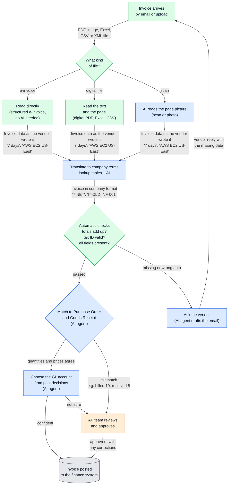
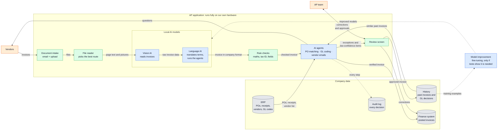

# Autonomous AP Application: How It Works

Two diagrams explain the application:

1. **The invoice journey** shows the steps that one invoice goes through, and what the data looks like after each step.
2. **The system and its data** shows the main parts of the application and the data that moves between them.

Colour key for both diagrams:

| Colour | Meaning |
|---|---|
| Blue | Local AI (runs on our own hardware) |
| Green | Fixed rules and ordinary software |
| Orange | People |
| Grey | Stored data |

## Diagram 1: The Invoice Journey

Follow one invoice from top to bottom. The text on each arrow shows the data that moves to the next step.

### Step-by-Step Explanation

**1. Invoice arrives**
- A vendor sends an invoice by email, or a team member uploads it.
- Accepted files: PDF, image, Excel, CSV and XML e-invoice.
- The application saves the original file and never changes it.

**2. What kind of file?**
- The application checks what is inside the file, not just its name.
- It picks the most reliable way to read the file (step 3a, 3b or 3c).

**3a. Read directly (structured e-invoice)**
- Some invoices arrive as structured data (XML).
- The application reads each value exactly. No AI is needed.

**3b. Read the text and the page (digital files)**
- Digital PDFs, Excel and CSV files contain real text.
- The application reads that text, so there are no misread characters.
- For PDFs, AI also looks at the page picture to understand the layout, for example which number is the total.

**3c. AI reads the page picture (scans and photos)**
- Scans have no readable text, only a picture.
- The vision AI reads the picture, including tables.
- This is the hardest route, and the only place where AI training may be needed.

**4. Translate to company terms**
- Vendors use their own words. The company uses fixed codes.
- The application uses lookup tables first, for example "7 days" → "7 NET".
- If no table entry fits, AI chooses from a short list of valid company codes. It cannot invent a code.

**5. Automatic checks**
- Fixed rules, not AI, check the invoice.
- Do the line amounts add up to the total? Is the tax ID valid? Are all required fields present?
- If data is missing or wrong, the invoice goes to step 8.

**6. Match to Purchase Order and Goods Receipt**
- An AI agent finds the Purchase Order and the Goods Receipt in the ERP.
- It compares what was ordered, what was received and what was billed ("three-way match").
- Fixed rules do the comparison. The agent handles the fuzzy parts, for example "Dell Latitude 5440" on the invoice matches "Laptop 14in" on the PO.
- If there is a mismatch (billed 10, received 8), the invoice goes to review.

**7. Choose the GL account**
- An AI agent decides which accounting bucket the cost belongs in, for example Office Supplies or Cloud Software.
- It looks at how accountants coded similar invoices from the same vendor.
- If it is confident, the invoice continues. If not, a person decides.

**8. Ask the vendor**
- An AI agent drafts a polite email that asks for the missing or incorrect information.
- A person approves the email before it is sent, until the drafts prove reliable.
- The vendor's reply goes back to step 1 and the invoice is processed again.

**9. AP team reviews and approves**
- A person sees only invoices that need attention: mismatches, low confidence or errors.
- Each value is shown next to its place in the original invoice.
- The person corrects values if necessary and approves the invoice.

**10. Invoice posted**
- The verified invoice goes into the finance system.
- Each step and decision is recorded for audit.

**What to notice:**
- The application picks the most reliable way to read each file. AI reads the page picture only when the file has no readable text.
- AI reads and interprets the invoice. Fixed rules check the maths. AI never decides whether totals add up.
- When something is wrong, the application does not stop. It asks the vendor or a person, and then continues.

## Diagram 2: The System and Its Data

This diagram shows the main parts of the application and the data that moves between them. All parts inside the large box run on our own hardware. No invoice data goes to an outside AI service.

### Part-by-Part Explanation

**People**

- **Vendors**
  - Send invoices.
  - Answer questions from the application about missing or incorrect data.
- **AP team**
  - Review only the invoices that need a person.
  - Correct values and approve invoices.
  - Their corrections teach the application.

**The application (inside the large box)**

- **Document intake**
  - Collects invoices from the AP mailbox and from uploads.
  - Saves the original file.
- **File reader**
  - Checks each file and picks the best way to read it: structured data, real text or page picture.
  - Sends the text and page pictures to the AI.
- **Vision AI**
  - Reads the invoice pages, including tables and layouts.
  - Gives the invoice data exactly as the vendor wrote it.
- **Language AI**
  - Translates vendor words into company codes.
  - Is also the "brain" of the AI agents.
- **Rule checks**
  - Ordinary software, not AI.
  - Checks maths, tax IDs and required fields.
- **AI agents**
  - PO matching: compares the invoice with the Purchase Order and the Goods Receipt.
  - GL coding: chooses the accounting bucket from past decisions.
  - Vendor emails: drafts questions to vendors.
  - Send uncertain cases to the review screen.
- **Review screen**
  - Shows the AP team each value next to its place in the original invoice.
  - Records each correction and approval.

**Company data**

- **ERP**
  - Contains Purchase Orders, Goods Receipts, the vendor list and GL codes.
  - The agents read it to verify each invoice.
- **History**
  - Contains past invoices and how accountants coded them.
  - The GL agent uses it to find similar invoices.
  - Grows with each correction by the AP team.
- **Finance system**
  - Receives the final, verified invoices.
- **Audit log**
  - Records each step, each AI decision and each human action.
  - Shows who or what decided what, and why.

**Background loop**

- **Model improvement**
  - Uses the history as training examples.
  - Runs only if tests show that the AI needs to be more accurate.
  - Makes improved models for the application to use.

**What to notice:**
- **Solid arrows** show the everyday flow of an invoice. **Dotted arrows** show the background flows: the audit record and the model improvement loop.
- The AI agents read company data (POs, receipts, past decisions), but they post only verified invoices.
- Each correction by the AP team goes back into the history. The next similar invoice uses it. The system improves with use.
