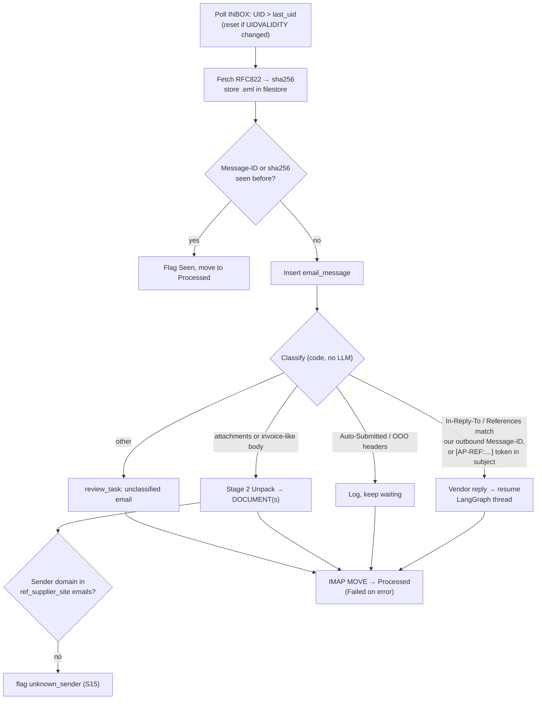
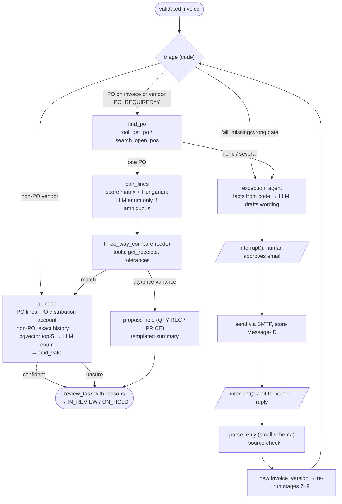

# AAP Module: Implementation Plan — Progress Status

| Item | Value |
|---|---|
| Status | Tracking copy of IMPLEMENTATION-PLAN.md (Draft 0.1) |
| Last updated | 2026-10-26 (real-invoice readiness R1: [PLAN-REAL-INVOICES.md](PLAN-REAL-INVOICES.md)) |
| Scope | Mock Oracle EBS in PostgreSQL, mailbox intake, Python pipeline, agent layer, containerized runtime, minimal UI |
| Builds on | PLAN.md, TECH-STACK.md, ARCHITECTURE.md, DIAGRAMS.md, WORKED-EXAMPLE.md |

Legend: ✅ done and verified · 🟡 done except one item · 🟠 in progress · ⬜ not started

## Progress Summary

| # | Phase | Status |
|---|---|---|
| 0 | Environment + skeleton | ✅ |
| 1 | Mock EBS | ✅ |
| 2 | App DB + core | ✅ |
| 3 | Invoice generator | ✅ |
| 4 | Pipeline 1–8 | ✅ stub and vLLM modes run end to end (vLLM accuracy findings → Phase 6) |
| 5 | Mailbox | ✅ |
| 6 | Eval baseline | ✅ harness + real-model baseline; prompt v2 passes both PLAN 4 gates on the dev set (held-out 515 set: see below); current prompt v4 still passes them (header 99.3 %, line F1 100 %) |
| 7 | Agents: match + GL | ✅ |
| 8 | Agents: exceptions | ✅ |
| 9 | Submit + result | ✅ |
| 10 | Minimal UI + hardening | ✅ |

Details per phase: §12. Verification evidence: below. Deviations from the plan: §0.1.

After the phases: **real-invoice readiness** from the customer's samples (5 invoice PDFs and their `APILOAD` file). Phase R1 (fixes that need no outside input) is done; R2 waits on the functional team. Plan, items and results: [PLAN-REAL-INVOICES.md](PLAN-REAL-INVOICES.md).

### Added 2026-10-26 (PLAN-REAL-INVOICES R1)

| Area | What | Verified by |
|---|---|---|
| Worker stability | Lock around every PDFium call (parallel parse crashed the worker); at start, jobs left `doing` by a dead worker go back to `todo` (`WORKER_RECOVER_ON_START`) | 5 sample PDFs parsed in parallel; `test_worker_recover.py` |
| Extraction | Prompt v4; schema adds `document_type`, `location_ref`, `bank_change_notice`, `taxes` (one row per printed tax); source check keeps `%` | `invoices-dev-55` real-model eval: header 99.3 %, line F1 100 %, `po_number` 94.5 → 100 % |
| Normalize | Invoice type from the title (credit → negative); several taxes summed; price per 1000 / in cents → per unit; implausible bank numbers and IBANs dropped; freight rows → `FREIGHT`; Canada hint → CAD | `test_real_invoice_rules.py` |
| Map | Terms from the due date when none (or none verifiable) are printed; one TAX line per tax row; store / location → cost center (value maps `location`); `GL_DATE_POLICY` | `test_real_invoice_rules.py` |
| Validation | C4 per tax row; C11 fails on a bank-change notice; new C13 invoice type vs sign; V-05 warns on a terms / due-date conflict | `test_real_invoice_rules.py` |
| APLOAD | The customer's pipe-delimited AP interface file: `GET /api/documents/{id}/apload`, `python -m aap.submit.apload` | `test_apload.py` (byte-for-byte against the sample) |
| Tests | 83 unit tests; e2e S1–S15 with the stub LLM: 23 passed, 3 skipped (embeddings) | |

### Verification (last runs, 2026-09-29)

| Check | Result |
|---|---|
| Unit tests (`tests/unit`, host) | 50 passed |
| Integration tests (`tests/integration`, testcontainers) | 8 passed |
| e2e, stub LLM (app container + throwaway pg + GreenMail) | 22 passed (3 embedding tests skip there and pass in the `worker` container): S1–S15 with agent outcomes; S3 loop; mailbox loop; reminders/timeouts; `recheck_holds`; submit S1/S2/S4/S8 + GL feedback; UI pages and forms; failure modes; audit check after every module |
| e2e S1–S15, **vLLM** (Qwen2.5-VL-7B FP8, RTX 5090) | runs end to end in 12 min; 13 of 15 scenarios give the planned result (S7, S13 do not) and 1 of 6 random invoices has a misread tax ID (see findings below) |
| vLLM smoke test (`tools.vllm_smoke`) | schema-valid JSON, 17/17 fields found in the source; ~19 s per invoice warm (~70 s first request) |
| Dev stack, mailbox | 3 invoices emailed to `ap@acse.local` → documents at the next poll (~27 s) → `IN_REVIEW` |
| Dev stack, submit | approve via API → `SUBMITTED` → `CREATED` (Oracle invoice) in ~11 s through the `erp` queue and `ebs-cm` |
| Batch: 500 random + 15 scenarios (earlier run, stub) | 515/515 VALIDATED in ~75 s |
| `ruff check src tools tests` | clean |

### Scenario results with the agent layer (stub LLM; vLLM the same except where noted)

| Scenario | Validation | Agent outcome |
|---|---|---|
| S1 | pass | ON_HOLD, `QTY REC` (WORKED-EXAMPLE summary). After `aap-mock receive` → `recheck_holds` → hold released, IN_REVIEW |
| S2 | pass | IN_REVIEW, `GL_REVIEW` (EC2 → 6420 from history; S3 line → model) |
| S3 | warn V-PO | IN_REVIEW, vendor email draft → approve → sent → vendor replies "PO 4500187" → re-validated, matched, IN_REVIEW |
| S4 | **fail C10** | IN_REVIEW, `DUPLICATE`; if approved anyway, Oracle rejects with `DUPLICATE INVOICE NUMBER` |
| S5 | pass | ON_HOLD, `PRICE` |
| S6, S15 | **fail C11** | IN_REVIEW, `BANK_CHANGE` (+ `UNKNOWN_SENDER`) |
| S7 | **fail C8** | IN_REVIEW, `SUPPLIER_INACTIVE` (vLLM: also C1, total not extracted) |
| S8 | pass | IN_REVIEW; posts in EUR with the Corporate rate |
| S9 | warn C9 | IN_REVIEW, `DATE_AMBIGUOUS` |
| S10 | **fail V-PO** | IN_REVIEW, `PO_NOT_OPEN` |
| S11 | **fail C4** | IN_REVIEW, vendor email draft (`INVOICE_MATH`); unanswered → reminder draft after 3 days, `VENDOR_NO_REPLY` after 7 |
| S12 | pass ×2 | IN_REVIEW ×2 |
| S13 | pass (warn C12) | IN_REVIEW (vLLM: **FAILED**, extraction loops until `max_tokens`) |
| S14 | NOT_INVOICE | Out-of-office reply to an exception email is logged on the thread; the agents keep waiting |

**vLLM findings for Phase 6:**

1. S13 (scanned, `image_only`): the model repeats itself until `max_tokens=4096` (`finish_reason=length`); a repetition penalty of 1.05 did not change it. The client now fails fast on truncation, and the job is not retried (the output would be identical).
2. S7: invoice total not extracted (C1).
3. Random R0002: GSTIN misread (characters dropped); C7 flags it correctly.
4. Throughput: ~27–30 generated tokens/s, which is low for a 7B FP8 model on this GPU. Check the FP8 kernel path on sm_120 and the guided-decoding overhead.
5. Smoke invoice: `due_date` copies the terms text, `item_code` holds line numbers, per-line `tax_rate` is inferred.

### Added 2026-09-29

| Area | What | Verified by |
|---|---|---|
| Phase 7 embeddings | bge-m3 dense vectors on the CPU via ONNX Runtime (`aap.embed`, no torch); `embed-fetch` one-shot download (2.3 GB) into the `models` volume; periodic `embed-backfill` (every 5 min, each distinct text once); `similar_history` uses pgvector cosine (HNSW) and falls back to RapidFuzz while the model or a supplier's embeddings are missing. Peak memory 1.7 GB, ~0.1 s per batch of short lines | `tests/e2e/test_embeddings.py` (worker service): backfill complete, vector hits for AWS S3, S2 through the agents with embeddings |
| Review feedback (plan 8) | Approving a line whose GL account a person decided (agents unsure, or clerk correction) adds a `gl_history_line` (source `review`, embedded at once), so the next identical line is coded from exact history without the model | `test_submit.py::test_s2…` |
| Phase 6 eval harness | `python -m aap.eval --dir <set>`: stages 1–8 on a generated set with truth sidecars; per tier (digital / scanned) and per field: extraction fields, mapped header fields, line-item precision / recall / F1, validation outcome; PLAN 4 gates (header ≥ 97 %, line F1 ≥ 95 %); stored in `eval_run` / `eval_result`, shown on the admin page. Eval documents are sandboxed (`source=eval`: own duplicate scope, no agents, not in the inbox, not re-queued) | unit tests (`test_eval_metrics.py`); stub run on `invoices-dev-55`: 55/55 VALIDATED, header 99.6 % (S9's ambiguous date), line F1 100 %, validation outcome 100 % |
| Phase 10 UI | Jinja2 + HTMX (vendored, works offline) at `/ui`: inbox with status chips and auto-refresh; invoice detail (original file, fields with source value / method / flags, validation, review reasons, agent decisions, holds, email thread, Oracle submissions, status history) with approve / reject and per-line corrections (PO line or GL account; only changed values count as corrections); outbox (edit, approve, discard); admin (mailbox, job queue, reference sync, GL history / embeddings, failed documents with retry, eval runs) | `tests/e2e/test_ui.py` |
| Phase 10 hardening | Oracle unreachable at submit/result → `ORACLE_ERROR` + `ORACLE_UNAVAILABLE` review task (was FAILED, whose retry re-extracted an approved invoice); `aap.audit_check` (status chain + audit events, decisions, open review tasks, approvals by a named person, Oracle events, sent/inbound mail records); model choices (`choose`) now write audit events (gap found by the check) | `tests/e2e/test_hardening.py`: LLM down → FAILED → retry recovers; Oracle down → review → re-approve posts; IMAP down recorded; poison email → Failed folder, poll continues; re-delivered jobs are no-ops; audit check clean after every e2e module |
| Test isolation | Every e2e module re-seeds EBS (small, seconds): modules post invoices and receive goods | full e2e suite |

### Phase 6: real-model eval (Qwen2.5-VL-7B FP8, `invoices-dev-55`)

| | v1 prompt (baseline) | v2 prompt + bounded evidence schema |
|---|---|---|
| Reached VALIDATED | 53 / 55 | **55 / 55** |
| Header accuracy (gate ≥ 97 %) | 95.6 % ✗ (digital 99.6 %, scanned 63.3 %) | **98.9 % ✓** (digital 99.2 %, scanned 96.7 %) |
| Line-item F1 (gate ≥ 95 %) | 98.8 % | **100 % ✓** |
| Line values not on the invoice (invented qty / price) | 64 | **0** |
| Bank account | 89.1 % | **98.2 %** |
| Extraction time (median) | 10.8 s digital, 26 s scanned | same |

What changed, from the diagnosis:

1. **Scanned pages looped** (S13 and one random invoice → FAILED). The raw output showed correct values followed by endless `"evidence": {"field": "lines", ...}` boxes with increasing y. Fix: the grounded schema only allows header field names in `evidence.field` and at most one entry per field (`maxItems`), so constrained decoding cannot loop; prompt v2 says the same.
2. **Bank account missed** when printed as "Account No: …" under "Payment details" → v2 names the usual labels and section.
3. **Invented unit price** for amount-only lines (verbatim contract) → v2: null when not printed. The eval scores "amount only" and "qty 1 × price" as the same line for F1 and counts invented values separately.

Remaining errors (10 fields in 55 invoices): digit misreads (tax ID, invoice number), IBAN put into `bank_account`, the customer read as the vendor once, a subtotal returned where only a total is printed, two missed PO numbers and one missed total. Several are caught downstream (C7 tax-ID check, supplier mapping, C1). These are the fine-tuning candidates of PLAN 4 if the held-out numbers confirm them.

The prompt was tuned on this set, so the held-out 515-invoice set is the honest measure (next section).

### Other fixes from the real-model and replay runs

| Finding | Fix |
|---|---|
| GPU at ~30 tok/s | Laptop was on battery (GPU capped at 60 W), then in the Windows "Balanced" power mode (P4). Power mode set to Best performance: P0, ~161 W, **~53 tok/s** (1.8×) |
| 1,000-invoice replay: 85 % `GL_REVIEW` | Exact-history GL required unanimous past coding, but the history contains ~4 % deliberate miscoding (§3.5). Now automatic when ≥ 90 % of at least 3 past lines agree (`GL_EXACT_AUTO`, `GL_EXACT_MIN`); the outliers are named in the reason. Re-run on 300 replayed invoices: **2.3 %** `GL_REVIEW`. S2's mixed S3 history (3 of 4) still goes to review |
| Failed extractions left no trace | The error `extraction_run` keeps the model's raw output. First version deadlocked (separate transaction waiting on the stage's own document lock, found on the real model); now written after the stage's rollback, with a regression test |
| Poll batch 50 → a 1,000-email burst needs 10 min just to be picked up | `MAILBOX_BATCH` (default 200) |
| Metric changes needed a GPU re-run | `python -m aap.eval --rescore <run id>` re-scores stored results |

### Phase 10: 1,000-invoice replay through the mailbox (dev stack, stub LLM)

1,000 emails sent by `vendor_sim` (3 min 50 s) → **1,000 documents, 1,000 invoices, all `IN_REVIEW`**, 7,000 stage jobs succeeded, 0 failed, 0 stuck. The last invoice finished ~40 s after the last email was sent. `aap.audit_check --since 2026-09-29`: **2,077 documents, 0 problems**.

### Open items

1. **Held-out eval (done):** prompt v2 on `invoices-batch-500` (515 invoices it was never tuned on), eval run `a97daaed`: **515/515 VALIDATED, header accuracy 99.5 % (digital 99.8 %, scanned 96.9 %), line-item F1 98.6 % (scanned 100 %)**: both PLAN 4 gates pass. Weakest fields: `extract.subtotal` 96.7 %, scanned `invoice_number` / `vendor_email` 92.2 %, scanned `vendor_tax_id` 94.1 %. Still 151 invented quantity / unit-price values on digital amount-only lines (0 on the tuning set), so the verbatim rule does not fully hold for some layouts. The run was interrupted once by the Docker VM running out of memory (item 3) and finished with `--resume`, which also re-ran the 2 invoices that timed out during the outage.
2. PLAN 4 decision: on this synthetic set, fine-tuning is **not** needed for header or line extraction (both gates pass zero-shot with prompt v2). The real gold set decides for production; scanned invoices and exact copying of amount-only lines are where to look first.
3. Docker VM memory: the WSL default (16 GB, no `.wslconfig`) ran out during the held-out eval (swap full, load 115, Docker and WSL stopped answering). `%UserProfile%\.wslconfig` is now `memory=24GB`, `swap=8GB`, `processors=20` (§1.1), matching `docker/wslconfig.example`; WSL and Docker Desktop were restarted and the eval resumed with `--resume`.
4. The Windows power mode was switched to Best performance for the GPU runs (Settings → System → Power to change it back).

## 0. What Changes vs. the Existing Docs

| Topic | Existing docs | This build | Why |
|---|---|---|---|
| Oracle connection | python-oracledb to an EBS test instance | **Mock EBS database in PostgreSQL** (`ebs` DB). Real EBS/Fusion adapters come later. | No EBS or Fusion access yet. The adapter interface (ARCHITECTURE §9.1) is unchanged, so adding the real adapter later only means swapping the implementation. |
| Mailbox | "Later stage" | **In scope now** (GreenMail for dev, IMAP connector) | Priority. It is also needed for the exception agent's reply loop. |
| Agent layer | "Later stage" (AD-07) | **In scope now** (LangGraph, Postgres checkpointer) | Priority. |
| UI | React + PDF.js + Nginx container | **Server-rendered Jinja2 + HTMX pages from FastAPI, plus Swagger.** No Node build and no `ui` container. | Keep the frontend minimal until the backend is done. The API contract stays the same, so the React UI can be added later. |
| LLM for dev | vLLM only | `LLM_BACKEND=vllm` or `stub` | Pipeline and agent work can continue without the GPU, for example in CI or while vLLM is loading. |

Everything else in the existing docs still applies: R-01…R-07, the canonical model, stages 1–11, `Decimal` for money, and constrained decoding.

**R-01 and the agent layer.** The agents are LangGraph **nodes that call typed tools in code**. The LLM never receives tool definitions. It only returns JSON that must match a schema, and for decisions that schema is an `enum` of candidates prepared by code (the WORKED-EXAMPLE pattern). This keeps R-01 intact ("the LLM has no tools") while still giving us an agentic pipeline.

### 0.1 Deviations During the Build (status)

| Topic | Plan | Built | Why |
|---|---|---|---|
| Reject code for line totals | `LINES AMOUNT DOES NOT MATCH INVOICE AMOUNT` | `LINES AMOUNT MISMATCH` | `REJECT_LOOKUP_CODE` is `VARCHAR2(30)` in EBS; the longer wording is the lookup meaning |
| APXIIMPT runner | "enqueues a job" | Extra container `ebs-cm` (mock concurrent manager, LISTEN/NOTIFY + polling) | Keeps the import inside the simulated EBS, outside the app worker |
| Alembic | Hand-written migrations | Baseline `0001` builds from model metadata | Every later schema change must be a new revision |
| Similar-history search (GL, S2) | bge-m3 + pgvector | RapidFuzz behind the same function | Embeddings not wired yet; `gl_history_line.embedding` exists |
| Non-PO history lines | No item | Seeder puts the item on non-PO history lines (R12 allows it) | Gives history a category, so exact-history mapping works without the LLM |
| GL date | Not specified | `GL_DATE_POLICY=invoice_date` (default): invoice date if its AP period is open, else today; `today`: always today (EBS Workbench default) | Prevents V-GL failures for old invoices (S9); the customer's default is open (PLAN-REAL-INVOICES R2.6) |
| Vendor replies | IMAP poller | IMAP poller (`aap.mailbox.poller`); `POST /api/documents/{id}/vendor-reply` stays for manual entry | Done in Phase 5 |
| IMAP client | `imapclient` | stdlib `imaplib` behind the `MailboxConnector` protocol | No new dependency; the protocol hides it |
| vLLM image | `vllm/vllm-openai` pinned | `aap-vllm:dev` = v0.10.1.1 + a one-line patch (`docker/vllm.Dockerfile`): the vision encoder falls back to PyTorch SDPA instead of xformers | xformers runs a Hopper-only kernel on sm_120 → `CUDA error: invalid argument` at engine start |
| vLLM host port | 8000 | `VLLM_HOST_PORT` (default 8100); containers still use `vllm:8000` | 8000 and 8010 are taken by other local projects |
| Approval | Buttons in the UI | `POST /api/documents/{id}/decision` with optional clerk `corrections` (PO line or GL account per line); freezes an `approved` invoice version | Invoices that triage sends straight to review (e.g. S4) have no agent pairing; the clerk supplies it |
| Hold API | `apply_hold` | `apps.ap_holds_pkg_insert_single_hold` (mirrors `AP_HOLDS_PKG.INSERT_SINGLE_HOLD`), re-applied by every `migrate` | `apps_intf` cannot write base tables; APXIIMPT places `QTY REC`/`PRICE` itself, the API adds the rest |
| Pre-submit duplicate check | V-06 again at stage 10 | Not repeated; Oracle's import rejects (`DUPLICATE INVOICE NUMBER`) | Approving a C10 failure is an explicit clerk decision; Oracle stays the last line of defence |
| Exact-history GL | Unanimous history (WORKED-EXAMPLE 2 wording) | ≥ 90 % of ≥ 3 past lines (`GL_EXACT_AUTO` / `GL_EXACT_MIN`) | Seeded history contains ~4 % miscoding; unanimity sent 85 % of invoices to review |
| Prompts | v1 | v4 (`extraction/prompts/v4`), v1–v3 kept | v2: eval findings (bank labels, invented prices, evidence loop); v3: value not label, terms, PO labels, subtotal; v4: the customer's real samples (PLAN-REAL-INVOICES) |
| Embeddings runtime | sentence-transformers / torch | ONNX Runtime + tokenizers (`aap.embed`) | No 2.5 GB CUDA torch wheel in the worker; 1.7 GB peak memory |
| Alembic baseline | Frozen metadata | `0001` still builds from the live models, so later revisions use `IF NOT EXISTS` | Fresh and upgraded databases stay identical |
| Stuck jobs | — | Periodic `requeue_stalled` job (every minute); at worker start, jobs left `doing` go back to `todo` (`WORKER_RECOVER_ON_START`) | Recovers documents whose enqueue failed, and jobs a crashed worker was running (`requeue_stalled` skips those) |
| Submit format | Open interface | Open interface, plus the customer's APLOAD file (`aap.submit.apload`) | Their existing AP interfaces use it; which one goes live is PLAN-REAL-INVOICES R2.4 |
| Mock data date | — | `SEED_ANCHOR_DATE` (default 2026-09-28) | AUG-26/SEP-26 are the open periods; re-seed later with a newer anchor |
| Vendor wording of items | — | `MTL_SYSTEM_ITEMS_B.ATTRIBUTE1` (mock-only DFF) | Generated invoices describe items differently from the PO |

---

## 1. Hardware Analysis

### 1.1 Host

| Component | Spec | Consequence for this build |
|---|---|---|
| GPU | RTX 5090 Laptop, 24 GB VRAM, Blackwell sm_120 | One 7–8B VLM at FP8 with a large KV cache, **or** two 7–8B models at FP8 with smaller caches. Needs CUDA ≥ 12.8 and a vLLM image built for sm_120. Pin the version in Phase 0. |
| RAM | 32 GB | Main constraint. Set the WSL2 VM to 24 GB. Do not train and serve at the same time. |
| CPU | Core Ultra 9 275HX, 24 cores | bge-m3 embeddings on CPU, PDF rendering, Postgres and parsing all fit easily. |
| Disk | ~800 GB free | Models (~35 GB), images (~15 GB), DB and filestore (<10 GB for the MVP). |
| OS | Windows 11 → WSL2 Ubuntu 24.04 → Docker Desktop | vLLM runs only in Linux containers. |

> **Status 2026-09-28 (measured):** GPU RTX 5090 Laptop, 24,463 MiB, driver 616.56 ✅. Docker VM memory 16 GB (below the 24 GB target: set `.wslconfig`, then `wsl --shutdown`). Docker 29.7.2, Python 3.12, uv 0.12. WeasyPrint's native libraries are only in the app image, so the invoice generator and e2e tests run in the container.
>
> The specs above come from TECH-STACK.md §4. They could not be checked live in this session. `start_container.bat` checks the GPU, the Docker memory limit and the daemon every time it starts, and prints warnings.

**Required `%UserProfile%\.wslconfig`:**

```ini
[wsl2]
memory=24GB
swap=8GB
processors=20
```

### 1.2 GPU Memory Plan

| Option | Models | vLLM flags | VRAM | When |
|---|---|---|---|---|
| **A (default)** | Qwen2.5-VL-7B-Instruct, FP8, used for every LLM task | `--gpu-memory-utilization 0.85 --max-model-len 16384 --limit-mm-per-prompt image=4` | ~20 GB | Start here (AD-01) |
| B | VL-7B for extraction, plus Qwen3-8B FP8 for choices and email text | VL: `0.55`, `12288`; Qwen3: `0.33`, `8192` | ~21 GB | Only if the eval shows the VL model is weak on bounded choices or email drafting |
| C (eval only) | Qwen3-VL-30B-A3B, AWQ 4-bit | `0.92`, `8192` | ~22 GB | A/B test alone; nothing else runs on the GPU |

Keep about 1.5 GB of VRAM free for the Windows display driver, which is why utilization stops at 0.85. Both vLLM services are defined in compose, but only `vllm` is in the default `gpu` profile. `vllm-text` is in profile `gpu2`.

### 1.3 RAM Budget (inside the 24 GB WSL2 VM)

| Container | RAM | Notes |
|---|---|---|
| vllm | 6–8 GB | Model load spikes. Set `shm_size: 8g`. |
| postgres (pgvector) | 1.5 GB | `shared_buffers=512MB`, `work_mem=32MB` |
| worker (+ bge-m3 on CPU) | 3.5 GB | bge-m3 fp32 is about 2.3 GB, loaded only in the worker |
| api | 0.5 GB | |
| mail (GreenMail) | 0.4 GB | JVM `-Xmx256m` |
| **Total** | **~12–14 GB** | Leaves room for Docker Desktop and builds |

---

## 2. Database Decision: PostgreSQL 16 + pgvector (not MongoDB)

| Need | PostgreSQL | MongoDB |
|---|---|---|
| Keep EBS tables and columns as they are | Native: tables, sequences, views, `_ALL` + `ORG_ID` | We would have to denormalize, which is no longer EBS-like |
| 3-way match (`PO_HEADERS → LINES → LINE_LOCATIONS → DISTRIBUTIONS → RCV_TRANSACTIONS`) | Joins and aggregates in SQL, the same as the real Oracle queries | `$lookup` chains; the queries would need rewriting for Oracle |
| Vector search for GL history | pgvector in the same DB | Atlas Vector Search is not in the free self-hosted build |
| Job queue (Procrastinate) and LangGraph checkpointer | Both use Postgres natively | Extra services would be needed |
| Document-shaped data (`SourceInvoice`, email headers) | `JSONB` | Native |
| Future Oracle adapter | SQL in, SQL out; the queries carry over almost unchanged | Full rewrite |

**Decision:** one Postgres 16 container (`pgvector/pgvector:pg16`) with **two databases**:

- `ebs`: the mock Oracle EBS. It is treated as an **external system**, and the application reaches it **only through the adapter**.
- `aap`: application data, the reference data copy, the job queue, the agent checkpoints, vectors and the audit log.

Separate databases enforce R-06: application code cannot join across into EBS tables by accident.

---

## 3. Mock Oracle EBS (`ebs` database)

### 3.1 Faithfulness Rules

| Oracle | PostgreSQL mock |
|---|---|
| Owner schemas `AP`, `PO`, `GL`, `APPLSYS`, `HR`, `INV`, `AR`, `IBY`, `ZX` | Postgres schemas `ap`, `po`, `gl`, `fnd`, `hr`, `inv`, `hz`, `iby`, `zx` |
| `APPS` synonyms | Schema `apps` holds a view for every base table plus the standard EBS views (`AP_TERMS`, `HR_OPERATING_UNITS`, `GL_CODE_COMBINATIONS_KFV`, `PO_VENDORS`). Adapter roles use `search_path=apps`. |
| Table and column names | **Identical**, in lowercase (Postgres folds unquoted identifiers, so `SELECT INVOICE_NUM FROM AP_INVOICES_ALL` works unchanged) |
| `NUMBER` IDs | `bigint`, from sequences with EBS names (`ap_invoices_s`, `po_headers_s`, …) and EBS-like start values (vendor IDs 30000+, invoice IDs 880000+) |
| `NUMBER` amounts / quantities | `numeric` |
| `VARCHAR2(n)` | `varchar(n)`, same lengths |
| `DATE` | `timestamp(0)` (Oracle `DATE` has a time part) |
| Flags | `varchar(1)` with `'Y'`/`'N'` |
| WHO columns | Every table: `created_by`, `creation_date`, `last_updated_by`, `last_update_date`, `last_update_login` |
| DFFs | `attribute_category`, `attribute1`…`attribute15` where EBS has them. Custom meanings are documented in §3.4. |
| Multi-org | `_ALL` tables with `org_id`. The MO-secured views without `_ALL` are skipped. |
| Accounts | Roles `apps_ro` (read-only on `apps`) and `apps_intf` (insert into the interface tables + execute the import function), matching TECH-STACK §9. The owner role `ebs_owner` is used only by the seeder. |

### 3.2 Tables (by module)

Only the columns the pipeline, agents, validation or adapter need are listed below, together with the columns required to keep the rows realistic. DDL lives in `ebs_mock/ddl/<module>.sql`.

**FND / foundation**

| Table | Key columns |
|---|---|
| `FND_CURRENCIES` | CURRENCY_CODE, ENABLED_FLAG, CURRENCY_FLAG, PRECISION, EXTENDED_PRECISION, SYMBOL, ISSUING_TERRITORY_CODE, START_DATE_ACTIVE, END_DATE_ACTIVE |
| `FND_LOOKUP_VALUES` | LOOKUP_TYPE, LOOKUP_CODE, LANGUAGE, MEANING, DESCRIPTION, ENABLED_FLAG, START_DATE_ACTIVE, END_DATE_ACTIVE, VIEW_APPLICATION_ID, SECURITY_GROUP_ID, TAG. Seeded types: `INVOICE TYPE`, `SOURCE`, `HOLD CODE`, `REJECT CODE`, `PAY GROUP`, `VENDOR TYPE`, `PAYMENT METHOD`, `LINE TYPE`, `MATCH OPTION` |
| `FND_USER` | USER_ID, USER_NAME, EMPLOYEE_ID, EMAIL_ADDRESS, START_DATE, END_DATE |
| `FND_CONCURRENT_PROGRAMS` | CONCURRENT_PROGRAM_ID, CONCURRENT_PROGRAM_NAME (`APXIIMPT`), APPLICATION_ID (200) |
| `FND_CONCURRENT_REQUESTS` | REQUEST_ID, CONCURRENT_PROGRAM_ID, PHASE_CODE (P/R/C), STATUS_CODE (I/R/C/E/G), ARGUMENT_TEXT, ARGUMENT1…ARGUMENT10, REQUESTED_BY, REQUEST_DATE, ACTUAL_START_DATE, ACTUAL_COMPLETION_DATE, COMPLETION_TEXT |
| `FND_FLEX_VALUE_SETS` / `FND_FLEX_VALUES` / `FND_FLEX_VALUES_TL` | FLEX_VALUE_SET_ID, FLEX_VALUE_SET_NAME; FLEX_VALUE_ID, FLEX_VALUE, ENABLED_FLAG, SUMMARY_FLAG; DESCRIPTION, LANGUAGE. These hold the segment descriptions the GL agent needs ("6430 = Data storage and backup"). |

**HR / organization**

| Table / view | Key columns |
|---|---|
| `HR_ALL_ORGANIZATION_UNITS` | ORGANIZATION_ID, BUSINESS_GROUP_ID, NAME, TYPE, DATE_FROM, DATE_TO, LOCATION_ID |
| `HR_ORGANIZATION_INFORMATION` | ORGANIZATION_ID, ORG_INFORMATION_CONTEXT ('Operating Unit Information'), ORG_INFORMATION3 (ledger ID) |
| `HR_OPERATING_UNITS` (view) | ORGANIZATION_ID, NAME, SET_OF_BOOKS_ID, DATE_FROM, DATE_TO |
| `HR_LOCATIONS_ALL` | LOCATION_ID, LOCATION_CODE, ADDRESS_LINE_1…3, TOWN_OR_CITY, REGION_2, POSTAL_CODE, COUNTRY, SHIP_TO_SITE_FLAG, BILL_TO_SITE_FLAG, INACTIVE_DATE |
| `PER_ALL_PEOPLE_F` | PERSON_ID, EFFECTIVE_START_DATE, EFFECTIVE_END_DATE, EMPLOYEE_NUMBER, FULL_NAME, FIRST_NAME, LAST_NAME, EMAIL_ADDRESS |
| `PO_AGENTS` | AGENT_ID, LOCATION_ID, START_DATE_ACTIVE, END_DATE_ACTIVE (buyers are useful to the exception agent) |

**GL**

| Table / view | Key columns |
|---|---|
| `GL_LEDGERS` | LEDGER_ID, NAME, SHORT_NAME, CHART_OF_ACCOUNTS_ID, CURRENCY_CODE, PERIOD_SET_NAME, ACCOUNTED_PERIOD_TYPE |
| `GL_CODE_COMBINATIONS` | CODE_COMBINATION_ID, CHART_OF_ACCOUNTS_ID, ACCOUNT_TYPE (A/L/O/R/E), ENABLED_FLAG, SUMMARY_FLAG, DETAIL_POSTING_ALLOWED_FLAG, DETAIL_BUDGETING_ALLOWED_FLAG, START_DATE_ACTIVE, END_DATE_ACTIVE, SEGMENT1…SEGMENT30. Segments 1–4 are populated: Company-CostCentre-Account-SubAccount, for example `01-510-6420-0000`. |
| `GL_CODE_COMBINATIONS_KFV` (view) | + CONCATENATED_SEGMENTS |
| `GL_PERIOD_STATUSES` | APPLICATION_ID (200 = AP), LEDGER_ID, PERIOD_NAME (`SEP-26`), CLOSING_STATUS (O/C/F/N), START_DATE, END_DATE, PERIOD_YEAR, PERIOD_NUM |
| `GL_DAILY_RATES` | FROM_CURRENCY, TO_CURRENCY, CONVERSION_DATE, CONVERSION_TYPE (`Corporate`), CONVERSION_RATE |

**Parties, banks and tax**

| Table | Key columns |
|---|---|
| `HZ_PARTIES` | PARTY_ID, PARTY_NAME, PARTY_TYPE, PARTY_NUMBER, JGZZ_FISCAL_CODE, STATUS. This holds suppliers, banks and branches. |
| `IBY_EXT_BANK_ACCOUNTS` | EXT_BANK_ACCOUNT_ID, BANK_ID, BRANCH_ID, BANK_ACCOUNT_NUM, BANK_ACCOUNT_NAME, IBAN, CURRENCY_CODE, COUNTRY_CODE, START_DATE, END_DATE |
| `IBY_ACCOUNT_OWNERS` | ACCOUNT_OWNER_ID, EXT_BANK_ACCOUNT_ID, ACCOUNT_OWNER_PARTY_ID, PRIMARY_FLAG, END_DATE |
| `ZX_RATES_B` | TAX_RATE_ID, TAX_RATE_CODE, TAX_REGIME_CODE, TAX, TAX_STATUS_CODE, PERCENTAGE_RATE, ACTIVE_FLAG, EFFECTIVE_FROM, EFFECTIVE_TO |

**AP (Payables)**

| Table / view | Key columns |
|---|---|
| `AP_SUPPLIERS` | VENDOR_ID, VENDOR_NAME, VENDOR_NAME_ALT, SEGMENT1 (supplier number), PARTY_ID, VENDOR_TYPE_LOOKUP_CODE, ENABLED_FLAG, SUMMARY_FLAG, ONE_TIME_FLAG, NUM_1099, VAT_REGISTRATION_NUM, TERMS_ID, TERMS_DATE_BASIS, PAY_GROUP_LOOKUP_CODE, INVOICE_CURRENCY_CODE, PAYMENT_CURRENCY_CODE, PAYMENT_METHOD_LOOKUP_CODE, MATCH_OPTION, RECEIPT_REQUIRED_FLAG, INSPECTION_REQUIRED_FLAG, HOLD_ALL_PAYMENTS_FLAG, HOLD_FUTURE_PAYMENTS_FLAG, START_DATE_ACTIVE, END_DATE_ACTIVE, ATTRIBUTE1…15 |
| `PO_VENDORS` (view) | 11i-compatible view over `AP_SUPPLIERS` |
| `AP_SUPPLIER_SITES_ALL` | VENDOR_SITE_ID, VENDOR_ID, VENDOR_SITE_CODE, ORG_ID, PURCHASING_SITE_FLAG, PAY_SITE_FLAG, PRIMARY_PAY_SITE_FLAG, RFQ_ONLY_SITE_FLAG, ADDRESS_LINE1…4, CITY, STATE, ZIP, PROVINCE, COUNTRY, AREA_CODE, PHONE, EMAIL_ADDRESS, REMITTANCE_EMAIL, TERMS_ID, INVOICE_CURRENCY_CODE, PAYMENT_CURRENCY_CODE, VAT_REGISTRATION_NUM, MATCH_OPTION, TOLERANCE_ID, ACCTS_PAY_CODE_COMBINATION_ID, PREPAY_CODE_COMBINATION_ID, LOCATION_ID, PARTY_SITE_ID, HOLD_ALL_PAYMENTS_FLAG, INACTIVE_DATE, ATTRIBUTE1…15 |
| `AP_TERMS_TL` | TERM_ID, LANGUAGE, SOURCE_LANG, NAME (`30 NET`, `IMMEDIATE`, `2/10 NET 30`), DESCRIPTION, ENABLED_FLAG, TYPE, RANK, DUE_CUTOFF_DAY, START_DATE_ACTIVE, END_DATE_ACTIVE |
| `AP_TERMS` (view) | Standard view over `AP_TERMS_TL` (US) |
| `AP_TERMS_LINES` | TERM_ID, SEQUENCE_NUM, DUE_PERCENT, DUE_AMOUNT, DUE_DAYS, DUE_DAY_OF_MONTH, DUE_MONTHS_FORWARD, DISCOUNT_PERCENT, DISCOUNT_DAYS, DISCOUNT_PERCENT_2, DISCOUNT_DAYS_2 |
| `AP_TOLERANCE_TEMPLATES` | TOLERANCE_ID, TOLERANCE_NAME, TOLERANCE_TYPE, PRICE_TOLERANCE, QUANTITY_TOLERANCE, QTY_RECEIVED_TOLERANCE, MAX_QTY_ORD_TOLERANCE, MAX_QTY_REC_TOLERANCE, SHIP_AMT_TOLERANCE, TOTAL_AMT_TOLERANCE. **The 3-way match tolerances come from here**, so finance owns them. |
| `AP_INVOICES_ALL` | INVOICE_ID, INVOICE_NUM, VENDOR_ID, VENDOR_SITE_ID, ORG_ID, SET_OF_BOOKS_ID, INVOICE_TYPE_LOOKUP_CODE, INVOICE_DATE, INVOICE_RECEIVED_DATE, GL_DATE, INVOICE_AMOUNT, AMOUNT_PAID, TOTAL_TAX_AMOUNT, INVOICE_CURRENCY_CODE, PAYMENT_CURRENCY_CODE, EXCHANGE_RATE, EXCHANGE_RATE_TYPE, EXCHANGE_DATE, TERMS_ID, TERMS_DATE, DESCRIPTION, SOURCE, PO_HEADER_ID, PAYMENT_STATUS_FLAG, WFAPPROVAL_STATUS, PAY_GROUP_LOOKUP_CODE, PAYMENT_METHOD_CODE, ACCTS_PAY_CODE_COMBINATION_ID, PARTY_ID, PARTY_SITE_ID, REQUESTER_ID, CANCELLED_DATE, CANCELLED_AMOUNT, DOC_SEQUENCE_VALUE, REQUEST_ID, ATTRIBUTE1…15 |
| `AP_INVOICE_LINES_ALL` | INVOICE_ID, LINE_NUMBER, LINE_TYPE_LOOKUP_CODE (ITEM/TAX/FREIGHT/MISCELLANEOUS), LINE_SOURCE, ORG_ID, DESCRIPTION, AMOUNT, BASE_AMOUNT, QUANTITY_INVOICED, UNIT_PRICE, UNIT_MEAS_LOOKUP_CODE, INVENTORY_ITEM_ID, ITEM_DESCRIPTION, PO_HEADER_ID, PO_LINE_ID, PO_LINE_LOCATION_ID, PO_DISTRIBUTION_ID, RCV_TRANSACTION_ID, MATCH_TYPE, ACCOUNTING_DATE, PERIOD_NAME, DEFAULT_DIST_CCID, TAX_CLASSIFICATION_CODE, TAX_RATE_CODE, TAX_RATE, GENERATE_DISTS, DISCARDED_FLAG, CANCELLED_FLAG |
| `AP_INVOICE_DISTRIBUTIONS_ALL` | INVOICE_DISTRIBUTION_ID, INVOICE_ID, INVOICE_LINE_NUMBER, DISTRIBUTION_LINE_NUMBER, LINE_TYPE_LOOKUP_CODE, AMOUNT, BASE_AMOUNT, QUANTITY_INVOICED, UNIT_PRICE, DESCRIPTION, ACCOUNTING_DATE, PERIOD_NAME, DIST_CODE_COMBINATION_ID, PO_DISTRIBUTION_ID, RCV_TRANSACTION_ID, MATCH_STATUS_FLAG, POSTED_FLAG, ACCRUAL_POSTED_FLAG, ORG_ID, SET_OF_BOOKS_ID. **This is the GL-coding history that the GL agent learns from.** |
| `AP_HOLDS_ALL` | HOLD_ID, INVOICE_ID, LINE_LOCATION_ID, HOLD_LOOKUP_CODE (`QTY REC`, `QTY ORD`, `PRICE`, `AMOUNT`, …), HOLD_REASON, HOLD_DATE, HELD_BY, RELEASE_LOOKUP_CODE, RELEASE_REASON, STATUS_FLAG, ORG_ID |
| `AP_INVOICES_INTERFACE` | INVOICE_ID, INVOICE_NUM, INVOICE_TYPE_LOOKUP_CODE, INVOICE_DATE, INVOICE_RECEIVED_DATE, GL_DATE, PO_NUMBER, VENDOR_ID, VENDOR_NUM, VENDOR_NAME, VENDOR_SITE_ID, VENDOR_SITE_CODE, INVOICE_AMOUNT, INVOICE_CURRENCY_CODE, EXCHANGE_RATE, EXCHANGE_RATE_TYPE, EXCHANGE_DATE, TERMS_ID, TERMS_NAME, TERMS_DATE, DESCRIPTION, SOURCE, GROUP_ID, REQUEST_ID, STATUS, ORG_ID, OPERATING_UNIT, PAYMENT_METHOD_CODE, CALC_TAX_DURING_IMPORT_FLAG, ADD_TAX_TO_INV_AMT_FLAG, ATTRIBUTE_CATEGORY, ATTRIBUTE1…15 |
| `AP_INVOICE_LINES_INTERFACE` | INVOICE_ID, INVOICE_LINE_ID, LINE_NUMBER, LINE_TYPE_LOOKUP_CODE, AMOUNT, DESCRIPTION, QUANTITY_INVOICED, UNIT_PRICE, UNIT_OF_MEAS_LOOKUP_CODE, INVENTORY_ITEM_ID, ITEM_DESCRIPTION, PO_HEADER_ID, PO_NUMBER, PO_LINE_ID, PO_LINE_NUMBER, PO_LINE_LOCATION_ID, PO_SHIPMENT_NUM, PO_DISTRIBUTION_ID, PO_DISTRIBUTION_NUM, RECEIPT_NUMBER, RCV_TRANSACTION_ID, DIST_CODE_COMBINATION_ID, DIST_CODE_CONCATENATED, ACCOUNTING_DATE, TAX_CLASSIFICATION_CODE, TAX_RATE_CODE, ORG_ID, ATTRIBUTE1…15 |
| `AP_INTERFACE_REJECTIONS` | PARENT_TABLE, PARENT_ID, REJECT_LOOKUP_CODE, + WHO |

**PO / Receiving / Items**

| Table | Key columns |
|---|---|
| `PO_LINE_TYPES_B` | LINE_TYPE_ID, LINE_TYPE (`Goods`, `Services`), ORDER_TYPE_LOOKUP_CODE (QUANTITY/AMOUNT), MATCHING_BASIS |
| `PO_HEADERS_ALL` | PO_HEADER_ID, SEGMENT1 (PO number), TYPE_LOOKUP_CODE (STANDARD/BLANKET), VENDOR_ID, VENDOR_SITE_ID, VENDOR_CONTACT_ID, AGENT_ID, SHIP_TO_LOCATION_ID, BILL_TO_LOCATION_ID, TERMS_ID, CURRENCY_CODE, RATE_TYPE, RATE, AUTHORIZATION_STATUS, APPROVED_FLAG, APPROVED_DATE, CLOSED_CODE, CLOSED_DATE, CANCEL_FLAG, COMMENTS, START_DATE, END_DATE, BLANKET_TOTAL_AMOUNT, ORG_ID, ATTRIBUTE1…15 |
| `PO_LINES_ALL` | PO_LINE_ID, PO_HEADER_ID, LINE_NUM, LINE_TYPE_ID, ITEM_ID, ITEM_DESCRIPTION, CATEGORY_ID, UNIT_MEAS_LOOKUP_CODE, UNIT_PRICE, QUANTITY, AMOUNT, VENDOR_PRODUCT_NUM, MATCHING_BASIS, CLOSED_CODE, CANCEL_FLAG, ORG_ID |
| `PO_LINE_LOCATIONS_ALL` | LINE_LOCATION_ID, PO_HEADER_ID, PO_LINE_ID, SHIPMENT_NUM, SHIPMENT_TYPE, QUANTITY, QUANTITY_RECEIVED, QUANTITY_ACCEPTED, QUANTITY_REJECTED, QUANTITY_BILLED, QUANTITY_CANCELLED, AMOUNT, AMOUNT_RECEIVED, AMOUNT_BILLED, PRICE_OVERRIDE, NEED_BY_DATE, PROMISED_DATE, SHIP_TO_LOCATION_ID, SHIP_TO_ORGANIZATION_ID, RECEIPT_REQUIRED_FLAG, INSPECTION_REQUIRED_FLAG (2/3/4-way), MATCH_OPTION (P/R), QTY_RCV_TOLERANCE, INVOICE_CLOSE_TOLERANCE, RECEIVE_CLOSE_TOLERANCE, TAXABLE_FLAG, CLOSED_CODE, ORG_ID |
| `PO_DISTRIBUTIONS_ALL` | PO_DISTRIBUTION_ID, PO_HEADER_ID, PO_LINE_ID, LINE_LOCATION_ID, DISTRIBUTION_NUM, SET_OF_BOOKS_ID, CODE_COMBINATION_ID, ACCRUAL_ACCOUNT_ID, VARIANCE_ACCOUNT_ID, BUDGET_ACCOUNT_ID, QUANTITY_ORDERED, QUANTITY_DELIVERED, QUANTITY_BILLED, QUANTITY_CANCELLED, AMOUNT_BILLED, DESTINATION_TYPE_CODE, DELIVER_TO_LOCATION_ID, DELIVER_TO_PERSON_ID, ACCRUE_ON_RECEIPT_FLAG, PROJECT_ID, TASK_ID, ORG_ID |
| `RCV_SHIPMENT_HEADERS` | SHIPMENT_HEADER_ID, RECEIPT_NUM, RECEIPT_SOURCE_CODE ('VENDOR'), VENDOR_ID, VENDOR_SITE_ID, SHIPMENT_NUM, PACKING_SLIP, SHIPPED_DATE, SHIP_TO_ORG_ID |
| `RCV_SHIPMENT_LINES` | SHIPMENT_LINE_ID, SHIPMENT_HEADER_ID, LINE_NUM, ITEM_ID, ITEM_DESCRIPTION, QUANTITY_SHIPPED, QUANTITY_RECEIVED, UNIT_OF_MEASURE, PO_HEADER_ID, PO_LINE_ID, PO_LINE_LOCATION_ID, PO_DISTRIBUTION_ID, SHIPMENT_LINE_STATUS_CODE, TO_ORGANIZATION_ID |
| `RCV_TRANSACTIONS` | TRANSACTION_ID, PARENT_TRANSACTION_ID, TRANSACTION_TYPE (RECEIVE/ACCEPT/REJECT/DELIVER/RETURN TO VENDOR/CORRECT), TRANSACTION_DATE, QUANTITY, UNIT_OF_MEASURE, SHIPMENT_HEADER_ID, SHIPMENT_LINE_ID, PO_HEADER_ID, PO_LINE_ID, PO_LINE_LOCATION_ID, PO_DISTRIBUTION_ID, VENDOR_ID, VENDOR_SITE_ID, PO_UNIT_PRICE, CURRENCY_CODE, DESTINATION_TYPE_CODE, ORGANIZATION_ID |
| `MTL_SYSTEM_ITEMS_B` | INVENTORY_ITEM_ID, ORGANIZATION_ID, SEGMENT1 (item number), DESCRIPTION, PRIMARY_UOM_CODE, PRIMARY_UNIT_OF_MEASURE, ITEM_TYPE, PURCHASING_ITEM_FLAG, INVENTORY_ITEM_FLAG, EXPENSE_ACCOUNT, LIST_PRICE_PER_UNIT, ENABLED_FLAG |
| `MTL_CATEGORIES_B` / `_TL` | CATEGORY_ID, STRUCTURE_ID, SEGMENT1…SEGMENT4 (for example `IT`-`CLD`-`INF`-`001`), ENABLED_FLAG; DESCRIPTION. **These are the "internal codes" the mapper selects.** |
| `MTL_ITEM_CATEGORIES` | INVENTORY_ITEM_ID, ORGANIZATION_ID, CATEGORY_SET_ID, CATEGORY_ID |
| `MTL_UNITS_OF_MEASURE_TL` | UOM_CODE, UNIT_OF_MEASURE, UOM_CLASS, LANGUAGE, DISABLE_DATE (the target for `ea`/`pcs`/`nos` → `Each`) |

**Total:** ~45 base tables + ~6 standard views. Anything not listed (payments, XLA, projects, AR) stays out until an agent needs it.

### 3.3 Mock Payables Open Interface Import (`APXIIMPT`)

`ebs_mock/import_program.py`, exposed as the Postgres function `apps.fnd_request_submit_request('SQLAP','APXIIMPT', …)` through a thin PL/pgSQL wrapper that enqueues a job. It behaves like the real program:

1. Inserts `FND_CONCURRENT_REQUESTS` (phase `P` → `R` → `C`) and returns `REQUEST_ID`.
2. Picks up `AP_INVOICES_INTERFACE` rows for the `GROUP_ID` where `STATUS IS NULL`.
3. Validates them and writes real EBS reject codes to `AP_INTERFACE_REJECTIONS`, for example `DUPLICATE INVOICE NUMBER`, `INVALID SUPPLIER`, `INVALID SUPPLIER SITE`, `INVALID PO NUM`, `INVALID TERMS`, `INCONSISTENT CURR`, `INVALID DISTRIBUTION ACCT`, `LINES AMOUNT DOES NOT MATCH INVOICE AMOUNT`.
4. On success, creates `AP_INVOICES_ALL` / `AP_INVOICE_LINES_ALL` / `AP_INVOICE_DISTRIBUTIONS_ALL` (copying the PO distribution account for PO-matched lines, as EBS does), updates `PO_LINE_LOCATIONS_ALL.QUANTITY_BILLED` / `PO_DISTRIBUTIONS_ALL.QUANTITY_BILLED`, and sets interface `STATUS='PROCESSED'`. Otherwise it sets `'REJECTED'`.
5. Runs a simplified invoice validation that places `AP_HOLDS_ALL` holds (`QTY REC`, `PRICE`) using the tolerance template.

It also has a configurable random delay (1–10 s) so the adapter's polling loop is exercised.

### 3.4 Custom DFF Usage (documented in the same way a real customer would)

| Column | Meaning |
|---|---|
| `AP_SUPPLIERS.ATTRIBUTE1` | `PO_REQUIRED` = `Y`/`N` (subscription vendors such as AWS = `N`) |
| `AP_SUPPLIERS.ATTRIBUTE2` | Default cost centre for non-PO invoices (for example `510` for AWS) |
| `AP_INVOICES_INTERFACE.ATTRIBUTE15` | Idempotency key `<document_id>:<version>` (R-07) |

### 3.5 Seed Data

The generator is `ebs_mock/seed/`. It uses Faker with `SEED=42`, so every run produces identical data. It inserts in FK order and checks invariants at the end. `python -m aap.ebs_mock.seed [--force] [--scale small|default|large]`.

| Entity | Default volume | Realism notes |
|---|---|---|
| Ledgers / OUs | 2 ledgers; OUs `ACSE US OU` (org 204, USD) and `ACSE India OU` (org 458, INR) | Ledger IDs are linked through `HR_ORGANIZATION_INFORMATION` |
| Locations | 12 | Ship-to and bill-to |
| Currencies / rates | 10 currencies; 2 years of daily `Corporate` rates | Random walk around real levels |
| Periods | `OCT-24` … `DEC-26`; the current month and the previous month are open | AP application 200 |
| COA values / CCIDs | 3 companies, 25 cost centres, 120 natural accounts; ~600 CCIDs | A realistic chart: 1xxx assets, 2xxx liabilities, 6xxx expenses. About 3% of CCIDs are disabled or end-dated. |
| Suppliers / sites | 150 suppliers, ~320 sites (1–4 each) | US EINs and Indian GSTINs with valid checksums; 5% inactive sites; email domains per supplier |
| Bank accounts | 1–2 per supplier | Used for the bank-change fraud check |
| Terms | 12 (`IMMEDIATE`, `15 NET`, `30 NET`, `45 NET`, `60 NET`, `2/10 NET 30`, …) | With `AP_TERMS_LINES` |
| Tolerance templates | 3 | `Standard`, `Strict`, `Services` |
| Items / categories / UOMs | 400 items, 60 categories, 15 UOMs | Categories include `IT-CLD-INF-001`, `IT-CLD-STO-002`, … |
| Buyers | 15 people and agents | |
| POs | 900 (2–6 lines each) | 80% fully received, 12% partially received, 5% not received, 3% closed or cancelled; 10% `BLANKET` |
| Receipts | ~2,500 shipments, ~7,000 `RCV_TRANSACTIONS` | `QUANTITY_RECEIVED` always equals the net `RECEIVE`+`CORRECT`−`RETURN` |
| Historical invoices | ~6,000 invoices, ~15,000 lines and distributions over 24 months | PO-matched and non-PO. Coding follows per-vendor habits with ~4% deliberate miscoding (the "past miscoding" noise in WORKED-EXAMPLE) |
| Holds | ~150 historical | Released and open |

**Invariants checked after seeding** (seeding fails if any breaks): PO shipment quantities vs. receipt transactions, billed ≤ received for 3-way lines, invoice amount = sum of lines = sum of distributions, all CCIDs exist, all sites belong to suppliers in the same OU, and no duplicate `(VENDOR_ID, INVOICE_NUM)`.

**Golden scenario fixtures** are fixed IDs layered on top of the random data. Each is a test case for the pipeline and the agents:

| # | Scenario | Fixture |
|---|---|---|
| S1 | Qty mismatch (WORKED-EXAMPLE 1) | Vendor 30418 Northwind, site `DALLAS-HQ`, PO `4500123`, 4 lines, line 1 received 8 of 10 |
| S2 | No-PO cloud bill + GL choice (Example 2) | AWS vendor, `PO_REQUIRED=N`, 14 past EC2 lines → 6420, mixed S3 history (6430 ×3, 6420 ×1) |
| S3 | Missing PO → vendor email (Example 3) | Northwind PO `4500187` fits the amount; a second PO also fits, so the case is ambiguous |
| S4 | Duplicate | `INVOICE_NUM` already in `AP_INVOICES_ALL` |
| S5 | Price over tolerance | Invoice unit price +4% vs. 2% tolerance |
| S6 | Bank change | Invoice bank account ≠ `IBY_EXT_BANK_ACCOUNTS` → fraud flag |
| S7 | Inactive site | `INACTIVE_DATE` in the past |
| S8 | Foreign currency | EUR invoice to the US OU with a `GL_DAILY_RATES` row |
| S9 | Ambiguous date | `03/04/2026` from a vendor with no country hint |
| S10 | PO closed for invoicing | `CLOSED_CODE='CLOSED FOR INVOICE'` |
| S11 | Tax math error | Tax ≠ subtotal × rate |
| S12 | Two invoices in one email | Two PDFs attached |
| S13 | Scanned invoice | Image-only PDF (route `image_only`) |
| S14 | Out-of-office reply to an exception email | `Auto-Submitted: auto-replied` |
| S15 | Unknown sender domain | Sender not in any site email domain |

### 3.6 Dev CLI for EBS Events (`aap-mock`)

These commands simulate business events so the agents can react (for example the "hold until received" flow):
`aap-mock receive --po 4500123 --line 1 --qty 2`, `aap-mock close-po --po …`, `aap-mock cancel-line …`, `aap-mock disable-ccid …`, `aap-mock end-date-site …`, and `aap-mock import-status --request-id …`.

---

## 4. Application Database (`aap`)

Alembic manages this database. All transaction tables are append-only (R-05).

| Group | Tables |
|---|---|
| Documents | `document`, `page`, `extraction_run`, `invoice_version`, `field_evidence`, `validation_result`, `submission` (as in ARCHITECTURE §8.1) |
| Mailbox | `mailbox_state` (per folder: UIDVALIDITY, last UID), `email_message` (direction, message_id, in_reply_to, references[], from, to, cc, subject, date, raw_sha256, classification, thread_key, document_id), `email_attachment`, `email_outbox` (draft, status `PENDING_APPROVAL`/`APPROVED`/`SENT`/`DISCARDED`, sent message_id, approved_by) |
| Agents | `agent_run` (thread_id = document_id, graph version, status), `agent_decision` (node, inputs, candidates, prompt, raw LLM output, chosen value, confidence, reason), `review_task` (reason codes, suggested action), `hold` (app-side mirror of the proposed EBS hold) |
| Mapping | `value_map`, `value_map_proposal` |
| Reference copy | `ref_supplier`, `ref_supplier_site`, `ref_supplier_bank`, `ref_terms`, `ref_currency`, `ref_operating_unit`, `ref_ccid` (+ segment descriptions), `ref_category`, `ref_uom`, `ref_tax_rate`, `ref_tolerance`, `ref_sync_run` |
| Vectors | `gl_history_line` (vendor_id, description, ccid, natural account, category, invoice date, `embedding vector(1024)`, HNSW index) |
| Eval | `eval_run`, `eval_result` |
| Audit | `audit_event` (INSERT-only grant) |
| Library-owned | `procrastinate_*`, LangGraph `checkpoints*` |

**Reference sync:** a nightly Procrastinate periodic job plus a manual trigger. It reads `apps.*` through `apps_ro` and replaces the `ref_*` tables in one transaction. The same job embeds new `AP_INVOICE_DISTRIBUTIONS_ALL` history into `gl_history_line`; the first full run takes about 3–5 minutes on CPU. **Live** queries (PO, receipts, duplicates, CCID validity) go through the adapter to `ebs` at decision time, as ARCHITECTURE describes.

---

## 5. Adapter Layer

```
adapters/
  base.py          ErpReadPort, ErpWritePort (Protocols)
  ebs_mock.py      MockEbsAdapter   → psycopg to the ebs DB (apps_ro / apps_intf)
  ebs_oracle.py    (later) EbsOpenInterfaceAdapter → python-oracledb, same SQL
  fusion_rest.py   (later) FusionRestAdapter
```

| Port | Operations |
|---|---|
| `ErpReadPort` | `load_reference_data()`, `get_po(po_number)`, `search_open_pos(vendor_id, currency, min_open_amount, unit_prices)`, `get_receipts(po_line_location_ids)`, `find_duplicate(vendor_id, invoice_num, amount, date)`, `ccid_valid(segments)`, `get_gl_history(vendor_id, since)`, `get_supplier_contacts(vendor_site_id)` |
| `ErpWritePort` | `to_payload(invoice)`, `submit(payload, idempotency_key)`, `get_status(ref)`, `apply_hold(...)` |

The SQL in `ebs_mock.py` is written against the `apps` views using EBS names, so the Oracle adapter can reuse it almost verbatim (only bind syntax changes). `ADAPTER=ebs_mock` in `.env` selects the implementation.

---

## 6. Mailbox Integration

### 6.1 Components

| Component | Dev | Production (later) |
|---|---|---|
| Mail server | **GreenMail** container (SMTP 3025, IMAP 3143, auto-creates any `*@*` user) | Exchange Online or Gmail over IMAP + XOAUTH2, or a Microsoft Graph connector |
| Connector | `mailbox/imap.py` using `imapclient` behind the `MailboxConnector` protocol (`fetch_new`, `get_raw`, `move`, `flag`, `send`) | `mailbox/graph.py` |
| Poller | Procrastinate periodic task every 30 s (`MAILBOX_POLL_SECONDS`) | Same |
| Sender | `aiosmtplib` via `MailboxConnector.send` | Same connector |
| Vendor simulator | `tools/vendor_sim`: sends generated invoices from vendor addresses and auto-replies to exception emails with scripted answers (for example the S3 PO number) | — |

Using GreenMail instead of Mailpit is deliberate. Mailpit has no IMAP, and we want the dev path to use the **same protocol** as production, including reading vendor replies from real mailboxes.

### 6.2 Inbound Flow



- The poll is idempotent. A crash between fetch and move re-fetches the message, and the Message-ID/sha256 dedupe absorbs it.
- Limits: 25 MB per attachment; accepted types are those in MVP §9.1. HTML bodies are sanitized with `bleach` and remote content is never fetched. Zip attachments are flagged for review in the MVP.
- The raw `.eml` is stored first, so every later stage can be replayed (R-04).

### 6.3 Outbound Flow (Exception Agent)

1. The agent creates an `email_outbox` draft (`PENDING_APPROVAL`) and calls `interrupt()`.
2. A human approves or edits it in the minimal UI → `Command(resume=...)`.
3. The worker sends it with a generated `Message-ID`, subject token `[AP-REF:<short doc id>]` and `Reply-To` set to the AP mailbox, then stores the Message-ID.
4. The graph calls `interrupt()` again and waits for the reply. A periodic job sends a reminder draft after `VENDOR_REPLY_REMINDER_DAYS` (default 3) and escalates to review after `VENDOR_REPLY_TIMEOUT_DAYS` (default 7).

---

## 7. Python Pipeline (Stages 1–8, 10–11)

Each stage is one idempotent Procrastinate task. It reads the previous stage's output from the DB and writes its own output plus an `audit_event` (R-04). The task queues are `ingest` (concurrency 8), `llm` (concurrency 4), `agents` (4), `erp` (2) and `periodic`.

| Stage | Module | Key libraries | Notes |
|---|---|---|---|
| 1 Intake | `ingest/intake.py` | `filetype`, hashlib | Sources: upload API, mailbox, `tools/dropdir` watcher (optional) |
| 2 Unpack | `ingest/unpack.py` | `email`, `extract-msg` (license check pending), `html2text`, `bleach` | Rules from ARCHITECTURE §6.2 |
| 3 Parse | `ingest/parse/{pdf,image,sheet,email}.py` | pdfplumber, pypdfium2 (200 DPI), Pillow, opencv-headless, openpyxl, xlrd, pandas, charset-normalizer | Common `ParsedPage` model |
| 4 Route | `ingest/route.py` | — | Text-layer QA score per page → `text_and_image` / `image_only` / `text_only` |
| 5 Extract | `extraction/` | `openai` SDK → vLLM, xgrammar via `response_format` | Prompt files are versioned in `extraction/prompts/vN/`. Invoices over 4 pages are chunked. `source_check.py` flags `not_found_in_source`. |
| 6 Normalize | `normalize/` | `dateparser`, Babel, `Decimal` | Two-date-format flag, currency from vendor default |
| 7 Map | `mapping/` | RapidFuzz | Exact → fuzzy top 5 → LLM enum choice. Covers supplier, site, terms, currency, UOM, category, tax rate. |
| 8 Validate | `validation/rules/` | — | One module per rule, covering V-01…V-07 plus WORKED-EXAMPLE C1–C12 (EIN/GSTIN checksum, bank match, open GL period, duplicate) and C13 (invoice type vs sign, added 2026-10-26) |
| → | **Agent layer** | §8 | |
| 10 Submit | `submit/` | adapter | Idempotency key, `GROUP_ID`, and polling `FND_CONCURRENT_REQUESTS` |
| 11 Result | `submit/result.py` | adapter | Reads `AP_INTERFACE_REJECTIONS` → `ORACLE_ERROR` with reasons |

**LLM client:** `llm/client.py` exposes `ask(task, content, schema)`. `LLM_BACKEND=stub` returns answers from the synthetic generator's ground-truth sidecar (`<sha256>.truth.json`), and uses the first candidate for enum choices. This lets stages 5–11 and all agents be developed and tested without a GPU.

**Status model additions** (on top of ARCHITECTURE §7): `VALIDATED → AGENTS_RUNNING → {IN_REVIEW | AWAITING_VENDOR | ON_HOLD}`, with `AWAITING_VENDOR → AGENTS_RUNNING` on reply and `ON_HOLD → AGENTS_RUNNING` on a receipt change.

---

## 8. Agent Layer (LangGraph)



| Item | Design |
|---|---|
| State | `AgentState` (Pydantic): document_id, invoice_version_id, po_candidates, line_pairs, variances, gl_lines, exceptions, outbox_id, decisions[] |
| Checkpointer | `langgraph-checkpoint-postgres` `PostgresSaver` in `aap`; `thread_id = document_id` |
| Tools | `agents/tools/*.py`: typed functions over `ErpReadPort` and the `aap` DB. They are called by nodes and never exposed to the LLM (R-01). |
| LLM use | Only (a) ambiguous line pairing, (b) GL account choice from retrieved candidates, (c) email wording, (d) reply parsing. Each uses an enum or small schema with temperature 0. |
| Thresholds | `MATCH_AUTO_ACCEPT=0.80`, `MATCH_MARGIN=0.15`, `GL_SIM_AUTO=0.90`; price/qty tolerances from `AP_TOLERANCE_TEMPLATES` |
| Resume triggers | API (email approval, review decisions), mailbox poller (vendor reply), periodic `recheck_holds` job (receipt changed in EBS) |
| Auto-post | **Off** in this build. Every invoice ends in review with the agents' reasoning attached. The auto-approval rule (ARCHITECTURE §14) is a later flag. |
| Audit | Every node writes an `agent_decision` row and an `audit_event` row |
| Feedback | Review corrections → `value_map_proposal`, and new `gl_history_line` rows immediately |

---

## 9. Minimal UI

FastAPI + Jinja2 + HTMX, served by the `api` container at `/ui`. There is no build step.

- **Inbox:** the invoice list with a status filter.
- **Invoice detail:** the original file in an `<iframe>` (the browser's PDF viewer), a fields table (value, source value, method, flags), validation results, agent decisions and reasons, and approve / reject / hold buttons with a simple correction form.
- **Outbox:** pending vendor emails with edit, approve and discard.
- **Admin:** sync reference data, re-run failed jobs, and mailbox status.
- Swagger at `/docs` covers everything else.

There is no authentication in the dev build (bound to `127.0.0.1`). Local users and roles (TECH-STACK §11) come with the real UI.

---

## 10. Containers

| Service | Image | Ports (host, `127.0.0.1` only) | Profile | Depends on |
|---|---|---|---|---|
| `postgres` | `pgvector/pgvector:pg16` | 5432 | default | — |
| `mail` | `greenmail/standalone` (pinned) | 3025 SMTP, 3143 IMAP | default | — |
| `migrate` | app image, one-shot: EBS DDL + seed if empty, then `alembic upgrade head` | — | default | postgres healthy |
| `model-fetch` | app image, one-shot: download weights into the `models` volume if missing | — | gpu | — |
| `vllm` | `vllm/vllm-openai:<pinned sm_120 build>` | 8000 | gpu | model-fetch |
| `vllm-text` | same | 8001 | gpu2 | model-fetch |
| `api` | app image, `uvicorn aap.api.main:app` | 8080 | default | migrate |
| `worker` | app image, `procrastinate worker` + periodic jobs | — | default | migrate |

- **Volumes:** `pgdata`, `filestore`, `models`, `hf-cache`. Use named volumes, not Windows bind mounts, because I/O to `C:\` from WSL2 is slow. The source is bind-mounted into `api` and `worker` only when `DEV_RELOAD=1`.
- **GPU:** `deploy.resources.reservations.devices: [{driver: nvidia, count: 1, capabilities: [gpu]}]`, `shm_size: 8g`, `HF_HUB_OFFLINE=1`.
- **Network:** `vllm` is attached to an `internal: true` network with `worker` only. Host port 8000 is for dev debugging and is disabled in `.env.prod`.
- **App image:** `python:3.12-slim` + `uv sync --frozen`, with a multi-stage build. The bge-m3 weights are baked in, or pulled at build time into `hf-cache`.

**`start_container.bat`** (repo root) is the Windows entry point:

```
start_container.bat              build + start (GPU mode, falls back to CPU/stub if no NVIDIA GPU)
start_container.bat --cpu        start without vLLM, LLM_BACKEND=stub
start_container.bat --seed       force re-seed of the mock EBS database
start_container.bat --reset      delete all volumes (asks for confirmation; --yes skips it)
start_container.bat --no-build   skip image rebuild
start_container.bat stop | status | logs [service]
```

It checks for the Docker CLI and Compose v2, starts Docker Desktop and waits if the engine is down, creates `.env` from `.env.example`, detects the GPU, warns if the Docker VM has less than 20 GB, waits for `/health`, and prints the URLs.

---

## 11. Repository Layout

```
AAP-Module/
  start_container.bat
  docker-compose.yml
  .env.example
  docker/
    app.Dockerfile
    postgres/init/01-databases-roles.sql     # creates ebs + aap DBs, roles, extensions
  pyproject.toml  uv.lock
  src/aap/
    config.py                 # pydantic-settings
    schemas/                  # SourceInvoice, CanonicalInvoice, Field[T], AgentState
    db/                       # SQLAlchemy models + alembic/
    ebs_mock/
      ddl/                    # fnd.sql hr.sql gl.sql hz_iby_zx.sql ap.sql po.sql rcv.sql inv.sql apps_views.sql grants.sql
      seed/                   # generators per module, scenarios.py, invariants.py
      import_program.py       # APXIIMPT simulation
      cli.py                  # aap-mock
    adapters/                 # base.py, ebs_mock.py
    refsync/
    mailbox/                  # connector.py, imap.py, poller.py, classify.py, outbox.py
    ingest/                   # intake.py, unpack.py, parse/, route.py
    llm/                      # client.py, stub.py
    extraction/               # prompts/v1/, extract.py, source_check.py
    normalize/  mapping/  validation/rules/
    agents/                   # graph.py, state.py, nodes/, tools/
    submit/
    worker/                   # procrastinate app, tasks, periodic
    api/                      # main.py, routers/, templates/ (Jinja+HTMX)
    eval/                     # harness, metrics per tier/field
  tools/
    invoicegen/               # Jinja HTML → PDF (WeasyPrint) → optional scan noise; writes truth sidecar
    vendor_sim/
  tests/                      # unit/, integration/ (testcontainers-postgres), e2e/ (scenarios S1–S15)
  docs/
```

---

## 12. Phases

Priority order: **mock EBS → pipeline → mailbox → agents**, with the UI last and minimal. One developer.

| # | Phase | Deliverables | Done when | Est. | Status (2026-09-28) |
|---|---|---|---|---|---|
| 0 | Environment + skeleton | `.wslconfig`, compose, `start_container.bat`, app image, uv project, `/health`, `LLM_BACKEND` switch, vLLM smoke test (one invoice → JSON), pinned versions (T-04) | `start_container.bat` brings everything up; vLLM answers a schema-constrained request | 3–4 d | ✅ **Done.** Stack, image, `/health`, stub switch verified. vLLM v0.10.1.1 (patched for sm_120, `docker/vllm.Dockerfile`) serves Qwen2.5-VL-7B FP8; `tools.vllm_smoke` returns schema-valid JSON (17/17 fields in source, ~19 s warm). |
| 1 | **Mock EBS** | DDL for §3.2, `apps` views, roles, seeder + invariants, golden scenarios S1–S15, `APXIIMPT` simulation, `aap-mock` CLI | Seeding is reproducible; WORKED-EXAMPLE SQL runs unchanged against `apps`; import creates and rejects invoices correctly | 1.5 wk | ✅ **Done.** Integration tests pass (invariants, WORKED-EXAMPLE SQL as `apps_ro`, role permissions, APXIIMPT create/reject/QTY REC hold). |
| 2 | App DB + core | Pydantic schemas, Alembic models (§4), filestore, audit, Procrastinate wiring, `MockEbsAdapter` read side, ref sync | Ref sync fills `ref_*` from `ebs` | 4 d | ✅ **Done.** Ref sync fills all `ref_*` tables and `gl_history_line` (no embeddings yet). |
| 3 | Invoice generator | `tools/invoicegen` from EBS data (PO-backed and non-PO), 10+ layouts, scan-noise variant, truth sidecar | 500 PDFs + truth for S1–S15 and random cases | 4 d | ✅ **Done.** 11 layouts; 515 PDFs + truth saved in `test-data/invoices-batch-500`, 55 in `test-data/invoices-dev-55`. |
| 4 | **Pipeline 1–8** | Intake, unpack, parse, route, extract (vLLM + stub), source check, normalize, map, validate | S1–S15 reach `VALIDATED` with correct flags in stub mode; vLLM mode runs end to end | 2 wk | ✅ **Done.** Stub: S1–S15 as expected, 515/515 batch VALIDATED. vLLM: S1–S15 run end to end (12 min); S7 total missed, S13 scan loops to `max_tokens` → Phase 6. |
| 5 | **Mailbox** | GreenMail, IMAP connector, poller, classifier, outbound sender, vendor simulator | Emailing an invoice to `ap@acse.local` creates a document within 30 s; replies thread correctly | 1 wk | ✅ **Done.** `aap.mailbox` (connector, classifier, poller; periodic every 30 s), threading on In-Reply-To/References/`[AP-REF:…]`, threaded OOO logged (S14), `tools/vendor_sim` (send + scripted replies). Live: email → document in ~27 s. e2e mailbox loop through GreenMail passes. |
| 6 | Eval baseline | Harness, per-tier/per-field metrics stored in `eval_*`, decision gates (PLAN §4) | Baseline report on the synthetic set (and the gold set when available) | 4 d | ✅ **Done.** `aap.eval` harness (per tier / field, line F1, validation outcome, gates, `--rescore`); real-model baseline and prompt v2: 55/55 VALIDATED, header 98.9 %, line F1 100 % on the dev set. Held-out 515 run: see "Open items". |
| 7 | **Agents: match + GL** | LangGraph graph, tools, scoring + Hungarian, tolerances, GL history embeddings + pgvector, hold proposals, `recheck_holds` | S1 → hold with the correct summary; `aap-mock receive` → re-match → clean; S2 → 6420 auto and 6430 → review | 2 wk | ✅ **Done.** Also bge-m3 (ONNX, CPU) + pgvector similarity with RapidFuzz fallback, embedding backfill job, review feedback into GL history, strong-majority exact-history rule. |
| 8 | **Agents: exceptions** | Draft → approval interrupt → send → wait → parse reply → revalidate; reminders and timeouts; OOO handling | S3 closes the loop automatically with `vendor_sim`; S14 does not break the wait | 1.5 wk | ✅ **Done.** Draft → approval → SMTP → reply by IMAP → parse → re-validate → triage (S3 closes via `vendor_sim`); reminder draft after 3 days and `VENDOR_NO_REPLY` review after 7 (at most one reminder); OOO during the wait keeps waiting. |
| 9 | Submit + result | `ErpWritePort` on the mock, idempotency, polling, rejection handling | Approved S1 → `AP_INVOICES_ALL` row; re-submitting creates no duplicate; S4 → `DUPLICATE INVOICE NUMBER` | 4 d | ✅ **Done.** Approve (with optional corrections) → `approved` version → submit (`erp` queue, key in `ATTRIBUTE15`) → delayed result polling → CREATED / ORACLE_ERROR; proposed holds applied via the hold API. e2e: S1 posts with `QTY REC`, re-submit creates nothing, S4 → `DUPLICATE INVOICE NUMBER`, S2 GL from agents, S8 EUR. Live via API: CREATED in ~11 s. |
| 10 | Minimal UI + hardening | §9 pages; replay 1,000 synthetic invoices through the mailbox; failure-mode tests; audit completeness check | 1,000-invoice replay has no stuck jobs; every decision is traceable | 1 wk | ✅ **Done.** UI (§9 pages) with e2e tests; 1,000-invoice mailbox replay: 0 failed, 0 stuck; failure-mode tests; `aap.audit_check`: 0 problems over 2,077 documents. |

**Total:** about 11–12 weeks. Phases 3 and 5 can overlap with 4. Phases 7–8 run on the stub LLM until Phase 6 shows the model is good enough.

## 13. Testing Strategy

| Level | Tooling | What |
|---|---|---|
| Unit | pytest | Each validation rule, normalizer, scorer and mapper step; EBS seed invariants |
| Integration | pytest + testcontainers (pgvector image) | Adapter SQL against a freshly seeded `ebs`; ref sync; import program reject codes |
| Graph | pytest + LangGraph `MemorySaver` + stub LLM | Every branch of §8, including interrupt/resume |
| E2E | `docker compose` with `--cpu` + `vendor_sim` | S1–S15 from email to final state, run in CI |
| Model | eval harness with `LLM_BACKEND=vllm` | Accuracy per tier and field, run on demand on the laptop |

## 14. `.env` Keys (initial)

`ADAPTER=ebs_mock`, `LLM_BACKEND=vllm|stub`, `VLLM_BASE_URL`, `EXTRACT_MODEL`, `CHOICE_MODEL`, `EMBED_MODEL=BAAI/bge-m3`, `PG_*`, `EBS_RO_DSN`, `EBS_INTF_DSN`, `MAIL_IMAP_HOST/PORT/USER/PASSWORD`, `MAIL_SMTP_HOST/PORT`, `AP_MAILBOX=ap@acse.local`, `MAILBOX_POLL_SECONDS=30`, `VENDOR_REPLY_REMINDER_DAYS=3`, `VENDOR_REPLY_TIMEOUT_DAYS=7`, `MATCH_AUTO_ACCEPT=0.80`, `MATCH_MARGIN=0.15`, `GL_SIM_AUTO=0.90`, `SEED=42`, `SEED_SCALE=default`, `DEV_RELOAD=0`.

## 15. Risks

| Risk | Mitigation |
|---|---|
| The mock EBS drifts from real EBS behaviour | Column names and lengths come from the EBS eTRM. Adapter SQL is written against `apps` views only. Validate against a real EBS instance as soon as access exists (AR-02). |
| vLLM on sm_120 is unstable | Pin a known-good image in Phase 0; the stub backend keeps development moving |
| 32 GB RAM pressure | Profiles keep the second model off; no training while serving; the bat warns about the VM limit |
| Synthetic invoices are too clean | Scan noise, 10+ layouts, public datasets (DocILE/SROIE) in the eval; real gold set when available |
| Email loops (auto-reply ↔ auto-reply) | Never auto-send (human approval); OOO detection; at most one reminder |
| Agent reasoning is hard to audit | `agent_decision` rows store the candidates, prompt, raw output and reason for every LLM call |

## 16. Open Items

| ID | Item |
|---|---|
| IP-01 | Confirm the mailbox provider for production (IMAP + OAuth2 or Microsoft Graph) |
| IP-02 | Confirm the chart-of-accounts segment structure to mirror (4 segments assumed; the customer's APLOAD sample shows 8 segments separated by `.`, segment 3 = location: PLAN-REAL-INVOICES R2.1, R2.2) |
| IP-03 | Confirm the operating units and currencies to seed (US + India assumed) |
| IP-04 | Real tolerance values for `AP_TOLERANCE_TEMPLATES` (finance) |
| IP-05 | `extract-msg` license (T-02) |
